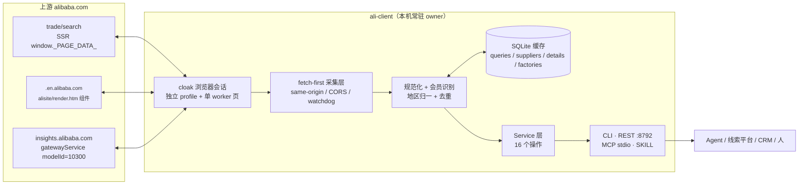

# ali-client

**阿里巴巴国际站（alibaba.com）本地只读客户端 —— 文档设计稿**

一次可选登录 · 常驻浏览器会话 · `fetch-first` 采集 · SQLite 缓存 · `CLI / REST / MCP / SKILL` 四通道

  
  
  
  
  

> [!NOTE]
> **当前阶段：文档设计（未进入开发）**。本仓库当前只包含文档与探路证据；代码结构在评审通过后按文档实现。
> 本项目与阿里巴巴官方无关，仅使用本人/授权账号做**低频、只读**查询（不询盘、不聊天、不收藏、不写后台），请遵守平台服务条款与当地法律。

## 这是什么

把 **阿里国际站 alibaba.com** 的一小块能力封装成本机常驻、**只读、带缓存**的客户端，供 Agent 与业务系统调用：

- **搜工厂**：关键词 + **中国省/市两级**筛选 → 供应商列表（分页、去重、缓存）；
- **看公司**：**上平台年限**、**Supplier Index 星级（SOPI）**、**主要产品**，以及会员套餐、省市地址、认证与基础经营指标；
- **识别会员**：出口通 / 金品诚企（Verified Supplier）/ 领袖卖家（Verified Pro）三层归一化枚举 + 原始证据；
- **四通道**：CLI（`ali`）、本地 REST（`127.0.0.1:8792`）、MCP（`ali_*` 工具）、SKILL。

它不是全量封装：不做产品搜索、询盘/聊天/下单等写操作，不做官方 API，不做 Web 控制台。

## 架构（设计稿）

核心设计要点（均由实测得出，详见 [实测报告](exploration/2026-11-15/REPORT.md)）：

| 要点 | 结论 |
|---|---|
| **anonymous-first** | 匿名即可拿到 v1 全部字段（搜索 35 字段与登录态一致、详情三组件全量）；登录可选，且是会话级 cookie，需常驻浏览器 |
| **fetch-first** | worker 页内 `fetch` 搜索 URL 解析 `_PAGE_DATA_`；跨子域 CORS `POST render.htm` 拿详情；**页面导航仅兜底/过验证** → 实测 150+ 次 fetch 无滑块 |
| **省市两级** | 平台无官方省/市筛选 → `locationMode=strict`（详情回填后精确过滤，≤60 家/查询，7d 缓存）/ `keyword` 快速模式 |
| **会员识别** | `verified_pro` > `verified_supplier` > `gold_supplier` > `unknown`，输出枚举 + 证据；Supplier Index = `supplierStars`（0–5 心） |
| **人机验证** | 仅导航触发；`x5sec` ≈30min；自动类人拖拽 + reload 重试（实测 3/3 最终成功）+ 人工/二维码兜底；fetch watchdog 15–20s |
| **缓存** | SQLite 结构化缓存（query 2h / detail 7d / factory 24h），不落 HTML/cookie/验证码 |

## 文档

| 文档 | 内容 |
|---|---|
| [docs/README.md](docs/README.md) | 文档索引与阅读顺序 |
| [00 需求访谈记录](docs/00-需求访谈记录.md) | Round 1–4 范围确认、两轮探路结论、设计决策 |
| [01 需求文档（PRD）](docs/01-需求文档.md) | 背景/目标/非目标、术语、场景、架构、FR-1..FR-12、非功能、验收标准、里程碑 |
| [02 接口设计（草案）](docs/02-接口草案.md) | CLI/REST/MCP/SKILL 全量操作、数据模型、缓存 DDL、算法、错误码、配置、测试策略 |
| [03 部署与使用](docs/03-部署与使用.md) | 安装、登录、CLI/REST/MCP 使用、systemd、排障、FAQ |
| [04 环境配套](docs/04-环境配套.md) | `~/cloak-env`、Chromium、profile、端口/数据目录、依赖锁定、NixOS 注意事项 |
| [05 会员体系与识别规则](docs/05-会员体系与识别规则.md) | 出口通/金品诚企/领袖卖家体系、字段映射、识别规则、样本验证、来源链接 |
| [06 风控与人机验证](docs/06-风控与人机验证.md) | 滑块/x5sec 实测、自动过验证策略、异常恢复、人工中继、合规 |
| [实测报告](exploration/2026-11-15/REPORT.md) | 两轮真实浏览器探路：请求链路、字段、匿名对照、接口边界、证据清单 |
| [探路证据目录](exploration/2026-11-15/README.md) | 证据索引与复现说明（daemon 脚本、artifacts） |

## 约定

| 项 | 值 |
|---|---|
| CLI | `ali` |
| REST | `127.0.0.1:8792`（loopback + Bearer） |
| MCP | server `ali-client`，工具前缀 `ali_` |
| 数据目录 | `~/.ali-client`（profile / cache / logs / run） |
| 环境变量前缀 | `ALI_` |
| systemd | `ali-client.service` |
| 上游语言/币种 | `en-US` / `USD`（输出英文归一 + 保留原文 `*Text`） |
| 只读约束 | 不询盘、不聊天、不收藏、不写后台；只抓公开页面/接口 |

## 当前状态与下一步

- ✅ 需求访谈（Round 1–4）、两轮真实浏览器探路、会员体系调研、完整文档设计
- ⏳ **文档评审中**：评审通过后进入实现（M1 骨架 → M2 采集层 → M3 领域层 → M4 联调 → M5 收尾）
- 文档中的接口/命令为**设计稿**，实现后需以实测回填（标记 ✅实测 / 📐设计）

## 许可

TBD（实现阶段确定；参考同机 `zhilian-client` 的 MIT 约定，保留探路证据与文档版权）。
