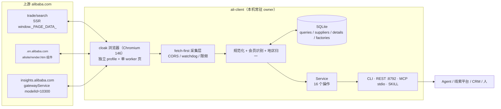
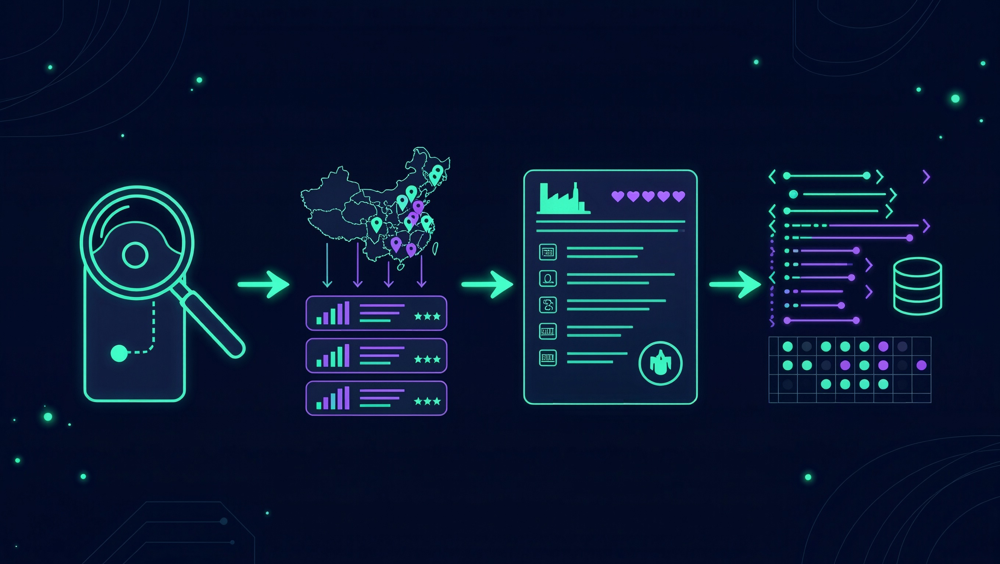
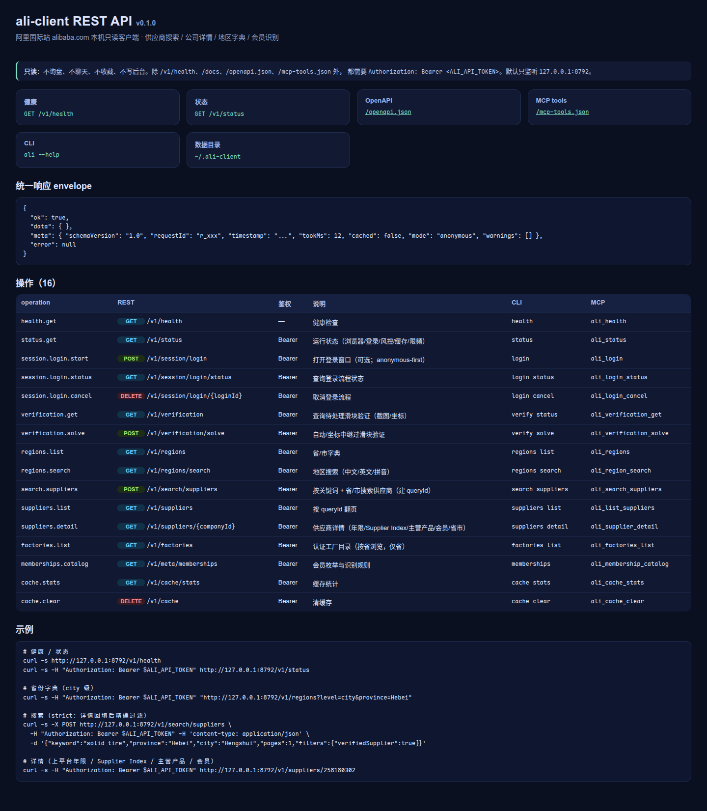

<div align="center">


# ali-client

**把阿里巴巴国际站（alibaba.com）的工厂搜索与公司详情，变成 Agent 可调用的本地只读数据源。**

一次可选登录 · cloak 浏览器常驻会话 · `fetch-first` 采集 · SQLite 缓存 · **CLI / REST / MCP / SKILL** 四通道

<p>
  
  
  
  
  
  
  
</p>

[快速开始](#-快速开始) · [能力矩阵](#-能力矩阵) · [真实输出](#-真实输出实测) · [架构](#-架构) · [四通道接入](#-四通道接入) · [文档](#-文档)

</div>

> [!NOTE]
> 本项目与阿里巴巴官方无关。仅使用本人/授权账号做**低频、只读**查询（不询盘、不聊天、不收藏、不写后台），请遵守平台服务条款与当地法律。
>
> **anonymous-first**：v1 默认**无需登录**即可完成全部查询（匿名搜索/详情/工厂目录均为完整数据）；登录仅作为可选项（且登录态是会话级 cookie，需要常驻浏览器进程）。

## 🎯 这是什么

alibaba.com 是 B2B 供应商数据的重要来源，但它没有开放 API，页面还是 SSR + 多组件异步渲染。`ali-client` 把其中**一小块能力**封装成本机常驻的只读客户端：

- **搜工厂**：关键词 + **中国省/市两级**筛选（平台本身没有省市筛选，客户端用「详情回填 + 精确过滤」补齐）；
- **看公司**：**上平台年限**、**Supplier Index 星级（SOPI，0–5 心）**、**主要产品**，以及会员套餐、省市地址、认证与基础经营指标；
- **识别会员**：出口通 / 金品诚企（Verified Supplier）/ 领袖卖家（Verified Pro）三层归一化枚举 + 原始证据；
- **四通道**：CLI（`ali`）、本地 REST（`127.0.0.1:8792`）、MCP（16 个 `ali_*` 工具）、SKILL。

它不是全量封装：不做产品搜索、询盘/聊天/下单等写操作，不做官方 API，不做 Web 控制台。

## ✨ 核心特性

| | 特性 | 说明 |
|---|---|---|
| 🔓 | **anonymous-first** | 匿名即可拿到 v1 全部字段（实测搜索 35 字段与登录态一致；详情三组件全量公开）；登录可选 |
| ⚡ | **fetch-first 采集** | 常驻 1 个 www worker 页，搜索/详情/工厂目录都走 `page.evaluate(fetch)`；实测 150+ 次 fetch **不触发滑块** |
| 🧭 | **省/市两级 strict 过滤** | 平台无官方省市筛选 → 详情回填后精确过滤（单查询 ≤60 家，7 天缓存），另有关键词快速模式 |
| 🎖️ | **会员识别** | `verified_pro` > `verified_supplier`（金品诚企）> `gold_supplier`（出口通）> `unknown`，输出枚举 + 证据 |
| 🗄️ | **SQLite 结构化缓存** | 搜索 2h / 详情 7d / 工厂目录 24h；不落 HTML / Cookie / 验证码 |
| 🛡️ | **风控治理** | 滑块自动过验证（类人拖拽 + reload 重试，实测最终 3/3 成功）+ 截图/坐标中继兜底 + fetch watchdog |
| 🤖 | **Agent 友好** | OpenAPI 3.1、MCP tools、CLI 自文档、SKILL 工作流；统一 envelope |
| 🧱 | **单 owner 模型** | systemd 常驻进程是唯一持有浏览器/profile 的 owner；CLI/MCP 默认代理 REST，不抢 profile |

## 🧭 架构




关键设计（均由两轮真机探路得出，见 [实测报告](exploration/2026-11-15/REPORT.md)）：

| 要点 | 结论 |
|---|---|
| 搜索数据 | 搜索页是 SSR，数据在 `window._PAGE_DATA_.offerResultData.offerList[]`（20/页 + 广告卡） |
| 详情数据 | `POST https://<sub>.en.alibaba.com/event/app/alisite/render.htm`，`componentKeys=shopSign,companyCard,companyOverview`，一次拿全 |
| 省市 | 平台只有 `country=CN`，**没有省市筛选** → 客户端 strict 回填过滤 / keyword 模糊 |
| 分页 | `totalCount` 不可靠（实测 712–784 波动）→ 以「返回 0 条」终止；`pages` 默认 5、上限 20 |
| 风控 | 滑块仅**页面导航**触发；`x5sec` ≈30 分钟；自动类人拖拽 3 轮 + reload 重试 |


## 🚀 快速开始

### 0）前置

- Linux（本机为 NixOS 26.11）+ Node ≥ 22.5；
- 共享环境 `~/cloak-env`（cloakbrowser 0.6.5 + Chromium 146，keyless）；
- 有桌面显示（`DISPLAY=:0`）：headful 浏览器风控更低；无显示可用验证码中继（见文档 06）。

```bash
# 1) 获取代码
git clone https://github.com/CindyRIng/ali-client.git
cd ali-client

# 2) 安装依赖并构建
npm install
cp .env.example .env
# 必填：随机 token（下面用 node 生成，避免依赖 openssl）
sed -i "s/^ALI_API_TOKEN=.*/ALI_API_TOKEN=$(node -e "console.log(require('crypto').randomBytes(24).toString('hex'))")/" .env
npm run build
npm test          # 31 个单测，不启浏览器

# 3) 启动常驻 owner（会打开 cloak 浏览器；首次约 10–20s）
bin/ali-run serve
# → ali-client REST listening on http://127.0.0.1:8792
# → docs: http://127.0.0.1:8792/docs

# 4) 注册 `ali` 命令（软链到 ~/.local/bin，确保在 PATH 中）
ln -sfn "$PWD/bin/ali-run" ~/.local/bin/ali
which ali && ali --version

# 5) 查询
ali health
ali status
bin/ali-run regions list --level city --province Hebei
bin/ali-run search suppliers --keyword "solid tire" --province Hebei --pages 1
bin/ali-run suppliers detail --company-id 258180302
```

安装为 systemd user 服务（推荐常驻）：

```bash
mkdir -p ~/.config/systemd/user
cp systemd/ali-client.service ~/.config/systemd/user/
systemctl --user daemon-reload
systemctl --user enable --now ali-client
journalctl --user -u ali-client -f
```

> CLI 默认探测本机 REST（`http://127.0.0.1:8792`）并代理；加 `--local` 可跳过常驻服务直接本地执行（调试用，会自己开浏览器）。

## 🧩 能力矩阵

| 能力 | CLI | REST | MCP |
|---|---|---|---|
| 健康检查 | `ali health` | `GET /v1/health` | `ali_health` |
| 运行状态（模式/浏览器/worker/风控/缓存） | `ali status` | `GET /v1/status` | `ali_status` |
| 可选登录 | `ali login` | `POST /v1/session/login` | `ali_login` |
| 滑块验证中继 | `ali verify status/solve` | `GET/POST /v1/verification*` | `ali_verification_get/solve` |
| 省/市字典 | `ali regions list` | `GET /v1/regions` | `ali_regions` |
| 地区搜索（中/英/拼音） | `ali regions search 衡水` | `GET /v1/regions/search` | `ali_region_search` |
| **供应商搜索**（建 queryId） | `ali search suppliers ...` | `POST /v1/search/suppliers` | `ali_search_suppliers` |
| 按 queryId 翻页 | `ali suppliers list` | `GET /v1/suppliers` | `ali_list_suppliers` |
| **供应商详情** | `ali suppliers detail` | `GET /v1/suppliers/{companyId}` | `ali_supplier_detail` |
| 认证工厂目录（按省） | `ali factories list` | `GET /v1/factories` | `ali_factories_list` |
| 会员枚举与规则 | `ali memberships` | `GET /v1/meta/memberships` | `ali_membership_catalog` |
| 缓存统计/清理 | `ali cache stats/clear` | `GET/DELETE /v1/cache` | `ali_cache_stats/clear` |
| 启动常驻服务 | `ali serve` | — | — |
| MCP server | `ali mcp` | — | —— |

所有响应统一 envelope：

```json
{ "ok": true, "data": {}, "meta": { "schemaVersion": "1.0", "requestId": "r_...", "tookMs": 12, "cached": false, "mode": "anonymous", "warnings": [] }, "error": null }
```

## 📊 真实输出（实测）



**按省 strict 搜索**（`solid tire` + 河北，20 家回填 → 1 家命中，21.6s）：

```text
$ ali search suppliers --keyword "solid tire" --province Hebei --pages 1 --max-enrich 20
queryId: q_8a1a71a6c8d25c7e  keyword: solid tire  mode: strict  cached: false
requested: {"province":"Hebei","city":null}  matched: 1  enriched: 20  limitReached: false
#     company                                   location       years  index  plan           rating  ad
----  ----------------------------------------  -------------  -----  -----  -------------  ------  ----
19    Xingtai Zhipeng Rubber And Plastic Techn  Hebei/Xingtai  2y     0/5    gold_supplier  —
```

**按城市（不带关键词）**：`--province Hebei --city Hengshui` → 平台按地点词搜索 + 详情回填，10 家精确命中衡水：

```text
effective: Hengshui | matched: 10 | enriched: 12 | returned: 10
- 244767685 Anping Sanxing Wire Mesh Factory            Hengshui  verified_supplier
- 240971484 Anping Yeson Wire Mesh Products Co., Ltd.   Hengshui  verified_supplier
- 286341183 Hengshui Weichi Stamping Parts Co., Ltd.    Hengshui  gold_supplier
...
```

**公司详情**（匿名即可拿到全部字段，`GET /v1/suppliers/258180302`）：

```json
{
  "companyName": "Hengshui Kangyuan Rubber And Plastic Technology Co., Ltd.",
  "joinedYears": 6,
  "supplierIndex": { "stars": 2, "maxStars": 5, "label": "Supplier Index" },
  "mainProducts": ["Solid Tires", "Forklift Tires", "PU Wheels", "Rubber Wheels", "Nylon Wheels"],
  "location": { "province": "Hebei", "city": "Hengshui", "address": "...Hengshui, Hebei, China", "confidence": "high" },
  "membership": { "plan": "verified_supplier", "label": "Verified Supplier", "verifiedSupplier": true, "onsiteAssessment": true, "assessedBy": "SGS Group" },
  "performance": { "storeRating": { "score": 4.6, "count": 10 }, "totalExportRevenueUSD": 2231223, "floorSpaceM2": 5000, "productionLines": 10 },
  "profile": { "establishedYear": 2018, "employees": "11 - 50 People", "mainMarkets": ["North America", "Mid East", "..."] }
}
```

**MCP**（stdio，16 个工具）：

```text
$ node scripts/mcp-smoke.mjs
tools: 16
names: ali_cache_clear,ali_cache_stats,ali_factories_list,ali_health,ali_list_suppliers,ali_login,ali_login_cancel,ali_login_status,ali_membership_catalog,ali_region_search,ali_regions,ali_search_suppliers,ali_status,ali_supplier_detail,ali_verification_get,ali_verification_solve
regions: true count= 11 first= Shijiazhuang
health: true ali-client 0.1.0
search: true queryId= q_8a1a71a6c8d25c7e returned= 1 mode= strict
detail: true Hengshui Kangyuan Rubber And P years= 6 stars= 2 plan= verified_supplier
```

**REST 文档**（`http://127.0.0.1:8792/docs`，自包含 HTML）：



## 🎖️ 数据与会员识别

**公司详情核心字段**

| 字段 | 来源 | 示例 |
|---|---|---|
| `joinedYears` / `joinedYearsText` | `shopSign.companyJoinYears` | `6` / `6 yrs` |
| `supplierIndex.stars` | `shopSign.supplierStars` | `2`（0–5 心，SOPI） |
| `mainProducts` | `companyOverview.supplierMainProducts` / `companyCard.companyMainMarket` | Solid Tires, Forklift Tires… |
| `location` | `companyRegisterProvince` + `supplierOperationalAddress` 解析 | Hebei / Hengshui |
| `membership.plan` | list + detail 合并判定 | `verified_supplier` |
| `performance.*` | `companyCard.authCards`（basicCapacity） | 评分 4.6、发货率 100%、年出口额 $2231223、厂房 5000m²、产线 10 |
| `profile.*` | `companyOverview` | 成立 2018、员工 11–50、主要市场… |

**会员三层识别**（详情见 [docs/05](docs/05-会员体系与识别规则.md)）：

```text
verified_pro        领袖卖家 / Verified Pro Supplier   ← list: verifiedSupplierPro=true
verified_supplier   金品诚企 / Verified Supplier       ← list: isAssessedSupplier=true / detail: companyHasPassAssessment=true
gold_supplier       出口通 / Gold Supplier             ← detail: accountIsPaidMember=true（未 assessed）
unknown             无法判定
```

> 注意：`Supplier Index`（`supplierStars`，0–5 心）≠ 店铺评分 `reviewScore`；`isGold` 不作主判据、`companyHasPassOnsite` 不等于金品、广告/`Trade Assurance` 不是会员档位。

## 🗄️ 缓存 / 限频 / 风控

| 项 | 默认 | 说明 |
|---|---|---|
| 搜索缓存 | 2h | `queryId` + 页数据 + 供应商档案 |
| 详情缓存 | 7d | strict 回填与 `suppliers.detail` 共用 |
| 工厂目录缓存 | 24h | insights gateway |
| 搜索 fetch 间隔 | 0.9s + 抖动 | 实测 9 次/31s 无滑块 |
| 详情并发/间隔 | 2 / 0.7s | 实测 30 家/41s 全成功 |
| 页面导航 | ≥10s，仅初始化/恢复/过验证 | 滑块唯一触发源 |
| fetch watchdog | 18s | 风控态 fetch 可能永不返回（AbortSignal 无效） |
| 滑块 | 自动 3 轮 + reload 重试 | 失败 → 截图/坐标中继或二维码人工扫码 |
| x5sec | ≈30 分钟 | `status.risk.x5secExpiresAt` 暴露 |

## 🔌 四通道接入

### CLI

```bash
ali search suppliers --keyword "led light" --province Guangdong --city Shenzhen \
  --pages 2 --verified-supplier --min-review 4.5 -f json
ali suppliers list --query-id q_xxx --page 2
ali suppliers detail --store kangyuanxiangsu -f json
ali regions search 衡水
ali factories list --province Hebei --category 44
```

### REST

```bash
export ALI_API_TOKEN="$(grep '^ALI_API_TOKEN=' .env | cut -d= -f2)"
curl -s -H "Authorization: Bearer $ALI_API_TOKEN" http://127.0.0.1:8792/v1/status
curl -s -X POST http://127.0.0.1:8792/v1/search/suppliers \
  -H "Authorization: Bearer $ALI_API_TOKEN" -H 'content-type: application/json' \
  -d '{"keyword":"solid tire","province":"Hebei","city":"Hengshui","pages":1}'
curl -s -H "Authorization: Bearer $ALI_API_TOKEN" http://127.0.0.1:8792/v1/suppliers/258180302
```

- `/docs`：自包含 HTML 文档；`/openapi.json`：OpenAPI 3.1；`/mcp-tools.json`：MCP 工具清单。

### MCP（Claude Desktop / Cursor / 其他 MCP 客户端）

```json
{
  "mcpServers": {
    "ali-client": {
      "command": "/home/songqian/ali-client/bin/ali-run",
      "args": ["mcp"],
      "env": { "ALI_API_TOKEN": "<your-token>" }
    }
  }
}
```

MCP server 默认代理常驻 REST（`ALI_API_URL` 或自动探测 `127.0.0.1:8792`），不自己抢浏览器/profile。

### SKILL

见 [skills/ali/SKILL.md](skills/ali/SKILL.md)：按地区找工厂 / 按产品词找工厂 / 供应商核验 / 失败处理（`CAPTCHA_REQUIRED`、`RATE_LIMITED`、`PAGE_NOT_AVAILABLE`）。

## 📁 项目结构

```text
ali-client/
├── src/
│   ├── main.ts / app.ts / backend.ts / service.ts
│   ├── adapters/alibaba/      # 搜索页/render 组件/工厂目录解析、地区归一、会员识别
│   ├── session/manager.ts     # owner 浏览器 + worker 页 + fetch/watchdog + 滑块治理
│   ├── cache/                 # SQLite / 内存缓存
│   ├── api/                   # operations 单一事实源 + dispatch
│   ├── transports/            # CLI / REST / MCP
│   ├── generators/            # OpenAPI / MCP tools / CLI spec 生成
│   ├── data/regions.ts        # 31 省 + 342 地级行政单位（自动生成）
│   └── domain/                # zod 数据模型
├── spec/                      # 生成物：openapi.json / mcp-tools.json / cli-commands.json / operations/
├── docs/                      # 完整文档（00–06）+ assets
├── exploration/2026-11-15/    # 两轮探路实测报告 + 证据 + 探针脚本
├── scripts/                   # gen-regions / mcp-smoke / shot-docs
├── systemd/ali-client.service
├── skills/ali/SKILL.md
├── bin/ali-run                # 在 ~/cloak-env FHS 中运行
└── tests/                     # 31 个单测（不启浏览器）
```

## 🛠️ 开发

```bash
npm run build        # tsc
npm test             # vitest（31 tests）
npm run typecheck    # 含 tests
npm run gen          # 生成 spec/openapi.json 等
npm run gen:check    # CI 校验生成物与实现同源（实现后启用）
npm run gen:regions  # 重新生成 src/data/regions.ts（pca-code + pinyin-pro）
node scripts/mcp-smoke.mjs   # MCP 冒烟（需常驻服务）
npm run self-test            # 35 项端到端自测（需常驻服务）
```

自测实际输出（2026-11-16）：

```text
=== 结果：35 passed, 0 warn, 0 failed（共 33）===
```

**验收基线**：`npm run build && npm test` 全绿；`ali health/status` 正常；真实上游搜索/详情/工厂目录/地区字典可用；CLI/REST/MCP 同源。

## 📚 文档

| 文档 | 内容 |
|---|---|
| [docs/00 需求访谈记录](docs/00-需求访谈记录.md) | Round 1–4 范围确认、两轮探路结论、设计决策 |
| [docs/01 需求文档 PRD](docs/01-需求文档.md) | 背景/目标/非目标、FR-1..FR-12、30 条验收标准 |
| [docs/02 接口设计](docs/02-接口草案.md) | 完整操作/数据模型/CLI/REST/MCP/采集器/状态机/DDL/算法 |
| [docs/03 部署与使用](docs/03-部署与使用.md) | 安装、登录、CLI/REST/MCP 使用、systemd、FAQ |
| [docs/04 环境配套](docs/04-环境配套.md) | cloak-env、Chromium、profile、端口/数据目录、NixOS |
| [docs/05 会员体系与识别规则](docs/05-会员体系与识别规则.md) | 出口通/金品诚企/领袖卖家、字段映射、识别规则 |
| [docs/06 风控与人机验证](docs/06-风控与人机验证.md) | 滑块/x5sec、自动过验证、异常恢复、人工中继 |
| [实测报告](exploration/2026-11-15/REPORT.md) | 两轮真机探路：请求链路、匿名对照、fetch-first、证据 |

## ❓ 已知限制

- **省市精确过滤依赖详情回填**：单查询最多 `maxEnrich`（默认 60）家，超出会 `enrichLimitReached`；结果可能少于该页原条数。
- **`totalCount` 不可靠**：同一查询实测 712–784 波动，不要用于精确翻页；以「返回 0 条」终止。
- **纯关键词搜索默认 `locationMode=off`**（不回填详情，速度快）；只有给出 `province`/`city` 才走 strict 回填。strict 回填 60 家约 60–90s，CLI→REST 超时默认 180s（`ALI_CLIENT_TIMEOUT_MS`）。
- **公司详情按 companyId 查询需要先有一次 search 建立映射**（或用 `--store <subdomain>` 直达）。
- `ali` 通过 `~/.local/bin/ali` 软链提供；移动仓库后需重建软链。
- 常驻进程启动时加载 `dist/`；改代码后需 `npm run build && systemctl --user restart ali-client`。
- **滑块/风控会变化**：自动过验证非 100%（实测最终 3/3），失败需人工/坐标中继或二维码扫码；`x5sec` 过期后需重新通过。无滑块时 `ali verify solve` 会返回 `CAPTCHA_FAILED`（预期行为）。
- **登录窗口是独立页面**：不影响查询 worker 页；登录可选，且登录态为会话级（浏览器进程关闭即掉）。
- **登录态会话级**：浏览器进程关闭即掉登录；anonymous-first 下 v1 查询不受影响。
- 工厂目录仅省、≈500 上限、无城市（上游限制）。

## ⚖️ 合规声明

- 只读：不询盘、不聊天、不收藏、不发商品、不写卖家后台；
- 低频：默认限频与抖动，页面导航 ≥10s、详情并发 2；请勿修改为高频滥用；
- 不保存：HTML、Cookie、Token、验证码图片不落缓存/仓库；
- 数据版权归原平台与供应商所有，本项目仅做本地结构化与检索；使用前请确认符合平台条款与当地法律。

## 📄 License

[MIT](LICENSE) © 2026 CindyRIng
