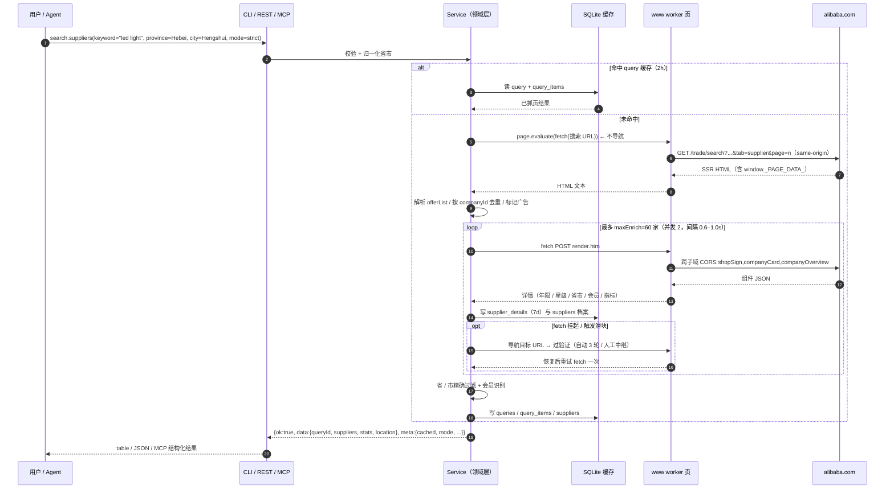
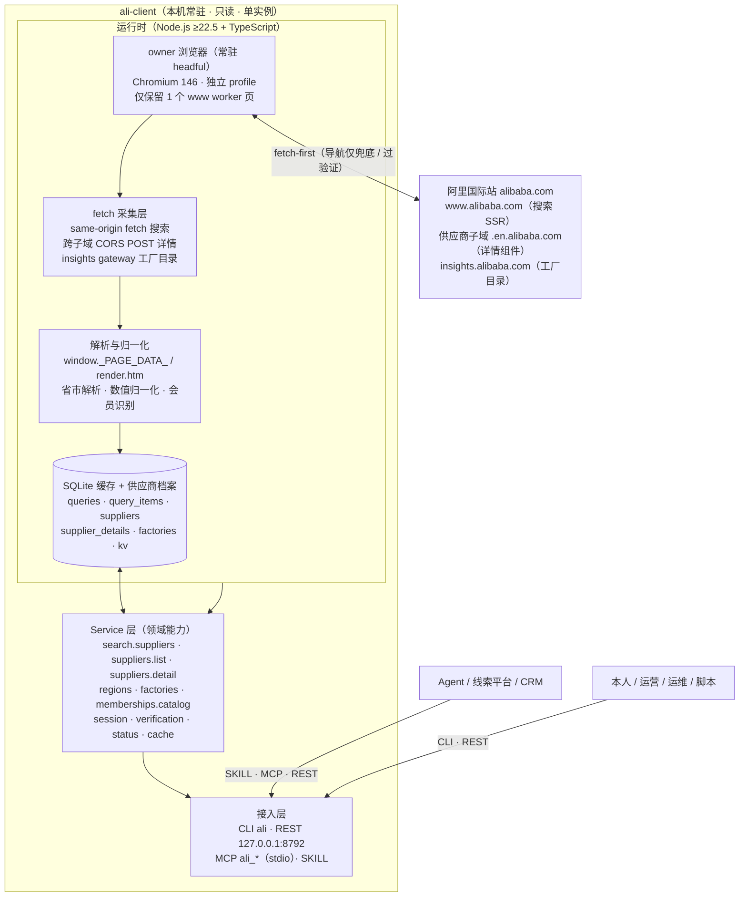
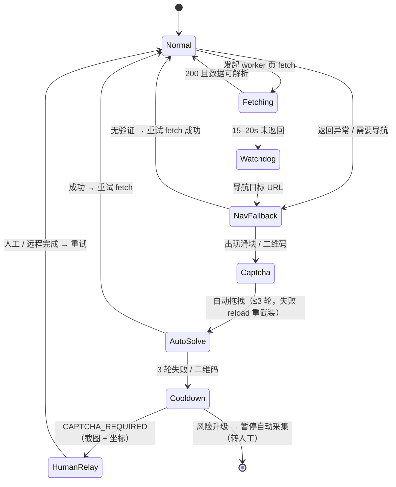

<p align="right"><a href="./README.md">← 文档索引</a></p>

# ali-client 需求文档（PRD）

| 项 | 内容 |
| --- | --- |
| 版本 | **v1.0**（设计稿） |
| 日期 | 2026-11-15 |
| 状态 | **设计稿（未实现，待评审）** |
| 项目 | ali-client（阿里国际站 alibaba.com 本机只读客户端） |
| 关联文档 | [00 需求访谈记录](./00-需求访谈记录.md) · [02 接口草案](./02-接口草案.md) · [03 部署与使用](./03-部署与使用.md) · [04 环境配套](./04-环境配套.md) · [05 会员体系与识别规则](./05-会员体系与识别规则.md) · [06 风控与人机验证](./06-风控与人机验证.md) · [实测报告](../exploration/2026-11-15/REPORT.md) · [会员套餐规则](../exploration/2026-11-15/membership-plans.md) |
| 一句话定位 | 在本机常驻一个「cloak 浏览器 + 阿里国际站」的**只读、匿名优先、fetch 优先、带缓存**客户端：把**供应商搜索（关键词 + 中国省/市两级过滤）、供应商详情、地区字典、会员识别**封装成 CLI / REST / MCP / SKILL 四形态，供 Agent / 线索平台 / CRM 消费。 |

> **本文是需求基线（What / Why / 验收）**。接口字段、错误码与上游 URL 以 [02 接口草案](./02-接口草案.md) 为准；风控细节以 [06 风控与人机验证](./06-风控与人机验证.md) 为准；会员体系以 [05 会员体系与识别规则](./05-会员体系与识别规则.md) 为准。

**标注约定**（全文通用）：

| 标注 | 含义 |
| --- | --- |
| ✅实测 | 已在 2026-11-15 两轮真实浏览器探路中验证，证据见 [附录 B](#附录-b实测证据索引) |
| 📐设计 | 需求 / 方案设计，尚未实现或待联调验证 |
| 未标注 | 默认按 📐设计 处理 |

---

## 🗺️ 本页导航

- [1. 背景与目标](#1-背景与目标)
- [2. 术语](#2-术语)
- [3. 用户与场景](#3-用户与场景)
- [4. 总体架构](#4-总体架构)
- [5. 功能需求（FR-1 ~ FR-12）](#5-功能需求)
- [6. 非功能需求](#6-非功能需求)
- [7. 接口摘要](#7-接口摘要)
- [8. 数据模型摘要](#8-数据模型摘要)
- [9. 缓存设计摘要](#9-缓存设计摘要)
- [10. 风控与人机验证（专章摘要）](#10-风控与人机验证专章摘要)
- [11. 里程碑](#11-里程碑)
- [12. 验收标准](#12-验收标准)
- [13. 风险与开放问题](#13-风险与开放问题)
- [附录 A：决策记录](#附录-a决策记录)
- [附录 B：实测证据索引](#附录-b实测证据索引)

<details><summary>展开二级小节与功能需求</summary>

  - [1.1 背景](#11-背景)
  - [1.2 目标（v1）](#12-目标v1)
  - [1.3 非目标（v1 明确不做）](#13-非目标v1-明确不做)
  - [1.4 版本边界](#14-版本边界)
  - [3.1 角色](#31-角色)
  - [3.2 用户故事](#32-用户故事)
  - [3.3 成功标准](#33-成功标准)
  - [3.4 典型场景时序](#34-典型场景时序)
  - [4.1 架构图](#41-架构图)
  - [4.2 组件职责](#42-组件职责)
  - [4.3 采集策略：fetch-first](#43-采集策略fetch-first)
  - [4.4 主数据流](#44-主数据流)
  - [4.5 单实例与只读约束](#45-单实例与只读约束)
  - [FR-1 会话与可选登录](#fr-1-会话与可选登录)
  - [FR-2 人机验证与 x5sec 治理](#fr-2-人机验证与-x5sec-治理)
  - [FR-3 status 与 health](#fr-3-status-与-health)
  - [FR-4 地区字典](#fr-4-地区字典)
  - [FR-5 供应商搜索](#fr-5-供应商搜索)
  - [FR-6 供应商列表翻页](#fr-6-供应商列表翻页)
  - [FR-7 供应商详情](#fr-7-供应商详情)
  - [FR-8 认证工厂目录](#fr-8-认证工厂目录)
  - [FR-9 会员识别与 catalog](#fr-9-会员识别与-catalog)
  - [FR-10 缓存与供应商档案](#fr-10-缓存与供应商档案)
  - [FR-11 限频、风控与冷却](#fr-11-限频风控与冷却)
  - [FR-12 四通道接入与可观测](#fr-12-四通道接入与可观测)
  - [6.1 性能目标](#61-性能目标)
  - [6.2 可靠性与恢复](#62-可靠性与恢复)
  - [6.3 安全](#63-安全)
  - [6.4 可维护性](#64-可维护性)
  - [6.5 合规](#65-合规)
  - [6.6 资源与兼容](#66-资源与兼容)
  - [13.1 风险](#131-风险)
  - [13.2 开放问题](#132-开放问题)

</details>

---

## 1. 背景与目标

### 1.1 背景

- **上游没有可用的开放 API**：阿里国际站（`alibaba.com`）面向买家/供应商的公开能力以页面与页面内接口为主，没有可直接申请使用的供应商搜索开放 API（📐 本项目定位，不含官方合作）；日常只能人工搜索、翻页、逐个打开公司页。
- **业务用途是 B2B 获客线索**：按中国省/市找到制造商、工贸企业 → 拿到供应商列表 → 查看公司详情（**上平台年限 / Supplier Index 星级 / 主营产品** + 会员套餐 + 基础经营指标 + 省市地址）→ 交给下游 Agent / 线索平台 / CRM 消费（下游形态暂不明确，v1 只做**通用稳定接口**）。
- **本机已有承接环境**：`~/cloak-env`（cloakbrowser 0.6.5 + Chromium 146，keyless）与同构项目 `zhilian-client`（REST 8791）、`boss-client`（REST 8790）、`tanji-client`（REST 8787–8789）。ali-client 复用同一工程骨架，占用 **REST 8792**、独立 profile / 数据目录 `~/.ali-client`（✅ 端口占用已核实，见 [00 §4](./00-需求访谈记录.md)）。
- **2026-11-15 完成两轮真实浏览器探路**：搜索链路（SSR `window._PAGE_DATA_`）、详情组件接口（`render.htm`）、认证工厂目录（`insights` gateway）、省市筛选缺口、会员/认证识别规则、风控与滑块、**匿名 vs 登录完整性对照**、**fetch-first 采集可行性**、**验证治理（自动拖拽 / x5sec / watchdog）**。证据见 [实测报告](../exploration/2026-11-15/REPORT.md)（✅实测）。
- **与同构项目的关键差异**（决定本项目设计）：

| 维度 | `zhilian-client` | `ali-client` |
| --- | --- | --- |
| 采集来源 | SSR `__INITIAL_STATE__` + `fe-api` | SSR `window._PAGE_DATA_` + `alisite render.htm` 组件接口 + `insights` gateway |
| 地区 | 官方城市码 `jl` 筛选 | **无官方省/市筛选**（仅 `country`）→ 客户端详情回填过滤 |
| 登录持久性 | token 可持久化（约 7 / 30 天） | **会话级 cookie，浏览器进程关闭即掉** → owner 浏览器必须常驻 |
| 会员体系 | 无 | **出口通 / 金品诚企 / 领袖卖家** 三层识别（本项目重点） |
| 风控 | 腾讯 EdgeOne | 阿里 `nc_1` 滑块 + 子域风控；`x5sec` 约 30 分钟 |
| 登录定位 | 必需（才能翻页 / 看详情） | **可选**（anonymous-first：v1 所需字段匿名全可得） |

### 1.2 目标（v1）

1. **稳定、低频、只读地采集**：以 **anonymous-first + fetch-first** 为主路径，owner 浏览器单实例常驻、只保留 1 个 www worker 页，页面导航仅用于兜底 / 过验证（✅实测）。
2. **关键词 + 中国省/市两级搜索**：平台无官方省市筛选（✅实测），客户端用「详情回填 + 精确过滤（strict）」实现省/市级检索，并提供 `keyword` 快速模式与 `off` 关闭模式。
3. **供应商详情**：上平台年限、Supplier Index 星级、主要产品为**必备三字段**；并输出省市地址、会员套餐、基础经营指标、`companyOverview`（成立年份 / 年营收 / 员工数 / 主要市场 / 付款交货条款 / 合同制造等）。
4. **会员识别**：三层归一化枚举 `verified_pro` > `verified_supplier` > `gold_supplier` > `unknown`，附原始证据与 `memberships.catalog` 自描述规则。
5. **地区字典**：中国内地 31 个省级行政区 + 地级行政区（333 个）静态字典，支持中/英/拼音/别名/阿里拼写噪声归一化。
6. **本地结构化缓存 + 供应商档案**：SQLite（query 2h / detail 7d / factory 24h / regions 静态），按 `companyId` 去重、可回溯；**不落 HTML / cookie / 验证码**。
7. **四通道同源**：CLI `ali` · REST `127.0.0.1:8792` · MCP 前缀 `ali_` · SKILL，统一 envelope `{ok,data,meta,error}`；由 `src/api/operations.ts` 单一事实源生成 OpenAPI 3.1 / MCP tools / CLI spec。
8. **可运维、可验收**：systemd `ali-client.service` 常驻；`status` 一眼看到登录态 / 浏览器 / worker / 风控冷却 / x5sec / 缓存；JSONL 结构化日志；文档（00–06）+ 实测报告闭环。

### 1.3 非目标（v1 明确不做）

| 不做 | 说明 |
| --- | --- |
| 写操作 | 不询盘、不聊天、不收藏、不关注、不下单、不发商品、不改资料、不写卖家后台 |
| 全站封装 | 只做「供应商搜索 / 供应商详情 / 地区字典 / 会员识别 + 认证工厂目录」，不做产品搜索、询盘、物流、订单等 |
| 官方 API / 开放平台 | 纯浏览器 fetch / 页面采集，不依赖、不冒充、不申请官方合作伙伴能力 |
| Web 控制台 | 不做 UI；只保留 CLI + REST + MCP + SKILL |
| raw 归档 / 证据链 | 只存结构化字段；不持久化 HTML、raw JSON、cookie、token、验证码图片 |
| CRM 写入 | 不直接写 CRM / 线索平台；由调用方消费统一 JSON |
| 自动破解验证码 | 不做通用破解；只做「类人拖拽自动过滑块（可配置关闭）」+「截图/坐标/二维码人工中继」 |
| 多账号 | v1 单账号（匿名或 1 个可选买家账号）；多账号架构预留、v1 不实现 |
| 代理 IP / 指纹伪造 | v1 不内置；不伪造设备指纹，复用同一 profile |
| 文件导出 | 不落 CSV / Excel / PDF，只返回 JSON |
| 首次登录全自动 | 不承诺；本机人工 headful 登录一次（登录本身可选） |
| 产品 tab 搜索 | `tab=supplier` 之外的产品搜索不在 v1 |
| 港澳台 / 海外地区筛选 | 地区字典 v1 仅中国内地 31 省 + 地级市（后续扩展） |

### 1.4 版本边界

| 能力 | v1（本文验收） | v1.1 预留 / 后续 | 说明 |
| --- | --- | --- | --- |
| 供应商搜索（关键词 + 省/市 strict / keyword） | ✅ P0 | — | 本 PRD 核心 |
| 供应商详情（年限 / Supplier Index / 主营产品 / 省市 / 会员 / 指标） | ✅ P0 | 详情 SSR DOM 中的 `supplierPerformance` 等模块 | v1 只依赖 `shopSign + companyCard + companyOverview` 三组件 |
| 认证工厂目录 `factories.list` | ✅ P1（仅省、上限约 500） | 类目字典输出、城市维度（上游暂无） | 接口预留 & v1 实现 |
| 多省市批量遍历 `search.batch` | ❌ 接口留位（`NOT_IMPLEMENTED`） | ✅ v1.1 | 与 00 §5 评审结论一致 |
| 远程部署登录 / 验证中继（二维码 / 短信 / 远程坐标） | 本机人工 headful；REST 坐标中继可用 | 远程无桌面部署、二维码中继 | 未确认，v1 不承诺 |
| 排序 `sortType` | 仅上游 URL 构造预留 | 暴露为过滤参数 | 实测存在，v1 不开放 |
| 其他地区（港澳台 / 海外） | ❌ | ✅ 后续 | 地区字典可扩展 |

---

## 2. 术语

| 术语 | 含义 |
| --- | --- |
| **ali-client** | 本项目：本机常驻、只读、带缓存的阿里国际站客户端；Node.js（≥22.5）+ TypeScript 实现，与 `zhilian-client` / `boss-client` / `tanji-client` 同构（📐） |
| **owner 浏览器** | ali-client 独占的常驻 headful Chromium 进程（独立 profile `~/.ali-client/profile`）；负责承载登录态（可选）与全部 worker fetch |
| **worker 页** | owner 浏览器中唯一保留的 `https://www.alibaba.com/` 页面；搜索 / 详情 / 工厂目录的 `fetch()` 全部在该页内发起 ✅ |
| **cloak-env** | 本机共享浏览器运行环境 `~/cloak-env`（cloakbrowser 0.6.5 + Chromium 146，keyless） |
| **SSR** | 服务端渲染：搜索页 HTML 内嵌完整数据，无独立列表 XHR ✅ |
| **`window._PAGE_DATA_`** | 搜索页内嵌的 SSR JSON 全局对象；核心为 `offerResultData.offerList[]`（20 条/页 + 广告）与 `snData`（筛选字典）✅ |
| **`render.htm`** | 公司详情组件接口 `POST https://<subdomain>.en.alibaba.com/event/app/alisite/render.htm`；`componentKeys` 控制返回组件 ✅ |
| **componentKeys** | 详情组件键：有效值 `shopSign` / `companyCard` / `companyOverview` / `companyMultimediaSummary` / `globalData` / `productGroups` / `footer`；v1 使用前三个一次请求 ✅ |
| **companyId** | 上游公司数字 ID（如 `258180302`），供应商去重主键 ✅ |
| **subdomain / storeUrl** | 供应商店铺子域（如 `kangyuanxiangsu.en.alibaba.com`）；详情接口按子域寻址，搜索卡 `action` 可推导 ✅ |
| **queryId** | 一次搜索的服务端查询 ID（`q_` + 16 位 hash），用于翻页与缓存命中 ✅ 设计（📐 命名规则见 02 §0.4） |
| **enrich / 详情回填** | strict 模式下对候选供应商逐条调用详情接口补全省市 / 年限 / 星级 / 会员，再本地过滤；单查询上限 `maxEnrich=60` ✅ |
| **strict 模式** | `locationMode=strict`（有省市时默认）：关键词搜索 → 详情回填 → 省 / 市**精确**过滤 ✅ |
| **keyword 模式** | `locationMode=keyword`：省 / 市名直接拼进关键词做相关性搜索，不调详情；结果标记「非严格地区筛选」✅ |
| **off 模式** | 关闭省市过滤，只按关键词 + `country` 返回 ✅ |
| **locationConfidence** | 省市置信度：`high` / `medium` / `low` / `unknown`；城市未知时保留但标 `low`（默认 `includeUnknownCity=true`）✅ |
| **goldYears / companyJoinYears** | 搜索卡 `goldYears`（文案如 `"6 yrs"`）与详情 `companyJoinYears`（如 `"6"`）：**上平台年限**；客户端归一化为 `joinedYears:int` 并保留 `joinedYearsText` ✅ |
| **Supplier Index / SOPI** | 平台综合绩效指数，0–5 星；详情字段 **`shopSign.supplierStars`**（页面 ♥♥ 展示）✅ |
| **store rating** | 店铺买家评价均分（如 4.6/5，`supplierRatingReviews.averageStar`）——**不是** Supplier Index ✅ |
| **出口通 / Gold Supplier** | 基础付费会员档位；`goldYears > 0` 表示至少出口通（弱证据）✅ |
| **金品诚企 / Verified Supplier** | 高级付费会员（含第三方实地评估）；`isAssessedSupplier=true` / `companyHasPassAssessment=true` ✅ |
| **领袖卖家 / Verified Pro** | 顶层会员 / 定向邀约身份标；搜索卡 `verifiedSupplierPro=true`（详情无此字段）✅ |
| **Assessed / 深度认证** | 金品的第三方实地评估层（SGS / TÜV 等），不是独立档位 ✅ |
| **Verified Custom Manufacturer** | 供应商身份类型（`identityKey=strengthFactory`，中文「实力工厂」），不是会员档位 ✅ |
| **Trade Assurance（TA）** | 信用保障交易服务（`ta=y`），不是会员档位 ✅ |
| **Top Sponsor Listing / P4P** | 顶展 / 直通车广告（`newAd` / `adInfo`），不是会员档位 ✅ |
| **x5sec** | 过滑块后平台写入的短时效 cookie；实测有效期 **≈29.8 分钟（约 30 分钟）** ✅ |
| **`nc_1` 滑块** | 阿里滑块验证：轨道 `#nc_1_wrapper` / `#nc_1_n1t`（300×34），手柄 `#nc_1_n1z`（42×34）；失败出二维码兜底 ✅ |
| **watchdog** | Node 侧 fetch 超时看门狗（15–20s）；风控态下页面内 `fetch` 可能永不返回且 `AbortSignal` 无效 ✅ |
| **fetch-first** | 采集优先在 worker 页内 `fetch`（搜索 same-origin；详情跨子域 CORS），**不导航页面** ✅ |
| **anonymous-first** | v1 默认匿名即可完整工作；登录可选，仅影响买家侧功能 ✅ |
| **Membership plan** | 会员归一化枚举：`verified_pro` > `verified_supplier` > `gold_supplier` > `unknown` ✅ |
| **envelope** | 全形态统一响应 `{ok,data,meta,error}`（见 02 §0.2）📐 |
| **MCP / SKILL** | MCP stdio server（工具前缀 `ali_`）与 Agent 技能包 `skills/ali/SKILL.md` 📐 |

---

## 3. 用户与场景

### 3.1 角色

| 角色 | 描述 | 使用方式 |
| --- | --- | --- |
| **本人 / 运营（主用户）** | 需要按行业 + 中国省市盘点供应商、看公司实力与会员档位的业务使用者 | CLI（`ali`）+ 偶尔 REST |
| **销售 / 线索团队** | 按目标区域拿供应商名单（公司名 / 省市 / 年限 / 星级 / 主营产品 / 会员）做外呼或邮件开发 | REST（脚本拉取）或 Agent 代操作 |
| **Agent（自动化消费方）** | Claude Code / Codex / DSH 等 Agent 执行「搜关键词 → 按省市过滤 → 拉详情 → 汇总名单」 | SKILL / MCP（默认代理 REST） |
| **下游线索平台 / CRM** | 周期性消费统一 JSON 线索，不直接操作浏览器 | REST（`127.0.0.1:8792` + Bearer） |
| **运维 / 本人排障** | 看健康状态、过验证、清缓存、排障 | CLI（`ali status` / `ali verify` / `ali cache`） |

### 3.2 用户故事

| ID | 故事 | 验收要点 |
| --- | --- | --- |
| US-01 | 作为使用者，我希望客户端开机自启、长期在线，且**不登录也能查** | systemd 常驻；匿名下 search / list / detail / factories 全可用；`meta.mode=anonymous` 明示 |
| US-02 | 作为使用者，我想一眼看到现在能不能查、浏览器是否健康、是否在风控冷却 | `status` 返回登录态 / browser / worker / upstream / risk(x5sec) / cache |
| US-03 | 作为使用者，我想按「关键词 + 省 + 市」找供应商 | `search.suppliers` 返回 `queryId` + 过滤后列表 + `stats` + `location` |
| US-04 | 作为使用者，我要**市级精确**结果，宁慢勿错 | `locationMode=strict` 默认；详情回填后省 / 市精确过滤；城市未知保留并标 `locationConfidence=low` |
| US-05 | 作为 Agent，我需要一个快速模式先看量再决定是否精筛 | `locationMode=keyword`：地点词拼关键词、不调详情、`meta.warnings` 标注相关性匹配 |
| US-06 | 作为 Agent，我想按 `queryId` 继续翻页拿到更多 | `suppliers.list` 按页返回；未抓页按 `maxPages` 抓取；越界 `PAGE_NOT_AVAILABLE` |
| US-07 | 作为销售，我想看公司实力：上平台年限、Supplier Index 星级、主营产品、省市、会员、基础指标 | `suppliers.detail` 一次返回 `shopSign + companyCard + companyOverview` 归一化字段 |
| US-08 | 作为 Agent，我要能区分「金品诚企 / 领袖卖家 / 出口通」并看到证据 | `membership.plan` 枚举 + `evidence` 原始字段；`memberships.catalog` 自描述规则 |
| US-09 | 作为运营，我想按省浏览「认证工厂」目录做补充名单 | `factories.list` 仅省维度、上限约 500、`capped=true`、无城市说明 |
| US-10 | 作为 Agent，我希望 CLI / REST / MCP 返回同一 schema，且重复查询不反复打上游 | 同 envelope；缓存命中 `meta.cached=true` |
| US-11 | 作为远程 Agent / 运维，我想在触发滑块时自动通过或拿到截图 + 坐标人工中继 | `verification.get/solve`；`CAPTCHA_REQUIRED.details` 给截图与坐标 |
| US-12 | 作为使用者，我必须确信这是**只读**客户端，不会动账号数据 | 无任何写操作端点 / 命令；不询盘、不聊天、不收藏、不下单 |

### 3.3 成功标准

| 维度 | 标准 | 验证方式 |
| --- | --- | --- |
| 数据完整 | 匿名下 v1 所需字段 100% 可得，字段集合与登录态一致 | 匿名 / 登录对照（✅ 实测 35 字段一致） |
| 地区精度 | strict 模式省市匹配准确；在城市未知时行为可解释（保留 + 低置信度 或 参数排除） | 验收 AC-06 / AC-07 |
| 会员正确 | `verified_pro` > `verified_supplier` > `gold_supplier` > `unknown` 判定与证据一致，不误用 `isGold` / `onsite` | 验收 AC-13 / AC-14 |
| 缓存收益 | 同查询 2h 内二次调用命中；strict 回填与详情共享缓存 | 验收 AC-16 / AC-17 |
| 性能 | 搜索 1 页 ≤3s（命中 ≤50ms）；详情 ≤2s（命中 ≤30ms） | 验收 AC-05 / AC-28 |
| 稳定 | 7×24 常驻；fetch 挂起可 watchdog 恢复；触发滑块可自动或人工恢复 | 验收 AC-22 / AC-23 |
| 接入 | CLI / REST / MCP 同源；`/docs`、`/openapi.json`、`/mcp-tools.json` 可用 | 验收 AC-18 / AC-25 |
| 合规 | 只读、低频；不落敏感数据；不主动破解验证码 | 验收 AC-19 / AC-20 |

### 3.4 典型场景时序



> 说明：整条链路的「慢变量」是 strict 回填（每家详情 0.3–0.8s ✅，并发 2）；`maxEnrich=60` 是单次搜索的硬预算，超出返回 `meta.warnings` 并标记 `enrichLimitReached`（📐 见 FR-5）。

---

## 4. 总体架构

### 4.1 架构图



### 4.2 组件职责

| 组件 | 职责 | 关键约束 |
| --- | --- | --- |
| **owner 浏览器** | 启动 / 守护常驻 headful Chromium；承载可选登录态；保留唯一 www worker 页 | 单实例；独立 profile；页面导航串行 ≥10s |
| **worker 页** | 全部 `fetch()` 的执行宿主（搜索 same-origin、详情跨子域、工厂目录） | 只保留 1 个；导航仅用于兜底 / 过验证 |
| **fetch 采集层** | 发请求、取 HTML / JSON、处理超时与重试 | watchdog 15–20s；失败 → 导航兜底 → 重试 1 次 |
| **解析与归一化** | 解析 `_PAGE_DATA_` / 组件 JSON；省市解析、数值归一化、`*Text` 原文保留、会员识别 | 上游字段名集中配置；改版只改一处 |
| **省市回填器** | strict 模式下逐条回填详情并做省 / 市精确过滤 | 并发 2；单查询 `maxEnrich=60`；详情缓存 7d 复用 |
| **SQLite 缓存** | 查询 / 单页条目 / 供应商档案 / 详情 / 工厂目录 / kv | WAL 单写者；只存结构化字段；TTL 见 FR-10 |
| **会话与验证中继** | 可选登录流程；滑块截图 / 坐标 / 自动拖拽；`x5sec` 状态 | 仅 loopback + Bearer；截图短 TTL；不落 cookie |
| **限频与风控** | 请求预算、间隔、并发、冷却、退避 | 单实例串行；超限 `RATE_LIMITED` |
| **Service 层** | 把采集 / 解析 / 缓存组合成 16 个领域操作（见 §7） | 四通道共用同一实现 |
| **接入层** | CLI / REST / MCP / SKILL | 统一 envelope；REST 仅 loopback + Bearer；MCP 默认代理 REST |
| **SKILL** | 面向 Agent 的工作流说明（不含浏览器操作） | 只调用 CLI / MCP |

### 4.3 采集策略：fetch-first

| 能力 | v1 采集方式 | 端点 / 参数 | 实测证据 |
| --- | --- | --- | --- |
| 供应商搜索 | worker 页内 **same-origin `fetch`** 搜索 URL → 解析 `window._PAGE_DATA_` | `GET https://www.alibaba.com/trade/search?fsb=y&IndexArea=product_en&has4Tab=true&keywords=…&originKeywords=…&tab=supplier&page=n&country=CN[&filters]` | ✅ 9 次搜索 fetch / 31s 无滑块；单页 HTML 约 480–630KB |
| 供应商详情 | worker 页内 **跨子域 CORS `POST`** 组件接口 | `POST https://<sub>.en.alibaba.com/event/app/alisite/render.htm`，form `componentKeys=shopSign,companyCard,companyOverview` | ✅ 30/30 子域成功、41s、单条 0.3–0.8s、19–45KB |
| 认证工厂目录 | worker 页内 `fetch` insights gateway | `GET https://insights.alibaba.com/openservice/gatewayService?modelId=10300&endpoint=pc&categoryIds=…&pageNo=…&pageSize=…` | ✅ 匿名可拿全量字段（含 `factoryProvince`） |
| 地区字典 | 本地静态 JSON，不请求上游 | — | 📐 内置字典（FR-4） |
| 兜底 / 过验证 | watchdog 超时、返回异常、`x5sec` 过期 → **导航目标 URL** →（必要时过滑块）→ 重试 fetch 1 次 | — | ✅ 删除 x5sec 后 fetch 挂起；导航过验证后 fetch 恢复 200（1s） |
| 禁止项 | **不**为每次操作导航页面（导航是唯一滑块触发源） | — | ✅ 约 8–9 次快速导航 / 30s 触发滑块；fetch 150+ 次未触发 |

> fetch-first 是 v1 的**架构级约束**：任何新操作优先设计为「worker 页内 fetch + 结构化解析」；只有 fetch 不可达 / 被风控 / 需要过验证时才允许导航。

### 4.4 主数据流

```text
下游（Agent / 线索平台 / CRM）
  → status 预检（mode / worker.fetchHealthy / risk.cooldownUntil / risk.x5secExpiresAt）
  → search.suppliers（关键词 + 省/市 + filters；生成 queryId；缓存 2h）
      → keyword 模式：地点词拼关键词，1 次/页 fetch，直接返回（标低置信度）
      → strict 模式：fetch 搜索页 → 解析 offerList → 去重/标广告 → 详情回填（≤60）→ 省市精确过滤
  → suppliers.list（按 queryId 翻页；已抓页直接读缓存，未抓页受 maxPages 限制）
  → suppliers.detail（companyId 或 store 子域；详情 7d 缓存；与 strict 回填共用）
  → factories.list（按省浏览认证工厂；缓存 24h；仅省维度）
  → memberships.catalog / regions.list / cache.stats（元数据与字典）
  → 统一 envelope 返回（CLI / REST / MCP 同构）
```

### 4.5 单实例与只读约束

1. **单实例**：文件锁 + profile 互斥；同机重复启动返回 `BAD_STATE`；MCP 默认代理到常驻 REST，**不自己开浏览器**（📐 02 §0.1）。
2. **只读**：无询盘、聊天、收藏、下单、发品、改资料等任何写操作；只有公开页面 / 接口的读取（✅ 合规底线）。
3. **不落敏感 / 原始数据**：不持久化 HTML、raw JSON、cookie、token、验证码图片；SQLite 只存结构化字段；验证截图临时文件短 TTL 清理（📐 FR-2）。
4. **网络面**：REST 仅监听 `127.0.0.1:8792`，除 `/v1/health`、`/docs`、`/openapi.json` 外都要 Bearer；验证中继仅本机（📐 02 §7）。
5. **频率面**：全上游请求单实例串行 / 有界并发（FR-11）；页面导航 ≥10s 间隔；全局预算 10 分钟 ≤120 次 fetch（📐）。
6. **常驻性**：登录态是会话级 cookie（✅ 实测进程关闭即掉），因此 owner 浏览器必须常驻；systemd `Restart=always`，崩溃重启复用 profile（📐）。

---

## 5. 功能需求

> 16 个操作的完整定义（路径 / 参数 / 返回 / 数据模型）见 [02 接口草案](./02-接口草案.md)；本节从**需求与验收**角度定义 FR-1 ~ FR-12。每条 FR 的错误码都来自 02 §0.3 的统一错误码表，不另造错误码。

### FR-1 会话与可选登录

**目标**：提供**可选**登录能力与常驻会话；v1 默认匿名即可完整工作（✅ 匿名字段完整），登录只影响买家侧功能。

| 项 | 内容 |
| --- | --- |
| 操作 | `session.login`（CLI `ali login`）、`session.loginStatus`（CLI `ali login status`） |
| 输入 | `session.login`：`{mode:"manual"}`（`qr` / `sms` 为远程中继预留，v1 不实现）；`session.loginStatus`：无 |
| 输出 | LoginInfo：`{mode,loginUrl,browserWindow,instructions,timeoutMs}`；LoginStatus：`{state,action,screenshotPath,loginUrl,expiresAt}`（`state` 取 pending / logged_in / timeout / failed；`action` 取 solve_captcha / enter_credentials / none） |
| 错误码 | `LOGIN_REQUIRED`（上游强制登录时）、`CAPTCHA_REQUIRED`（登录页滑块）、`BAD_STATE`（profile 被占用）、`UPSTREAM_TIMEOUT` |
| 验收点 | 匿名完整可用；登录可选；掉线自动降级匿名；进程/浏览器重启不破坏 profile |

**规则**

1. **anonymous-first**：未登录时 search / list / detail / factories / regions / membership catalog 全部可用；响应 `meta.mode="anonymous"`、`status.loggedIn=false`（✅ 实测：搜索 35 字段、详情三组件、工厂目录均匿名可拿）。
2. **登录方式**：v1 仅「本机人工 headful 登录一次」；客户端**不接收、不存储、不转发账号密码**，只打开 / 聚焦登录页并轮询状态；`timeoutMs=600000`（10 分钟）。
3. **登录态 = 会话级 cookie**：浏览器进程关闭即掉（✅ 实测复现 2 次）→ owner 进程必须常驻；`systemd Restart=always`；重启后复用 profile，但登录态可能需人工恢复（与 `zhilian-client` 的 token 持久化不同）。
4. **掉线降级**：登录态失效时读操作自动按匿名执行，`meta.warnings` 明示；不反复自动登录、不轰炸账号。
5. **单登录会话**：同一时刻只允许 1 个登录流程；超时 / 取消后释放；profile 被其他进程占用 → `BAD_STATE`。
6. **语言初始化**：首次启动把上游切到 `en-US` / `USD` 并持久化偏好（✅ 语言/货币影响字段文案；客户端固定英文归一化）。

**边界**

- 登录页出现滑块 / 二维码：走 FR-2 中继；v1 二维码仅人工扫码，不自动。
- `qr` / `sms` 模式：v1 返回 `NOT_IMPLEMENTED`（远程部署能力 v1.1 再评估）。
- 无桌面服务器：v1 不承诺完整登录能力，只保证匿名链路。
- 登录成功**不改变**采集方式（仍 fetch-first），仅 `status.mode` 变为 `logged_in`。

---

### FR-2 人机验证与 x5sec 治理

**目标**：在「页面导航极少」的前提下处理偶发阿里滑块 `nc_1`，自动通过 + 人工中继兜底，并管理 `x5sec` 生命周期。详细算法、演练与证据见 [06 风控与人机验证](./06-风控与人机验证.md)。

| 项 | 内容 |
| --- | --- |
| 操作 | `verification.get`（CLI `ali verify`）、`verification.solve`（CLI `ali verify solve`） |
| 输入 | `solve`：`{mode:"auto"}` 或 `{mode:"drag", from:[x,y], to:[x,y], durationMs?}`（远程坐标中继） |
| 输出 | VerificationInfo：`{required,type,pageUrl,screenshotPath,track{x,y,width,height,viewport},handle{x,y,width,height},autoSolveSupported}`（`type` 取 slider / qr / unknown）；SolveResult：`{solved,attempts,elapsedMs}` |
| 错误码 | `CAPTCHA_REQUIRED`（含 `details.screenshotPath` / 坐标）、`RATE_LIMITED`（冷却中）、`BAD_STATE` |
| 验收点 | 自动拖拽可过；失败 reload 重试 ≤3 轮；x5sec 约 30min 可见；截图 / 坐标中继可用 |

**规则**

1. **触发条件**（✅）：**仅页面导航触发**（约 8–9 次快速导航 / 30s 触发 1 次；fetch / XHR 150+ 次未触发）。因此 fetch-first 是第一道治理，导航是最后手段。
2. **验证结构**（✅）：轨道 `#nc_1_wrapper` / `#nc_1_n1t`（300×34），手柄 `#nc_1_n1z`（42×34）；失败后出现二维码兜底。
3. **自动过验证**（✅）：类人拖拽 = hover → 按下 → 停顿 → 小位移 → 58 步缓动（先加速后减速）→ 微回拉 → 松开，全程 1.5–2.5s + 随机抖动；失败 `page.reload()` 重新武装，最多 **3 轮**（单轮约 5–8s）。实测 3 次触发最终 **3/3 成功**（首次 2/3）。
4. **x5sec 生命周期**（✅）：过验证后写入，有效期 **≈29.8 分钟（约 30 分钟）**；`status.risk.x5secExpiresAt` 暴露剩余时间；剩余 <3 分钟且下次操作需要导航时可主动刷新（📐 02 §2.4）；**不主动删除 x5sec**。
5. **中继兜底**：自动失败 / 出现二维码 → `CAPTCHA_REQUIRED`，`details` 带截图路径 + 轨道 / 手柄坐标 + `verificationUrl`；支持 `mode:"drag"` 提交远程坐标（参考 `zhilian-client` 中继）；v1 不做二维码自动破解。
6. **安全**：截图临时文件 600 权限、30 分钟后清理；不写长期日志、不输出 cookie / 验证码内容；同一时刻只有 1 个待处理验证。

**边界**

- 子域风控升级：首批实测子域出现过拖拽失败（页面报错），需人工兜底；3 轮后不再自动重试。
- 风控态 fetch 挂起：见 FR-11 / §10（watchdog → 导航 → 过验证 → 重试）。
- 同 profile 单纯重启浏览器**不能**恢复风控态（✅ 实测），不要用重启当解法。
- 冷却期再次触发 → `RATE_LIMITED`（`details.retryAfterMs`），不继续拖拽。

---

### FR-3 status 与 health

**目标**：一眼体检——进程、浏览器、worker 页、登录、上游节流、风控、x5sec、缓存；不消耗查询预算、不触发验证。

| 项 | 内容 |
| --- | --- |
| 操作 | `health`（`GET /v1/health`，免鉴权存活探针）、`status`（`GET /v1/status`，30s 缓存） |
| 输入 | 无 |
| 输出 | health：`{status,version,uptimeMs}`；status：见下方字段组 |
| 错误码 | `INTERNAL_ERROR`（聚合状态异常） |
| 验收点 | 字段齐全；不触发上游查询；登录 / 风控 / 缓存一目了然 |

| status 字段组 | 字段 | 说明 |
| --- | --- | --- |
| 会话 | `mode`（`logged_in`/`anonymous`/`unknown`）、`loggedIn`、`account{displayName,country}`、`language` | 匿名优先时 `mode=anonymous` |
| profile | `profile{dir,present,lockedByPid}` | 独立 profile 与占用进程 |
| 浏览器 | `browser{running,pid,headless,uptimeMs}` | owner 是否常驻（headful 建议） |
| 上游节流 | `upstream{lastPageNavAt,lastDetailAt,requestsLast10Min,cooldownUntil,captcha{required,lastSolvedAt}}` | 最近的导航 / 详情 / 冷却 / 待验证 |
| worker | `worker{url,ready,fetchHealthy,lastFetchHungAt}` | fetch 健康与挂起时间（watchdog） |
| 风控 | `risk{x5secExpiresAt,riskState,cooldownUntil}` | x5sec 剩余、风控态、冷却 |
| 缓存 | `cache{queries,suppliers,details,factories,bytes}` | 规模与体积 |
| 版本 | `version` | 服务版本 |

**规则**

1. 只读接口；`status` 不发起上游请求，只聚合内存 / 缓存 / 浏览器状态（📐），避免「体检本身触发风控」。
2. `health` 不需要 Bearer，供 systemd / 探针使用；`status` 需要 Bearer。
3. `account` 做脱敏（displayName / country 级别；不返回 cookie / 手机号 / 邮箱）。
4. 30 秒缓存，避免高频轮询；任何写缓存 / 清缓存后立即失效。

**边界**

- 浏览器未就绪：`browser.running=false`、`worker.ready=false`、`worker.fetchHealthy=false`，不报错。
- fetch 挂起：`worker.lastFetchHungAt` 非空、`fetchHealthy=false`；恢复后自动置空。
- 冷却中：`risk.cooldownUntil` 非空、`upstream.cooldownUntil` 非空，`RATE_LIMITED` 的 `retryAfterMs` 与其一致。

---

### FR-4 地区字典

**目标**：提供中国内地省 / 市两级字典与归一化能力，作为 strict / keyword 搜索的输入基础；平台**没有**官方省 / 市筛选（✅ 实测 `snData.supplierLocation.Province` 的 values 恒为空），必须客户端自维护。

| 项 | 内容 |
| --- | --- |
| 操作 | `regions.list`（CLI `ali regions list`）、`regions.search`（CLI `ali regions search <q>`） |
| 输入 | list：`{level,province?}`（`level` 取 province / city）；search：`{q}` |
| 输出 | `{level, province?, items[Region], count}`；Region 字段见 §8 |
| 错误码 | `INVALID_ARGUMENT`（歧义 / 无法归一化 / 参数非法）、`NOT_FOUND`（指定 code 不存在） |
| 验收点 | 31 省 + 333 市；中 / 英 / 拼音 / 别名可查；歧义给候选；城市可反查父省 |

**规则**

1. **规模**：中国内地 **31 个省级行政区 + 333 个地级行政区**（📐 静态字典；港澳台 / 海外后续扩展）。
2. **字段**：`code`（如 `CN-13` / `CN-13-1311`）、`level`、`nameZh`、`nameEn`（阿里展示英文口径）、`pinyin`、`aliases[]`、`parentCode`、`aliSpellings[]`。
3. **归一化顺序**（📐 02 §2.5）：① 精确匹配 `nameZh` / `nameEn` / `pinyin` / `code` / `aliases`；② 去空格 / 大小写 + 去「省 / 市 / 自治区 / 特别行政区 / Province / City」后缀再匹配；③ 阿里拼写噪声映射（如 `Gunagdong`→`Guangdong`；`Guang` 歧义 → 拒绝并给候选）；④ 命中多个 → `INVALID_ARGUMENT` + `details.candidates[]`；⑤ 只给 `city` 未给 `province` → 反查父省。
4. **排序稳定**（按 `code`），供 CLI `--province` 校验与 Agent 选择；`regions.search` 支持拼音与中文模糊匹配。

**边界**

- 省市同名（如吉林市 / 吉林省）：结合 `province` 或返回候选提示，不擅自猜测。
- 地址拼写噪声：已见 `Guang`、`Gunagdong` 等（✅ 实测），由 `aliSpellings` 统一映射；映射不全会降级为 `unknown` 城市而不是错配。
- `regions.search` 无结果 → 空列表（`count=0`），不是错误。
- 字典更新走版本化静态文件（365d 缓存 / 随版本发布），不请求上游。

---

### FR-5 供应商搜索

**目标**：核心操作——「关键词 + 中国省 / 市两级筛选」→ 供应商列表；默认 strict 精确过滤，keyword 快速模式，off 关闭；一次调用生成可翻页的 `queryId`。

| 项 | 内容 |
| --- | --- |
| 操作 | `search.suppliers`（REST `POST /v1/search/suppliers`；CLI `ali search suppliers`；MCP `ali_search_suppliers`） |
| 输入 | `keyword?`（与 province/city 至少给一个）、`province?`、`city?`、`locationMode`（有省市默认 `strict`，否则 `off`）、`includeUnknownCity`（默认 true）、`country`（默认 `CN`）、`filters`、`pages`（默认 **5**、硬上限 **20**）、`maxEnrich`（默认 **60**）、`refresh` |
| 输出 | `queryId`、`keyword/effectiveKeyword`、`location{requested,normalized,mode,includeUnknownCity,enrichedCompanies,matched,unknownLocation,limitReached}`、`pages[]`、`suppliers[SupplierSummary]`、`stats` |
| 错误码 | `INVALID_ARGUMENT`、`CAPTCHA_REQUIRED`、`RATE_LIMITED`、`UPSTREAM_TIMEOUT`、`UPSTREAM_ERROR`；`ENRICH_LIMIT_REACHED` 走 HTTP 200 + `meta.warnings` |
| 验收点 | strict 省市精确；keyword 快速可用；filters 生效；终止条件正确；`queryId` 稳定可翻页 |

**规则（strict，默认）**

1. 归一化省市 → `provinceEn` / `cityEn` + 可选「地点关键词」`placeName`；语言固定 `en-US`。
2. 组上游 URL 并逐页 fetch：`keywords = keyword || placeName`、`originKeywords` 同值、`tab=supplier`、`country=CN`，叠加 filters；页间隔 0.8–1.2s（+抖动）；单页失败重试 2 次；**以「返回 0 条」终止**，`totalCount` 只作参考（✅ 同一查询 712–784 波动，登录 757 属噪声）。
3. 合并 `offerResultData.offerList[]`：按 `companyId` 去重；`newAd` / `adInfo` 标记 `isAd` + `adType`（`top_sponsor` / `p4p`）；广告不计入自然结果统计。
4. 详情回填：对候选按 `maxEnrich`（默认 60）逐条取详情（缓存优先；并发 2；间隔 0.6–1.0s，`ALI_DETAIL_INTERVAL_MS=700`），从 `shopSign.companyRegisterProvince` + `supplierOperationalAddress` 解析省 / 市。
5. 过滤：`province` 必须相等；`city` 必须相等；**城市未知保留**并标 `locationConfidence:"low"`（`includeUnknownCity=false` 时排除）。
6. 返回合并摘要（含 `joinedYears` / `supplierIndex` / `membership` / `location`）+ `stats{totalCount,rawItems,deduped,ads,returned,detailRequests,detailCacheHits,enrichLimitReached}`。
7. `queryId = "q_" + sha1(keyword|province|city|locationMode|filters|country|pages).slice(0,16)`；同 spec 命中缓存返回同一 `queryId`（📐 02 §0.4）。

**规则（keyword 快速模式）**

- 不调详情；`keywords = [keyword, placeName].filter(Boolean).join(" ")`；结果 `locationMatch:"keyword"`、`locationConfidence:"low"`；`meta.warnings` 标注「相关性匹配，非严格地区筛选」。
- 适用：先看量、无关键词纯地点词验证、对精度要求不高的区域扫描。

**规则（off 模式）**

- 仅关键词 + `country`，不做任何本地地区过滤。

**筛选参数映射（✅ 实测全部生效且可组合）**

| 输出参数 | 上游参数 | 取值 |
| --- | --- | --- |
| `verifiedSupplier` | `assessmentCompany=true` | 金品诚企 / Verified Supplier |
| `verifiedPro` | `verifiedPro=1` | 领袖卖家 / Verified Pro Supplier |
| `tradeAssurance` | `ta=y` | 信用保障（不是会员档位） |
| `minReviewScore` | `reviewScore` | `4` / `4.5` / `5` |
| `companyAuthTags[]` | `companyAuthTag` | ISO / BSCI / IATF 16949 / SEDEX / HACCP / FSC |
| `productAuthTags[]` | `productAuthTag` | CE / ROHS / EN 10223 / GRS / 2006/42/EC / API / OCS / AMECA / RWS / GPSR / DOT / E/E-MARK / CPR |
| `capabilities[]` | `tagKvPairIntFilter` | 5 / 6 / 7 / 8 / 10 / 11 / 12 / 13 / 34 / 35（含义见 02 §11.1） |

**边界**

- 无结果：返回空 `suppliers` + `stats`，不报错；提示放宽 filters / 更换 keyword。
- `enrichLimitReached=true`：返回已回填部分 + `meta.warnings`，不静默丢弃、不假装完整。
- 城市未知占比高：`location.unknownLocation` 显式给出，供调用方决定是否改 keyword 模式。
- 关键词可用页约 31 页（末尾可能只有几页），过滤后更深（✅ 实测）；`pages` 默认 5、硬上限 20。
- 上游改版导致 `_PAGE_DATA_` 缺失 → `UPSTREAM_ERROR`（日志带失效路径），**不返回空列表冒充成功**。
- **口径对齐**：分页与终止条件与 02 §0.4 / §2.6 一致——`pages` 默认 5、硬上限 20（`ALI_MAX_PAGES=5`），以「返回 0 条」终止。

---

### FR-6 供应商列表翻页

**目标**：按 `queryId` 翻页，优先复用已抓缓存；翻页成本可控、边界清晰。

| 项 | 内容 |
| --- | --- |
| 操作 | `suppliers.list`（REST `GET /v1/suppliers?queryId=&page=&refresh=`；CLI `ali suppliers list`；MCP `ali_list_suppliers`） |
| 输入 | `queryId`（必填）、`page`（默认 1）、`refresh` |
| 输出 | `{queryId,page,pageSize:20,totalCount,suppliers[],hasMore,fetchedPages[],location}` |
| 错误码 | `NOT_FOUND`（queryId 不存在 / 已过期）、`PAGE_NOT_AVAILABLE`（页未抓取且不允许继续抓）、`RATE_LIMITED` |
| 验收点 | 翻页正确；缓存命中；越界语义明确；与 search 共用数据 |

**规则**

1. `page` 从 1 开始；上游固定 20 条 / 页；`suppliers` 是 strict 过滤后的该页结果（**可能 <20**）。
2. 已抓页直接读缓存（2h）；未抓页在 query `pages` / `maxPages` 允许范围内可触发抓取（📐 02 §0.4）；否则 `PAGE_NOT_AVAILABLE`，提示提高 `pages` 或 `refresh`。
3. `hasMore` 依据「上游是否还有下一页 / 是否触达已抓边界」计算，**不用 `totalCount` 精确计算页数**（✅ 不可靠）。
4. 同一 `queryId` 的 list 与 search 共用 `query_items`；`refresh=true` 强制回源该页并覆盖缓存。
5. 页内容与 `search.suppliers` 同 spec（含 `location` 摘要），保证下游可无感切换。

**边界**

- `queryId` 过期（2h TTL）→ `NOT_FOUND`，提示重新 `search.suppliers`。
- 分页越界（page 超过可用页）→ `PAGE_NOT_AVAILABLE`。
- 强制刷新时上游异常 → `UPSTREAM_TIMEOUT` / `UPSTREAM_ERROR`，旧缓存仍可读（不删除）。

---

### FR-7 供应商详情

**目标**：一次请求拿到供应商详情：**上平台年限 / Supplier Index 星级 / 主营产品**（必备三字段）+ 会员套餐 + 基础经营指标 + 省市地址 + `companyOverview` 扩展字段。

| 项 | 内容 |
| --- | --- |
| 操作 | `suppliers.detail`（REST `GET /v1/suppliers/{companyId}?refresh=false`，也支持 `?store=<subdomain>`；CLI `ali suppliers detail`；MCP `ali_supplier_detail`） |
| 输入 | `companyId` 或 `store` 子域（二选一）；`refresh` |
| 输出 | SupplierDetail（见 §8 与 02 §2.8）：`location` / `joinedYears` / `supplierIndex` / `mainProducts` / `businessType` / `identity` / `profile` / `membership` / `performance` / `capabilities` / `trust` / `raw` / `fetchedAt` |
| 错误码 | `NOT_FOUND`、`CAPTCHA_REQUIRED`、`UPSTREAM_TIMEOUT`、`UPSTREAM_ERROR` |
| 验收点 | 三必备字段齐全；省 / 市可解析；会员 + 证据；`companyOverview` 字段可用；缓存 7d 命中 |

**规则**

1. **采集**：worker 页内**跨子域 CORS `POST`** `https://<sub>.en.alibaba.com/event/app/alisite/render.htm`，form 携带 `componentKeys=shopSign,companyCard,companyOverview`（✅ 有效组件 key 已枚举；其余 `supplierPerformance` 等返回空，v1 不依赖，数据在页面 SSR DOM 里、留 v1.1）。响应里的组件 `data` 是**字符串**，需再 `JSON.parse` 一层（✅）。
2. **必备三字段**：`joinedYears` ← `shopSign.companyJoinYears`（如 `"6"`），`joinedYearsText` 保留原文；`supplierIndex.stars` ← `shopSign.supplierStars`（0–5，上限 `maxStar`，页面 ♥♥ 展示）；`mainProducts.list` ← 英文口径 `companyCard.companyMainMarket.descMarkets[].products`（`supplierMainProducts` 为本地化列表），`mainProducts.text` 保留原文（✅ 三字段全部可结构化拿到）。
3. **省市**：`location.province` ← `companyRegisterProvince.value`；`location.city` 从 `supplierOperationalAddress` 解析（通常格式 `村/镇, 区/县, 市, 省, China`，取「省前一个 token」）；兜底用公司名子串 + 省市字典匹配（标 `source:"companyName"`、低置信度）；解析不出 → `city=null`、`confidence=low`（✅ 解析规则与地址噪声已实测，见 REPORT §4.5）。
4. **会员**：按 FR-9 判定并附 `evidence{source:"detail"}`；`trust` 输出 `tradeAssurance` / `baseVerify` / `onsiteAssessment` / `assessedBy`（SGS / TÜV…）/ `verifiedSupplier` / `verifiedPro`。
5. **`profile`（来自 `companyOverview`，✅ 匿名可用）**：成立年份、年营收（数字串或区间文案 → `annualRevenue.value` + `kind`）、员工数、主要市场、付款方式、交货条款、合同制造（OEM / Design / Buyer label）、公司简介、优势描述、能力标签。
6. **`performance`（来自 `companyCard.authCards`，✅ 悬浮卡字段全部命中）**：店铺评分与评价数、准时发货率、响应时间 / 响应率、近一年出口额（`totalExportRevenueUSD` + `*Text`）、厂房面积、产线数、类目热销排名、主要市场占比。
7. **原文与归一化双存**：`*Text` 字段保留上游英文原文（如 `"6 yrs"`、`"$2231223"`、`"5,000+ m²"`），数值字段由客户端解析（📐 02 §0.5）。`supplierRating`（实测 `=6`）含义未确认 → **只放 `raw`**，不并入星级。
8. **缓存**：详情 7d；与 strict 回填**共用同一缓存**（一次抓取、两处复用，📐 FR-10）。

**边界**

- 语言 / 币种：上游固定 `en-US` / `USD`；检测到非英文偏好时提示重新初始化，不混用中英文值。
- 组件缺字段：字段置 `null` 并在 `raw` 保留可回溯证据，不报错、不编造。
- CORS 失败 / 子域风控：退回「导航公司页 → 解析 SSR DOM」兜底（📐 02 §0.7），仍失败则 `CAPTCHA_REQUIRED`。
- `companyOverview` 年营收可能是区间文案（如 `"US$2.5 Million - US$5 Million"`），`annualRevenue.kind="range"`，不做错误换算；`totalExportRevenuePreYear`（近一年出口额）≠ `companyTotalRevenue`（年营收）（✅ 两者已区分）。
- 详情响应 19–45KB（✅），不落 HTML / raw JSON。

---

### FR-8 认证工厂目录

**目标**：按省浏览「认证工厂目录」作为搜索的补充名单（P1，v1 实现）；平台目录**仅省维度、上限约 500**。

| 项 | 内容 |
| --- | --- |
| 操作 | `factories.list`（REST `GET /v1/factories?province=&categoryId=&page=&pageSize=&refresh=`；CLI `ali factories list`；MCP `ali_factories_list`） |
| 输入 | `province?`（中文 / 英文 / 拼音 / code）、`categoryId?`、`page`（默认 1）、`pageSize`（≤100）、`refresh` |
| 输出 | `{province,categoryId,page,pageSize,upstreamTotal:≈500,capped,items[],note}` |
| 错误码 | `INVALID_ARGUMENT`（省无法归一化）、`UPSTREAM_ERROR`、`UPSTREAM_TIMEOUT` |
| 验收点 | 仅省维度；`capped=true`；无城市说明；字段完整 |

**规则**

1. **采集**（✅ 实测）：worker 页内 `fetch` `https://insights.alibaba.com/openservice/gatewayService?modelId=10300&endpoint=pc&categoryIds=<id|0>&pageNo=<n>&pageSize=<≤100>`；筛选字典 `modelId=10161`（国家 + 43 个类目能力词条）、类目树 `modelId=10295&cateType=1` 可选输出。
2. **上游限制**（✅）：`keyword` / `country` / `province` 参数**被忽略**；`totalNum` 上限约 **500**（深页会回退第 1 页）→ 客户端按 `pageSize=100` 预取 ≤5 页（最多 500 行），再**本地按 `factoryProvince` 过滤 + 本地分页**，`capped=true` 明示。
3. **字段**（✅ 实测）：`companyId`、`companyName`、`companyUrl`、`countryCode`、`factoryProvince`、`goldSupplierYears` + `*Text`、`assessedSupplier`、`tradeAssurance`、`rate`、`reviews`、`totalEmployeesText`、`factorySizeText`、`responseTime`、`companyOnTimeShipping`、`productList[]`、`imageList[]` 等。
4. **差异显式化**：与 `search.suppliers` 相比必须输出「**仅省、无城市、无关键词、上限 500**」的说明，供 Agent 选择合适能力。

**边界**

- 指定省无结果 → 空 `items`（正常，不报错）；省不在中国内地字典 → `INVALID_ARGUMENT`。
- `categoryId` 使用上游数字 ID（如 `44`）；未知 ID 透传上游并原样返回错误。
- 目录数据可能滞后于搜索（缓存 24h）；`capped=true` 时提示「结果被上游上限截断」。

---

### FR-9 会员识别与 catalog

**目标**：把「出口通 / 金品诚企 / 领袖卖家」识别为稳定枚举 + 原始证据，供下游可解释消费；体系、术语冲突与样本详见 [05 会员体系与识别规则](./05-会员体系与识别规则.md)。

| 项 | 内容 |
| --- | --- |
| 操作 | `memberships.catalog`（REST `GET /v1/meta/memberships`；CLI `ali memberships`；MCP `ali_membership_catalog`）；会员字段随 search / detail 返回 |
| 输入 | 无（catalog 静态）；search / detail 内部调用识别规则 |
| 输出 | catalog：`{plans[],rules[],supplierIndex,storeRating,cautions[]}`；业务侧：`membership` 对象 |
| 错误码 | 无（静态数据；不产生业务错误） |
| 验收点 | 三层枚举正确；证据可回溯；误判陷阱覆盖；Supplier Index 语义正确 |

**判定优先级（📐 02 §3.3，✅ 样本已验证）**

```text
列表卡（source="list"）：
  verifiedSupplierPro === true           → verified_pro          # 领袖卖家（实测 3/3 同时 assessed）
  else isAssessedSupplier === true       → verified_supplier     # 金品诚企 / Verified Supplier
  else goldYearsInt > 0                  → gold_supplier         # 至少出口通（弱证据，中置信度）
  else                                   → unknown

详情（source="detail"，覆盖 / 升级列表结论）：
  companyHasPassAssessment === true      → verified_supplier
  accountIsPaidMember === true           → paidMember = true（配合 assessed=false → gold_supplier）
  companyHasPassOnsite === true          → onsiteAssessment = true（实地验厂，**不等于金品**）
  assessmentCertCompany                  → assessedBy（SGS / TÜV…）
  verifiedPro 只能来自列表卡（详情无该字段）
```

**规则**

1. `membership` 输出：`plan`（`verified_pro` / `verified_supplier` / `gold_supplier` / `unknown`）、`label`、`rank`（3/2/1/0）、`verifiedSupplier`、`verifiedPro`、`paidMember`、`goldSupplier`、`onsiteAssessment`、`baseVerify`、`assessedBy`、`goldYears`、`evidence`（原样保留来源字段，含 `source:"list"|"detail"`）（📐 02 §3.2）。
2. **误判陷阱**（✅ 第二轮实测修正）：`isGold` 不能作出口通主判据（非 assessed 付费商家 `isGold=false`）；`companyHasPassOnsite` ≠ 金品（出口通样本也为 true）；`memberTag` / `type` / `iconList` / `reviewScore` / `transactions` / `tag` 不能判档；广告（`newAd` / `adInfo`）与 Trade Assurance 都不是档位。
3. **Supplier Index** = `shopSign.supplierStars`（SOPI，0–5）；**不是** `reviewScore`（店铺评分）、**不是** `reviewCount`、**不是** `supplierRating`。
4. 证据来源必须标 `source`；下游不应假设列表卡具备详情字段（`accountIsPaidMember` 等在详情侧）。
5. `memberships.catalog` 固定返回 `plans` / `rules` / `supplierIndex` / `storeRating` / `cautions`，让 Agent 自解释，无需读本文。

**边界**

- 列表与详情结论冲突：详情优先（`verified_pro` 例外——只能由列表给出）。
- 无任何证据 → `unknown`，不猜测；`goldYears` 解析失败 → 弱证据降级为 `unknown`。
- 缓存陈旧（详情 7d）可能导致档位变化滞后；调用方可 `refresh=true` 复核。
- Verified Pro 样本有限（3 家）→ 规则标注置信度，联调后按实测校正。

---

### FR-10 缓存与供应商档案

**目标**：结构化缓存 + 供应商档案，降低上游请求与风控暴露，支持按 `companyId` 去重、回溯与后续名单查询。

| 项 | 内容 |
| --- | --- |
| 操作 | `cache.stats`（`GET /v1/cache/stats`）、`cache.clear`（`DELETE /v1/cache`，`kind` 取 all / queries / suppliers / details / factories）；search / list / detail / factories 内部读写 |
| 输入 | `refresh=true` 绕过读缓存；clear 的 `kind` |
| 输出 | stats：`{queries{count,hitRate,oldestAt},suppliers{count,withDetail},details{count,expired},factories{count,pages},bytes}`；clear：`{deleted{...}}` |
| 错误码 | `BAD_STATE`（数据库锁 / 损坏）、`INTERNAL_ERROR` |
| 验收点 | TTL 生效；strict 回填与详情共享；`refresh` 可回源；不落敏感数据 |

**规则**

1. SQLite `~/.ali-client/cache.sqlite`（WAL）；只存结构化字段，**不落 HTML / raw JSON / cookie / 图片 / 验证码**（📐 02 §4）。
2. 表与 TTL：

| 表 | 主键 | 内容 | TTL |
| --- | --- | --- | --- |
| `queries` | `query_id` | 查询 spec、页数、`totalCount`、时间 | 2h |
| `query_items` | `(query_id,page,position)` | 单页供应商摘要 JSON、是否广告 | 2h（跟 query） |
| `suppliers` | `company_id` | 供应商档案（名称 / URL / logo / 国家 / 省 / 市 / 年限 / 星级 / plan / 摘要） | 长期（最近更新时间） |
| `supplier_details` | `company_id` | 详情 JSON + 证据 | 7d |
| `factories` | `(category_id,page,position)` | 工厂目录项 JSON | 24h |
| `kv` | `key` | `lastLoginAt` / `captchaSolvedAt` / `schemaVersion` 等 | 按需 |

3. 去重键：`queryId` / `companyId`；strict 回填与 `suppliers.detail` **共用** `supplier_details`（一次抓取、两处复用）。
4. `refresh=true` 绕过读缓存并覆盖写回；`meta.cached` 标识是否命中。
5. 过期行惰性清理 + 启动时 prune；`cache.stats` 统计行数与字节；`cache.clear` 按 kind 删除（P1）。
6. 供应商档案长期保留（按公司去重、记录最近更新时间与末次来源 query），为 v1.1「名单查询 / 增量刷新」预留；v1 只积累档案 + 暴露 `cache.stats`，**不新增接口**。

**边界**

- 数据库锁 / 损坏：`BAD_STATE`，服务降级为直读上游（不崩溃）；恢复后重建。
- 清缓存不影响 profile / 登录态（登录态不落缓存）。
- 缓存不是事实源：字段口径变化或上游更新时，以 `refresh=true` 回源覆盖。

---

### FR-11 限频、风控与冷却

**目标**：把上游请求压到「实测无滑块区间」，并在触发风控时有序退避、冷却、可恢复；细节与演练见 [06 风控与人机验证](./06-风控与人机验证.md)。

| 项 | 内容 |
| --- | --- |
| 操作 | 横切能力（不单独暴露业务操作）；状态经 `status.risk` / `upstream` 暴露 |
| 输入 | 环境变量 `ALI_*`（间隔 / 并发 / 预算 / 上限，见 02 §9） |
| 输出 | `RATE_LIMITED.details{retryAfterMs,cooldownUntil}`；`status.upstream.requestsLast10Min` |
| 错误码 | `RATE_LIMITED`、`CAPTCHA_REQUIRED`、`UPSTREAM_TIMEOUT`、`UPSTREAM_ERROR` |
| 验收点 | 默认值生效；超预算拒绝；冷却可见；风控事件可观测 |

**默认值（全部可配，📐 02 §5）**

| 项 | 默认 | 依据 |
| --- | --- | --- |
| 页面导航（仅兜底 / 过验证） | 单实例串行，相邻 **≥10s** | ✅ 导航 8–9 次/30s 触发；9–11s 间隔 4 次不触发 |
| 搜索 fetch | 单实例串行，间隔 **0.8–1.2s** + 抖动 | ✅ 9 次 / 31s 无滑块 |
| 详情 fetch（`render.htm`） | 并发 **2**；单条间隔 0.6–1s（`ALI_DETAIL_INTERVAL_MS`=700ms） | ✅ 30 家 / 41s 全成功、无滑块 |
| fetch watchdog | **15–20s** | ✅ 风控态 fetch 挂起、`AbortSignal` 无效 |
| 单次搜索页数 | 默认 **5**、硬上限 **20** | ✅ 深页边界与「0 条」终止 |
| 单查询 enrich 上限 | **60** 家 | ✅ 0.3–0.8s/家；超出需回填 |
| 滑块失败重试 | 失败后 5s 重试，**≤3 轮** | ✅ 3/3 最终成功（首次 2/3） |
| 连续失败冷却 | **5min**（`risk.cooldownUntil`） | 📐 |
| x5sec | **≈30min** | ✅ 29.8min |
| 全局请求预算 | 10 分钟 **≤120 次** fetch | 📐 |

**规则**

1. 所有上游请求走统一令牌桶 / 队列；超预算 → `RATE_LIMITED` + `retryAfterMs`。
2. 单实例串行（页面导航）与有界并发（详情）；不允许多个 worker 页 / 多浏览器上下文。
3. 连续 2 次验证失败 → 冷却 5min；冷却期内所有需要上游的操作直接 `RATE_LIMITED`（命中缓存仍可返回）。
4. 退避指数化 + 抖动，禁止忙等重试；重试次数与间隔全部可配。
5. 风控事件（验证触发 / 失败 / 冷却 / fetch 挂起）写 warn 日志并在 `status` 暴露。

**边界**

- 冷却中仍可读缓存（`meta.cached=true`）。
- 上游 4xx/5xx → `UPSTREAM_ERROR`（可重试）；请求超时 → `UPSTREAM_TIMEOUT`。
- 风控升级（连续多日失败 / 子域持续被拦）→ 降低预算或暂停自动采集，转人工；见 §13 风险。

---

### FR-12 四通道接入与可观测

**目标**：同一能力在 CLI / REST / MCP / SKILL 下**同源同构**；统一 envelope；生成物单一事实源；日志可观测、可排障。

| 形态 | 入口 | 说明 |
| --- | --- | --- |
| CLI | `ali ...`（`dist/main.js`） | 人 / 脚本用；`--format` 取 table / json / plain（默认 table） |
| REST | `http://127.0.0.1:8792` | 默认只监听 loopback；除白名单外 Bearer |
| MCP | stdio server `ali-client`，工具前缀 `ali_` | **默认代理到常驻 REST**（不自己开浏览器，保证单实例） |
| SKILL | `skills/ali/SKILL.md` | 给 Agent 的工作流说明，内部调用 CLI / MCP |

**规则**

1. **统一 envelope**：`{ok,data,meta,error}`；`meta` 至少含 `schemaVersion` / `mode` / `cached` / `queryId` / `elapsedMs` / `serverTime`，可选 `warnings`（📐 02 §0.2）。
2. **单一事实源**：`src/api/operations.ts`（zod input/output + 元数据）生成 `spec/openapi.json`（OpenAPI 3.1）、`spec/mcp-tools.json`、`spec/cli-commands.json`、`spec/schemas/*.json`；`npm run gen` 生成、`npm run gen:check` 在 CI 校验生成物与实现一致（📐 02 §10）。
3. **REST**：除 `/v1/health`、`/docs`、`/openapi.json` 外都要 `Authorization: Bearer $ALI_API_TOKEN`；`/docs` 提供自包含 HTML；`/mcp-tools.json` 供 MCP 注册。
4. **CLI**：默认通过 `--api-url` / `ALI_API_URL` 调 REST（默认 `http://127.0.0.1:8792`）；REST 未启动时明确提示 `ali serve`，不静默失败。
5. **MCP**：工具 description 由 operations 生成，必须写明「只读」「strict 模式可能较慢（详情回填）」「触发验证时返回 `CAPTCHA_REQUIRED` 与恢复方式」。
6. **日志**：JSONL，字段含 `ts` / `level` / `requestId` / `op` / `cached` / `upstreamMs` / `errorCode` / `message`；默认写 `~/.ali-client/logs/`（滚动）并输出 stdout 供 journald；**脱敏** cookie / token / 验证码 / 账号敏感字段（📐）。
7. **一致性**：同一能力三通道返回同一 JSON schema；仅展示层（CLI table）不同。

**边界**

- Bearer 缺失 / 错误 → `UNAUTHENTICATED`；未实现操作（`search.batch`）→ `NOT_IMPLEMENTED`。
- 生成物与实现不一致 → `gen:check` 失败，禁止发布。
- 日志体积控制：默认按天 / 大小滚动，保留期可配；不把完整 HTML 或截图内容写日志。

---

## 6. 非功能需求

### 6.1 性能目标

| 操作 | 目标 | 依据 / 说明 |
| --- | --- | --- |
| `health` / `status` | ≤50ms（`status` 30s 缓存） | 本地聚合，不请求上游 |
| `regions.list` / `regions.search` | ≤20ms | 静态内存字典 |
| `search.suppliers`（off / keyword，1 页） | **≤3s**；缓存命中 **≤50ms** | ✅ 单次搜索 fetch 约 0.5–1s、HTML 约 480–630KB |
| `search.suppliers`（strict，含 ≤60 家回填） | P95 **≤45s**；详情全部命中缓存时 ≤3s | ✅ 详情 0.3–0.8s/家、并发 2；30 家 / 41s |
| `suppliers.list`（已抓页） | ≤100ms | 纯本地过滤 / 读缓存 |
| `suppliers.detail` | **≤2s**（未命中）；命中 **≤30ms** | ✅ 0.3–0.8s/条（19–45KB） |
| `factories.list`（1 页） | ≤2s；缓存命中 ≤50ms | ✅ insights gateway 匿名可用 |
| 单次上游等待上限 | watchdog **15–20s** 内必须结束 | ✅ 风控态 fetch 可能永不返回 |

> 口径：**「搜索 1 页 ≤3s」指搜索页采集 + 解析**；strict 模式的耗时主要来自详情回填，必须通过 `maxEnrich`、缓存与 `meta.warnings` 让调用方可见（不把慢查询伪装成快查询）。

### 6.2 可靠性与恢复

| 项 | 要求 |
| --- | --- |
| 常驻 | systemd `ali-client.service`；`Restart=always`；崩溃后复用 profile 自动拉起（📐） |
| 单实例 | 文件锁 + profile 互斥；同机双开 → `BAD_STATE`，不抢 profile |
| watchdog | 所有页面内 fetch 用 Node 侧 `Promise.race` 15–20s 超时；挂起 → 导航兜底 → 重试 1 次 → 冷却（✅ 挂起/恢复已实测） |
| 重试 | 搜索页失败重试 2 次；滑块 ≤3 轮；所有重试有上限、有抖动、有冷却 |
| 降级 | 登录态失效 → 匿名继续；上游异常 → `UPSTREAM_ERROR` 且旧缓存可读；数据库异常 → 直读上游 |
| 优雅退出 | 停止接收请求 → 落盘缓存 → 关闭浏览器（不残留 profile 锁） |
| 可观测 | `status` + JSONL 日志 + `cache.stats`；风控事件单独 warn |

### 6.3 安全

| 项 | 要求 |
| --- | --- |
| 网络 | REST 仅 `127.0.0.1:8792`；除 `/v1/health`、`/docs`、`/openapi.json` 外都要 Bearer |
| 凭据 | `ALI_API_TOKEN` 随机生成、不入库、不进日志；不接收账号密码 |
| 数据 | 不持久化 HTML / raw JSON / cookie / token / 验证码；SQLite 只存结构化字段 |
| 文件权限 | profile / cache / logs / run 目录 700、文件 600（📐 同构项目默认） |
| 截图 | 验证码截图临时文件 600、30 分钟后清理、不写长期日志 |
| 脱敏 | `status.account` 仅 displayName / country；日志脱敏 cookie / token / 验证码 / 账号字段 |
| 依赖 | 版本锁定（见 [04 环境配套](./04-环境配套.md)）；不使用来源不明的浏览器插件 / 代理 |

### 6.4 可维护性

1. **上游契约集中配置**：搜索 URL 模板、`_PAGE_DATA_` 路径、`componentKeys`、字段映射表集中于一处，改版只改一处（📐 同构项目约定）。
2. **单一事实源**：`src/api/operations.ts`（zod）→ 生成 OpenAPI / MCP tools / CLI spec；`gen:check` 进 CI（FR-12）。
3. **可测试**：解析 / 归一化 / 会员规则 / 省市匹配用 `exploration/2026-11-15/artifacts/*.json` 样本做单测（**不启动浏览器**）；浏览器层只在联调 / 冒烟测试中出现。
4. **契约稳定**：错误码固定（02 §0.3）；`schemaVersion=1.0`；新增字段向后兼容，破坏性变更升版本。
5. **文档闭环**：00 / 01 / 02 / 03 / 04 / 05 / 06 + 实测报告同步更新；实现完成回填联调结果。

### 6.5 合规

- **只读**：不询盘、不聊天、不收藏、不关注、不下单、不发商品、不改资料、不写卖家后台。
- **低频**：页面导航 ≥10s、fetch 串行 / 有界并发、全局预算；不做批量爬取或全站镜像。
- **单账号 / 本人使用**：不使用他人账号、不做账号共享与批量导流；登录可选。
- **不绕过权限 / 付费**：只读公开页面与匿名可得的公开数据；不破解付费墙、不伪造身份。
- **验证码**：自动拖拽仅作为「本机本人账号的滑块交互自动化」，可配置关闭；失败即转人工；不做通用破解。
- **数据用途**：仅用于内部 B2B 获客线索分析；不转售、不大规模再分发平台数据；遵守阿里服务条款与当地法律。
- **风险升级即停**：平台风控明显升级 / 收到平台警示时暂停自动采集（kill switch），人工评估后再恢复。

### 6.6 资源与兼容

| 项 | 要求 |
| --- | --- |
| 浏览器 | 单实例常驻 headful Chromium 146（cloak-env）；**只保留 1 个 worker 页**；禁止多上下文 |
| 内存预算 | 进程整体 **≤2GB**（Node ≤300MB + 浏览器 ≤1.5GB）为告警线（📐 设计预算，M4 实测校准） |
| 磁盘 | SQLite 目标 <500MB（不存 HTML）；日志滚动、保留期可配；profile 复用不无限增长 |
| CPU | 常态空闲接近 0；单次采集峰值受并发上限约束 |
| 并发 | 上游：页面串行 / 详情并发 2；接口层可排队，单实例处理 |
| 兼容 | Linux + systemd；Node.js **≥22.5** + TypeScript + zod + SQLite；NixOS 走 FHS；`~/cloak-env` |
| 端口 / 目录 | REST `8792`；数据目录 `~/.ali-client`（profile / cache / logs / run） |
| 语言环境 | 上游固定 `en-US` / `USD`；timezone Asia/Shanghai（📐 02 §9） |

---

## 7. 接口摘要

> 完整定义（路径 / 参数 / 示例 / 错误码 / 上游 URL）见 [02 接口草案](./02-接口草案.md)；本节只做摘要与检查表。

### 7.1 操作总表

| # | 操作 | CLI | REST | MCP | 缓存 TTL | 优先级 |
| --- | --- | --- | --- | --- | --- | --- |
| 1 | `health` | `ali health` | `GET /v1/health` | `ali_health` | — | P0 |
| 2 | `status` | `ali status` | `GET /v1/status` | `ali_status` | 30s | P0 |
| 3 | `session.login` | `ali login` | `POST /v1/session/login` | `ali_login` | — | P0 |
| 4 | `session.loginStatus` | `ali login status` | `GET /v1/session/login/status` | `ali_login_status` | — | P0 |
| 5 | `verification.get` | `ali verify` | `GET /v1/verification` | `ali_verification_get` | — | P0 |
| 6 | `verification.solve` | `ali verify solve` | `POST /v1/verification/solve` | `ali_verification_solve` | — | P0 |
| 7 | `regions.list` | `ali regions list` | `GET /v1/regions` | `ali_regions` | 静态 | P0 |
| 8 | `regions.search` | `ali regions search` | `GET /v1/regions/search` | `ali_region_search` | 静态 | P1 |
| 9 | `search.suppliers` | `ali search suppliers` | `POST /v1/search/suppliers` | `ali_search_suppliers` | 2h | P0 |
| 10 | `suppliers.list` | `ali suppliers list` | `GET /v1/suppliers` | `ali_list_suppliers` | 2h（页） | P0 |
| 11 | `suppliers.detail` | `ali suppliers detail` | `GET /v1/suppliers/{companyId}` | `ali_supplier_detail` | 7d | P0 |
| 12 | `factories.list` | `ali factories list` | `GET /v1/factories` | `ali_factories_list` | 24h | P1 |
| 13 | `memberships.catalog` | `ali memberships` | `GET /v1/meta/memberships` | `ali_membership_catalog` | 静态 | P1 |
| 14 | `cache.stats` | `ali cache stats` | `GET /v1/cache/stats` | `ali_cache_stats` | — | P0 |
| 15 | `cache.clear` | `ali cache clear` | `DELETE /v1/cache` | `ali_cache_clear` | — | P1 |
| 16 | `search.batch`（v1.1） | `ali search batch` | `POST /v1/search/batch` | `ali_search_batch` | 2h | P2 |

### 7.2 统一 envelope

```json
{
  "ok": true,
  "data": {},
  "meta": {
    "schemaVersion": "1.0",
    "mode": "anonymous",
    "cached": false,
    "queryId": null,
    "elapsedMs": 123,
    "serverTime": "2026-11-15T14:20:00+08:00",
    "warnings": []
  },
  "error": null
}
```

失败时 `ok=false`、`data=null`、`error={code,message,retryable,details}`（📐 02 §0.2）。

### 7.3 错误码摘要

| code | HTTP | 含义 | retryable |
| --- | --- | --- | --- |
| `INVALID_ARGUMENT` | 400 | 参数非法（含省市无法归一化） | false |
| `UNAUTHENTICATED` | 401 | REST Bearer 缺失 / 错误 | false |
| `NOT_FOUND` | 404 | 供应商 / 查询 / 地区不存在 | false |
| `LOGIN_REQUIRED` | 409 | 上游要求登录 | true（先 `session.login`） |
| `CAPTCHA_REQUIRED` | 409 | 触发滑块，需自动 / 人工中继 | true（`verification.solve`） |
| `RATE_LIMITED` | 429 | 本地限频 / 风控冷却 | true（`retryAfterMs`） |
| `UPSTREAM_ERROR` | 502 | 上游 4xx / 5xx 或结构变化 | true |
| `UPSTREAM_TIMEOUT` | 504 | 上游超时（watchdog） | true |
| `ENRICH_LIMIT_REACHED` | 200 + warnings | 回填达到 `maxEnrich`，结果可能不全 | — |
| `PAGE_NOT_AVAILABLE` | 409 | 请求页未抓取且不允许继续翻页 | true（提 pages / refresh） |
| `BAD_STATE` | 409 | 浏览器 / 会话 / 数据库状态异常 | true |
| `NOT_IMPLEMENTED` | 501 | v1 未实现（如 batch） | false |
| `INTERNAL_ERROR` | 500 | 未分类 | maybe |

### 7.4 鉴权与文档端点

- `Authorization: Bearer $ALI_API_TOKEN`；免鉴权白名单：`/v1/health`、`/docs`、`/openapi.json`。
- 文档端点：`/docs`（自包含 HTML）、`/openapi.json`（OpenAPI 3.1）、`/mcp-tools.json`（MCP 工具清单）。
- CLI / MCP 默认连 `http://127.0.0.1:8792`（`--api-url` / `ALI_API_URL`）。

### 7.5 机器可读契约（生成物）

| 生成物 | 路径 | 用途 |
| --- | --- | --- |
| OpenAPI 3.1 | `spec/openapi.json` | REST 文档 / 客户端生成 |
| MCP tools | `spec/mcp-tools.json` | MCP server 注册 |
| CLI commands | `spec/cli-commands.json` | commander 注册 / 自文档 |
| JSON Schema | `spec/schemas/*.json` | 外部集成 |

`npm run gen` 生成；`npm run gen:check` 在 CI 校验（📐 02 §10）。

---

## 8. 数据模型摘要

> 完整字段 / 类型 / zod 定义见 [02 §3](./02-接口草案.md)；本节只列关键字段与口径。

| 模型 | 关键字段 | 说明 |
| --- | --- | --- |
| `SupplierSummary` | `companyId`、`companyName`、`storeUrl`、`logoUrl`、`country`、`location{province,city,confidence,source}`、`joinedYears`、`joinedYearsText`、`supplierIndex{stars,maxStars}`、`membership`、`mainProducts[]`、`rating{score,count}`、`businessType`、`staffText`、`factoryAreaText`、`transactionsText`、`responseTime`、`capabilityTags[]`、`rank`、`isAd`、`adType`、`position` | 列表项；`supplierIndex` 仅在 strict 回填后存在 |
| `SupplierDetail` | `companyId`、`companyName`、`storeUrl`、`logoUrl`、`location`、`joinedYears` / `joinedYearsText`、`supplierIndex`、`mainProducts{list,text,source}`、`businessType`、`identity`、`profile`、`membership`、`performance`、`capabilities`、`trust`、`raw`、`fetchedAt` | 详情；三必备字段 + `companyOverview` 扩展 |
| `Membership` | `plan`、`label`、`rank`、`verifiedSupplier`、`verifiedPro`、`paidMember`、`goldSupplier`、`onsiteAssessment`、`baseVerify`、`assessedBy`、`goldYears`、`evidence{source,...}` | 枚举 + 原始证据 |
| `Region` | `code`、`level`、`nameZh`、`nameEn`、`pinyin`、`aliases[]`、`parentCode`、`aliSpellings[]` | 省 / 市字典 |
| `Query` | `queryId`、`keyword`、`province`、`city`、`locationMode`、`filters`、`country`、`pagesRequested`、`pagesFetched[]`、`totalCount`、`createdAt`、`expiresAt` | 查询是一等资源 |
| `Status` | 见 FR-3 字段组 | 体检入口 |

**关键口径（不可混淆）**

| 输出 | 上游来源 | 注意 |
| --- | --- | --- |
| `joinedYears` | `shopSign.companyJoinYears` / 列表 `goldYears` | 上平台年限，不是成立年份（成立年份在 `profile.establishedYear`） |
| `supplierIndex.stars` | `shopSign.supplierStars` | Supplier Index（SOPI，0–5）≠ 店铺评分 |
| `rating.score` | `companyCard.supplierRatingReviews.averageStar` | 店铺评分（买家评价均分），≠ Supplier Index |
| `mainProducts` | `companyCard.companyMainMarket.descMarkets[].products` / `shopSign.supplierMainProducts` | 英文口径优先，保留原文 |
| `location.province` | `shopSign.companyRegisterProvince.value` | 数据噪声（`Guang`、`Gunagdong`）需归一化 |
| `location.city` | `shopSign.supplierOperationalAddress` 解析 | 地址缺城市 → `null` + 低置信度 |
| `membership.*` | 列表卡 + 详情字段 | 见 FR-9 / 05；`isGold` 不作主判据 |

---

## 9. 缓存设计摘要

> 详细表结构 / 清理策略见 [02 §4](./02-接口草案.md) 与 FR-10；此处为摘要。

| 表 | 主键 | 内容 | TTL |
| --- | --- | --- | --- |
| `queries` | `query_id` | 查询 spec、页数、`totalCount`、时间 | 2h |
| `query_items` | `(query_id,page,position)` | 单页摘要 + 是否广告 | 2h（跟 query） |
| `suppliers` | `company_id` | 供应商档案（名称 / URL / 省 / 市 / 年限 / 星级 / plan） | 长期 |
| `supplier_details` | `company_id` | 详情 JSON + 证据 | 7d |
| `factories` | `(category_id,page,position)` | 工厂目录项 | 24h |
| `kv` | `key` | `lastLoginAt` / `captchaSolvedAt` / `schemaVersion` | 按需 |

- `refresh=true` 绕过读缓存并覆盖写回；`meta.cached` 标识命中。
- strict 回填与 `suppliers.detail` 共用 `supplier_details`；同一公司只抓一次。
- `cache.stats` 统计行数 / 字节；`cache.clear` 按 kind 删除；过期行惰性清理 + 启动 prune。
- **不存**：HTML / raw 响应 / cookie / token / 验证码 / 图片 / 完整账号信息（✅ 合规约束）。

---

## 10. 风控与人机验证（专章摘要）

> 完整机制、拖拽算法、演练步骤与证据索引见 [06 风控与人机验证](./06-风控与人机验证.md)；本节只保留需求层结论与验收口径。

### 10.1 风控要素（✅ 实测）

| 机制 | 表现 | 客户端策略 |
| --- | --- | --- |
| `nc_1` 滑块 | 仅**页面导航**触发（约 8–9 次快速导航 / 30s）；fetch / XHR 150+ 次未触发 | fetch-first；导航仅兜底；自动拖拽 + 人工 / 远程中继 |
| `x5sec` | 过验证后写入，有效期 **≈29.8 分钟（约 30 分钟）** | `status.risk.x5secExpiresAt` 暴露；**不主动删除**；需要导航且剩余 <3min 可主动刷新 |
| fetch 挂起 | 风控态下页面内 `fetch` 可能永不返回，`AbortSignal` 也无效 | Node 侧 watchdog **15–20s** → 导航 → 过验证 → 重试 1 次 → 冷却 |
| 子域风控 | 详情 CORS 偶发失败 / 页面报错（首批实测出现过） | 降并发 / 间隔；导航 SSR 兜底；人工介入 |
| 登录态 | 会话级 cookie，浏览器进程关闭即掉（实测复现 2 次） | owner 常驻；掉线自动降级匿名 |
| 二维码兜底 | 滑块多次失败后出现 | 人工扫码 / 截图中继；v1 不做自动破解 |

### 10.2 处置流程



### 10.3 治理原则（需求约束）

1. **不导航即不触发**：任何新操作优先设计为 worker 页内 fetch；导航只用于兜底 / 过验证（✅ 治理依据）。
2. **单实例、单 worker 页**：不并行开浏览器 / 上下文；MCP 不另起浏览器（FR-12）。
3. **watchdog 必须有**：页面内 fetch 挂死不能拖垮 Service；超时即走恢复路径。
4. **3 轮上限 + reload 重新武装**：自动拖拽失败后 reload 再试，最多 3 轮（✅ 3/3 最终成功、首次 2/3），不无限重试。
5. **冷却与预算**：连续失败进冷却（默认 5min）；全局请求预算超限 `RATE_LIMITED`（FR-11）。
6. **中继可用**：`CAPTCHA_REQUIRED.details` 给截图路径 + 轨道 / 手柄坐标；支持远程坐标提交（FR-2）。
7. **不靠重启恢复**：同 profile 单纯重启浏览器不能解除风控（✅ 实测）；不要主动删 `x5sec`。
8. **停止条件**：平台风控明显升级 / 收到警示 → 暂停自动采集转人工，人工评估后再恢复（6.5 合规）。

### 10.4 合规边界（摘要）

- 自动拖拽仅限**本机本人账号**的滑块交互自动化，**可配置关闭**；失败即转人工。
- 只读、低频、单账号；不破解付费墙 / 不伪造身份 / 不共享账号（6.5）。
- 验证截图短 TTL、600 权限、不写长期日志、不进响应体（只给路径）。

---

## 11. 里程碑

| 里程碑 | 内容 | 交付 / 退出标准 | 预估 |
| --- | --- | --- | --- |
| **M0 文档评审** | 00 / 01 / 02 / 03 / 04 / 05 / 06 + 实测报告 + 会员规则 | 评审通过 / 修改意见回填；关键口径冻结 | 📐 1–2 天 |
| **M1 骨架** | 复制 `zhilian-client` 骨架：config / errors / envelope / spec 生成器 / systemd / 测试脚手架 | `npm run build`、`npm test`、`npm run gen` 通过 | 📐 2–3 天 |
| **M2 采集层** | owner 浏览器 + 单 worker 页 + 搜索 fetch 解析 + 详情 CORS 解析 + watchdog / 兜底导航 + 验证中继 | 纯解析单测（不启浏览器）+ 匿名真机冒烟（搜索 / 详情各 1 次） | 📐 3–5 天 |
| **M3 领域层** | search / list / detail / regions / factories / memberships / cache / 限频 | CLI / REST / MCP 同源调用；缓存与错误码符合 02 | 📐 3–5 天 |
| **M4 联调** | 真实关键词 + 省市 + 匿名 / 登录跑通；回填实测结果到 REPORT / README | 联调记录 + §12 验收清单全过 | 📐 2–3 天 |
| **M5 收尾** | SKILL.md / `.env.example` / systemd / OpenAPI 文档 / GitHub 仓库 | 可常驻运行；文档冻结 v1.0 | 📐 1–2 天 |

---

## 12. 验收标准

> 每条 AC 都要有可复现的验证记录（命令 / 脚本 / 截图 / 日志），在 M4 汇总到联调记录；匿名类 AC 用**独立 fresh profile** 验证；风控类 AC 只在可恢复窗口做演练。

| ID | 验收项（可测） |
| --- | --- |
| AC-01 | **匿名完整**：无登录态 fresh profile 下 search / list / detail / factories 全部可用，搜索字段集合与登录态一致（≥35 字段），详情三组件齐全 ✅ |
| AC-02 | **anonymous-first 明示**：`meta.mode=anonymous`、`status.mode=anonymous`、warnings 可见；不得因未登录阻断 v1 能力 |
| AC-03 | `health` / `status` 字段齐全（FR-3）；`status` 响应 ≤50ms 且不触发上游请求 |
| AC-04 | **地区字典**：31 省 + 333 市；中 / 英 / 拼音 / 别名可查；`Gunagdong`→`Guangdong`；`Guang` 歧义返回 candidates；只给 city 可反查父省 |
| AC-05 | **搜索性能**：off / keyword 模式 1 页 ≤3s；缓存命中 ≤50ms |
| AC-06 | **省过滤精确**：strict 模式下返回项的 `location.province` 100% 等于请求省；`stats.matched` 与返回条数一致 |
| AC-07 | **市过滤精确**：城市匹配；城市未知默认保留并标 `locationConfidence=low`；`includeUnknownCity=false` 时被排除 |
| AC-08 | **enrich 预算**：`maxEnrich=60` 生效；超出时 `enrichLimitReached=true` 且 `meta.warnings` 含 `ENRICH_LIMIT_REACHED` |
| AC-09 | **分页终止**：`pages` 默认 5、硬上限 20；以「返回 0 条」终止；**不依赖 `totalCount`** 计算页数；totalCount 波动时结果仍可用 |
| AC-10 | **列表翻页**：`queryId` 翻页正确；`companyId` 去重；广告有 `isAd` / `adType`；越界 `PAGE_NOT_AVAILABLE`；过期 `NOT_FOUND` |
| AC-11 | **详情必备三字段**：`joinedYears`（+Text）、`supplierIndex.stars`、`mainProducts` 有数据时非空；并返回省市 |
| AC-12 | **Supplier Index 语义**：`supplierIndex.stars == shopSign.supplierStars`；`rating.score` 与星级不同源；`supplierRating` 仅出现在 `raw` |
| AC-13 | **会员三层**：`verified_pro` > `verified_supplier` > `gold_supplier` > `unknown` 判定正确并带 `evidence.source`；Kangyuan → `verified_supplier`；出口通样本在 `isGold=false` 时仍判 `gold_supplier` |
| AC-14 | **catalog**：`memberships.catalog` 返回 `plans` / `rules` / `supplierIndex` / `storeRating` / `cautions`，规则与 05 一致 |
| AC-15 | **工厂目录**：仅省维度；总量 ≤500；`capped=true`；明确「无城市 / 无关键词」；items 字段完整 |
| AC-16 | **缓存 TTL**：query 2h / detail 7d / factory 24h / regions 静态；`refresh=true` 绕过；`meta.cached` 正确 |
| AC-17 | **缓存共享**：strict 回填过的 companyId 再调 `suppliers.detail` 命中缓存（0 上游请求） |
| AC-18 | **四通道同构**：同一操作 CLI / REST / MCP 返回同一 schema 与 envelope |
| AC-19 | **鉴权 / 网络**：除白名单外都要 Bearer；非 loopback 不可达；缺失 token → `UNAUTHENTICATED` |
| AC-20 | **只读约束**：无任何写操作端点 / 命令；运行期网络审计无写请求（不询盘 / 不聊天 / 不收藏 / 不下单） |
| AC-21 | **限频与冷却**：超预算返回 `RATE_LIMITED` + `retryAfterMs`；连续失败冷却 5min；冷却中缓存命中仍可返回 |
| AC-22 | **验证治理**：自动拖拽可过或返回截图 + 坐标；3 轮后 `CAPTCHA_REQUIRED`；`x5sec` 在 `status` 可见（≈30min） |
| AC-23 | **watchdog 演练**：制造 fetch 挂起（如删除 `x5sec`）→ 15–20s 超时 → 导航 / 验证 / 重试后恢复（参考 REPORT §11.4） |
| AC-24 | **单实例**：同机双开被拒（`BAD_STATE`）；MCP 代理 REST，进程树中只有 1 组 Chromium |
| AC-25 | **生成物**：`/openapi.json`、`/mcp-tools.json`、`/docs` 可用；`npm run gen:check` 通过 |
| AC-26 | **日志**：JSONL 字段齐全；脱敏（无 cookie / token / 验证码）；滚动与保留期生效 |
| AC-27 | **验证中继**：`GET /v1/verification` 返回 slider / QR 信息；`solve auto` 与 `drag` 均可用；截图路径可访问 |
| AC-28 | **详情性能**：未命中 ≤2s；命中缓存 ≤30ms |
| AC-29 | **语言归一化**：上游 en-US / USD；数值字段归一化 + `*Text` 保留原文；不出现中英文混值 |
| AC-30 | **v1.1 占位**：`search.batch` 返回 `NOT_IMPLEMENTED`，文档明示 v1.1 实现 |

---

## 13. 风险与开放问题

### 13.1 风险

| 风险 | 影响 | 缓解 |
| --- | --- | --- |
| 上游改版（`_PAGE_DATA_` / `render.htm` / insights 结构变化） | 解析失败、字段缺失 | 上游契约集中配置；`UPSTREAM_ERROR`；回归样本；快速修复 |
| 风控策略升级（滑块频次 / fetch 挂起） | 采集中断、耗时上升 | fetch-first；watchdog；冷却；人工中继；必要时暂停 |
| 详情子域风控 | strict 回填失败、结果不全 | 降并发 / 间隔；导航 SSR 兜底；依赖缓存；`meta.warnings` 明示 |
| 匿名完整性变化 | 字段缺失（尤其会员标识） | 登录可选兜底；监控字段覆盖率；实测后更新规则 |
| 省市地址噪声（`Guang` / `Gunagdong` / 缺城市） | 城市误判 | 字典 + `aliSpellings` 映射；低置信度标记；不猜测 |
| `totalCount` 不可靠 | 下游误算页数 / 漏数据 | 以「0 条」终止；文档明示；`hasMore` 不用 `totalCount` |
| 会员判定样本有限（Verified Pro 3 家） | 档位误判 | 枚举 + 证据 + 置信度；05 持续校正 |
| 缓存陈旧 | 会员 / 指标滞后 | TTL（detail 7d）+ `refresh` + `fetchedAt` |
| 合规 / ToS | 账号风险 | 只读、低频、单账号；停止条件；不破解 |
| 资源占用（headful 浏览器） | 内存压力 | 单 worker 页；预算告警（≤2GB）；日志滚动 |

### 13.2 开放问题

1. `supplierRating`（实测 `=6`）含义未确认——是否输出为独立指标？（v1 只放 `raw`）
2. `companyHasPassAV` 含义未确认（AV 认证）。
3. `verifiedPro` 详情接口无字段、只能来自列表卡；若列表未命中该字段如何降级？v1 保持 `unknown` + 证据缺失说明。
4. 搜索卡是否会出现「所在地」A/B 模板标签（若出现可减少详情回填）——不依赖。
5. 深页上限与长期风控阈值的稳定值（当前实测：关键词约 31 页、导航 8–9 次/30s 触发）。
6. ~~分页默认值口径~~：已与 02 §0.4 / §2.6 对齐（默认 5 / 硬上限 20），无遗留。
7. ~~详情间隔与冷却默认值口径~~（已在 02 v1.0 统一：详情 `0.6–1.0s` / `ALI_DETAIL_INTERVAL_MS=700`；冷却 `ALI_COOLDOWN_S=60` 起步，连续失败按 60s→5min→15min 指数退避）。
8. `search.batch`（多省市遍历）v1.1 的并发、缓存、结果聚合形态。
9. 供应商档案「名单查询」是否在 v1.1 暴露为操作（v1 只积累档案）。
10. 工厂目录类目树 / 字典（`modelId=10295` / `10161`）是否作为 v1 输出。
11. 远程无桌面部署下的登录与验证中继（二维码 / 短信）方案。
12. 港澳台 / 海外地区字典扩展。
13. 中文站是否需要支持（v1 固定 en-US）。
14. 仓库可见性与 License（默认 private + 内部使用，待定）。

---

## 附录 A：决策记录

> 引用 [00 需求访谈记录](./00-需求访谈记录.md) §4（设计决策）与 §5（评审结论）；本文与该表冲突时以评审结论为准，并回写本文。

| # | 决策 | 结论 | 来源 |
| --- | --- | --- | --- |
| 1 | 命名 | 项目 `ali-client`；CLI `ali`；MCP 前缀 `ali_`、server `ali-client` | 00 §4 |
| 2 | REST 端口 | `127.0.0.1:8792`（8787–8791 已被占用） | 00 §4 |
| 3 | 数据目录 | `~/.ali-client`（profile / cache / logs / run） | 00 §4 |
| 4 | 环境变量前缀 | `ALI_` | 00 §4 |
| 5 | systemd | `ali-client.service` | 00 §4 |
| 6 | 登录定位 | **anonymous-first**：v1 默认匿名完整可用；登录可选（会话级） | 00 §5 #6 |
| 7 | 浏览器 | 常驻单实例、headful、独立 profile；**1 个 www worker 页** | 00 §4 |
| 8 | 采集策略 | **fetch-first**：worker 页 fetch 搜索 / 跨子域 CORS 详情 / insights 工厂目录；导航仅兜底 / 过验证 | 00 §5 #9 |
| 9 | 语言 / 币种 | 固定 `en-US` / `USD`；输出英文归一化 + `*Text` 原文 | 00 §4 |
| 10 | 详情组件 | `componentKeys=shopSign,companyCard,companyOverview` 一次请求 | 00 §5 #11 |
| 11 | 分页 | `pages` **默认 5、硬上限 20**；以「0 条」终止；`totalCount` 不可靠 | 00 §4 / 02 §0.4 / 本文 FR-5 |
| 12 | 省市 | `province` / `city` + `locationMode`（取 strict / keyword / off）；有省市默认 strict | 00 §5 #1 |
| 13 | strict 回填上限 | `maxEnrich=60`（可配，超出 warnings） | 00 §5 #2 |
| 14 | 城市未知 | 默认保留 + `locationConfidence=low`，可参数排除 | 00 §5 #3 |
| 15 | 会员 | 三层枚举 + 证据；`isGold` 不作主判据、`onsite` ≠ 金品、`accountIsPaidMember` 为主 | 00 §5 #12 |
| 16 | x5sec | 有效期 **≈30 分钟**；状态暴露；不主动删除 | 00 §4 / REPORT §11.4 |
| 17 | 验证治理 | 自动拖拽 ≤3 轮 + reload + watchdog 15–20s + 人工 / 坐标中继 | 00 §5 #10 |
| 18 | 工厂目录 | `factories.list` v1 就做（P1，仅省、上限≈500） | 00 §5 #4 |
| 19 | 多省市批量 | `search.batch` 接口留位，v1.1 实现 | 00 §5 #5 |
| 20 | 只读 | 不写、不询盘、不聊天；不落 HTML / cookie / 验证码 | 00 §4 |
| 21 | 交付节奏 | 文档先行（00–06 + 实测报告）→ 评审 → 实现 → 回填实测 | 00 §4 / §7 |

> 本文为 **v1.0 设计稿（未实现，待评审）**。评审通过后冻结关键口径；实现阶段如需改动，必须回写本文与 02，并在此表追加决策记录。

## 附录 B：实测证据索引

> 全部证据位于 `exploration/2026-11-15/`；结论汇总见 [REPORT.md](../exploration/2026-11-15/REPORT.md)。HTML / PNG 体积较大已在 `.gitignore` 排除；JSON / JSONL 证据保留。

**报告章节索引**

| 章节 | 内容 | 关联需求 |
| --- | --- | --- |
| REPORT §2 | 请求链路总览（搜索 / 详情 / 工厂 / 登录 / 语言） | FR-1 / FR-5 / FR-7 / FR-8 |
| REPORT §3 | 搜索页 `_PAGE_DATA_`、`offerList` 35 字段、筛选字典、分页 | FR-5 / FR-6 |
| REPORT §4 | 详情两入口、`shopSign` / `companyCard` 字段、悬浮卡对照、省市解析 | FR-7 / FR-9 |
| REPORT §5 | 认证工厂目录 API、字段、上限 500、参数被忽略 | FR-8 |
| REPORT §6 | 地区筛选结论（平台无省市筛选）与三方案 | FR-4 / FR-5 |
| REPORT §7 | 会员体系四层模型与结构化判定 | FR-9 |
| REPORT §8 | 风控与滑块实测（触发 / 自动过 / 登录态） | FR-2 / FR-10 / §10 |
| REPORT §11.1 | 匿名 vs 登录数据完整度对照 | FR-1 / AC-01 |
| REPORT §11.2 | fetch-first 可行性（9 fetch/31s、30/30 详情、混合 burst） | FR-5 / FR-7 / §10 |
| REPORT §11.3 | 分页边界与 `totalCount` 不可靠 | FR-5 / FR-6 |
| REPORT §11.4 | 验证治理（触发条件 / 3/3 / x5sec 29.8min / 挂起恢复） | FR-2 / FR-11 / §10 |
| REPORT §11.5 | 会员判定修正样本（Kangyuan / 出口通 / Pro） | FR-9 / AC-13 |
| REPORT §11.6 | `companyOverview` 新增字段 | FR-7 |
| REPORT §12 | 证据清单 | 附录 B |

**artifacts 关键文件**

| 文件 | 证明什么 | 关联 |
| --- | --- | --- |
| `artifacts/search_hebei_en_logged.page_data.json` | 英文 + 登录态搜索页数据模型依据（35 字段） | FR-5 |
| `artifacts/anon/anon_search_hebei_p1.page_data.json` | 匿名搜索与登录态字段集合一致 | FR-1 / AC-01 |
| `artifacts/render_components.json` | `componentKeys=shopSign,companyCard` 完整解析 | FR-7 |
| `artifacts/anon/anon_detail_components_full.json` | 匿名详情 `shopSign+companyCard+companyOverview` 全量 | FR-7 / FR-9 |
| `artifacts/anon/anon_component_enum.json` | 详情组件 key 枚举（有效 / 空返回） | FR-7 |
| `artifacts/anon/anon_detail_batch30.json` | 30 家详情批量 30/30、41s、无滑块 | FR-7 / FR-11 |
| `artifacts/anon/anon_burst_matrix.json` | 9 搜索 fetch + 10 详情混合 burst 无滑块 | FR-11 / §10 |
| `artifacts/anon/anon_filters_boundary.json` | 过滤参数全部生效 + 深页边界 | FR-5 |
| `artifacts/anon/anon_boundary_keyword.json` / `anon_cn_browse_keyword_variants.json` | 分页边界、无关键词、中文关键词 | FR-5 / FR-6 |
| `artifacts/anon/anon_pro_and_membership_samples.json` | Verified Pro 正样本 + 出口通 / 金品判定修正 | FR-9 / AC-13 |
| `artifacts/anon/anon_fetch_captcha_*.json` / `anon_fetch_after_*.json` | 删 x5sec 后 fetch 挂起 / 导航恢复 / 重启无效 | FR-2 / FR-11 / §10 |
| `artifacts/anon/anon-captcha-events.jsonl` | 3 次滑块事件、attempts、x5sec 有效期 | FR-2 |
| `artifacts/anon/anon_nav_stress*.page_data.json` | 页面导航触发阈值实验 | §10 |
| `artifacts/factory_model10300.json` / `factory_model10161.json` | 工厂目录列表字段 / 筛选字典 | FR-8 |
| `artifacts/cn_prov_c.page_data.json` / `prod_cn.page_data.json` | 证明 Province 筛选 values 恒为空 | FR-4 |
| `exploration/2026-11-15/membership-plans.md` | 会员体系、术语冲突与来源链接 | FR-9 / 05 |

---

*本文完。评审通过后：冻结 v1.0 口径 → M1 骨架 → 按 §11 推进；实现完成回填联调结果并升版本。*
