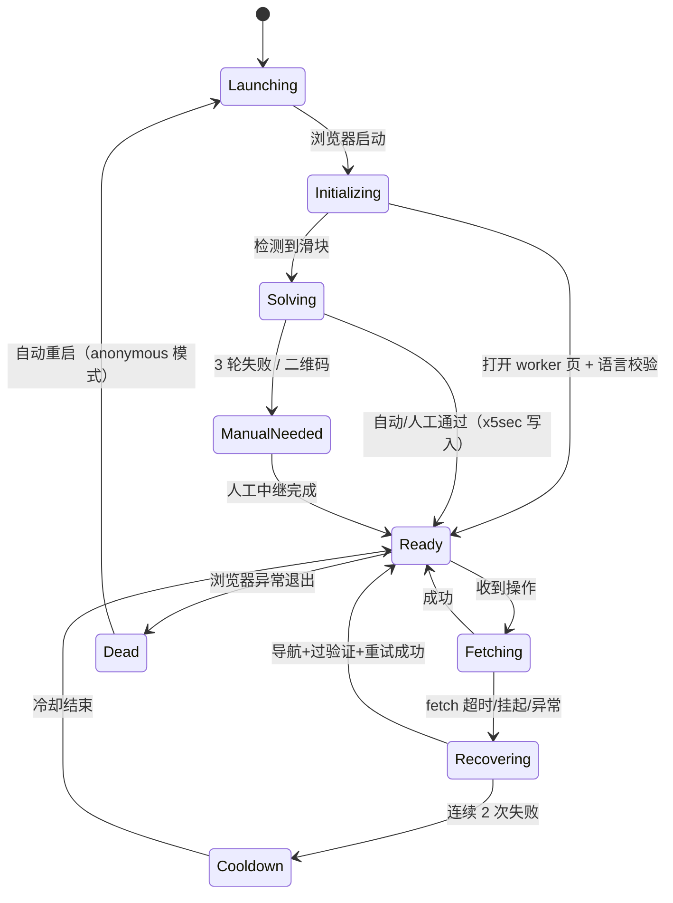

<p align="right"><a href="./README.md">← 文档索引</a></p>

# ali-client 接口设计（v1.0 设计稿）

| 项 | 内容 |
| --- | --- |
| 版本 | v1.0（2026-11-15，**设计稿，待评审**；实现后按实测回填） |
| 依据 | [需求访谈记录](./00-需求访谈记录.md)、[需求文档 PRD](./01-需求文档.md)、[实测报告](../exploration/2026-11-15/REPORT.md)、[会员体系与识别规则](./05-会员体系与识别规则.md)、[风控与人机验证](./06-风控与人机验证.md) |
| 一句话 | 把「阿里国际站供应商搜索 / 供应商详情 / 地区字典 / 会员识别」封装为 **CLI / REST / MCP / SKILL** 四形态、带 SQLite 缓存的本机只读客户端。 |
| 状态 | **v0.1.0 已实现**；`src/api/operations.ts` 为唯一事实源，生成 `spec/`（OpenAPI 3.1 / MCP tools / CLI）并与实现同源校验 |
| 事实标记 | ✅实测（两轮真机探路）/ 📐设计（未实现，实现后回填） |

---

## 0. 通用约定

### 0.1 形态与地址

| 形态 | 入口 | 说明 |
|---|---|---|
| REST | `http://127.0.0.1:8792` | 默认只监听 loopback；除 `/v1/health`、`/docs`、`/openapi.json` 外都要 Bearer |
| CLI | `ali ...`（`dist/main.js`） | 人/脚本用；`--format json|table|plain`，默认 `table` |
| MCP | stdio server `ali-client`，工具前缀 `ali_` | **默认代理到常驻 REST**（不自己开浏览器），保证单实例 |
| SKILL | `skills/ali/SKILL.md` | 给 Agent 的工作流说明，内部调用 CLI/MCP |

### 0.2 响应 envelope（全形态一致）

```json
{
  "ok": true,
  "data": {},
  "meta": {
    "schemaVersion": "1.0",
    "mode": "logged_in",
    "cached": false,
    "queryId": null,
    "elapsedMs": 123,
    "serverTime": "2026-11-15T14:20:00+08:00"
  },
  "error": null
}
```

失败：

```json
{
  "ok": false,
  "data": null,
  "meta": { "schemaVersion": "1.0", "mode": "anonymous", "elapsedMs": 88 },
  "error": {
    "code": "CAPTCHA_REQUIRED",
    "message": "Alibaba slider verification is required",
    "retryable": true,
    "details": { "screenshotPath": "/home/songqian/.ali-client/run/captcha.png", "verificationUrl": "http://127.0.0.1:8792/v1/verification" }
  }
}
```

### 0.3 错误码

| code | HTTP | 含义 | retryable |
|---|---|---|---|
| `INVALID_ARGUMENT` | 400 | 参数非法（含省市无法归一化） | false |
| `UNAUTHENTICATED` | 401 | REST Bearer 缺失/错误 | false |
| `NOT_FOUND` | 404 | 供应商/查询/地区不存在（缓存与上游均无） | false |
| `LOGIN_REQUIRED` | 409 | 上游要求登录（如后续页面） | true（先 `session.login`） |
| `CAPTCHA_REQUIRED` | 409 | 触发滑块，需要人工/自动过验证 | true（`verification.solve`） |
| `RATE_LIMITED` | 429 | 本地限频/上游风控冷却 | true（`retryAfterMs`） |
| `UPSTREAM_ERROR` | 502 | 上游 4xx/5xx 或结构变化 | true（可重试） |
| `UPSTREAM_TIMEOUT` | 504 | 上游超时 | true |
| `ENRICH_LIMIT_REACHED` | 200 + `meta.warnings` | 详情回填达到 `maxEnrich`，结果可能不全 | — |
| `PAGE_NOT_AVAILABLE` | 409 | 请求页超出查询已抓页且不允许继续翻页 | true（`refresh`/提高 `pages`） |
| `BAD_STATE` | 409 | 浏览器/会话状态异常（如 profile 被占用） | true |
| `NOT_IMPLEMENTED` | 501 | v1 未实现（如 batch） | false |
| `INTERNAL_ERROR` | 500 | 未分类 | maybe |

### 0.4 Query / 分页 / 刷新语义

- **查询是一等资源**：`search.suppliers` 生成 `queryId`（`q_` + 16 位 hash），后续 `suppliers.list` 按 `queryId + page` 翻页。
- `queryId = "q_" + sha1(keyword|province|city|locationMode|filters|country|pages).slice(0,16)`；同 spec 命中缓存时返回同一 `queryId`。
- 分页固定上游 20 条/页；`pages` 是**本次预抓页数**（默认 5，硬上限 20，`ALI_MAX_PAGES`）；`suppliers.list` 可取已抓页，也可触发抓取后续页（受 `maxPages` 与 `pages` 限制）。
- 所有读操作支持 `refresh=true`（强制回源，更新缓存）；`meta.cached` 表示本次是否命中缓存。
- 所有时间 ISO 8601 + `+08:00`；时长字段除注释外均为毫秒。

### 0.5 语言与归一化

- 上游固定 **en-US / USD**（首次初始化自动切换，写入偏好 cookie）。
- `*Text` 字段保留上游原始文案（如 `"6 yrs"`、`"$2231223"`、`"5,000+ m²"`）；数值字段由客户端归一化（`joinedYears: 6`、`totalExportRevenueUSD: 2231223`、`floorSpaceM2: 5000`）。
- 公司名、地址、产品名保持英文原文；地区字典同时提供中文/英文/拼音。

### 0.6 只读约束

- 不提供询盘、聊天、收藏、下单、卖家后台、修改资料等写操作。
- 不持久化 HTML、Cookie、Token、验证码图片（验证码截图临时文件，30 分钟后清理）。
- 上游请求全部带「低频率 + 抖动 + 单实例」策略（见 §6）。

---

### 0.7 采集策略（fetch-first，第二轮实测后定稿）

- **单 worker 页**：owner 浏览器只保留 1 个 `https://www.alibaba.com/` 页面（初始加载/恢复时使用；遇滑块自动/人工通过）。
- **搜索**：worker 页内 `page.evaluate(async () => fetch(searchUrl).then(r=>r.text()))` → 从 HTML 提取 `window._PAGE_DATA_`。**不导航**，因此不触发页面级滑块。
- **详情**：worker 页内 **跨子域 CORS** `POST https://<sub>.en.alibaba.com/event/app/alisite/render.htm`（`componentKeys=shopSign,companyCard,companyOverview`）。实测 30/30 子域成功、0.3–0.8s/条。
- **工厂目录**：worker 页内 `fetch insights.alibaba.com/openservice/gatewayService?modelId=10300…`。
- **兜底**：fetch 15–20s watchdog 超时 / 返回体异常 / `x5sec` 过期 → 导航目标 URL（触发验证则自动/人工通过）→ 重试一次 fetch；仍失败 → `CAPTCHA_REQUIRED`/`RATE_LIMITED` + 冷却。
- **不持久化**：HTML 只在内存中解析，落缓存的是结构化字段。

## 1. 操作总表

| # | 操作 | CLI | REST | MCP | 缓存 TTL | 优先级 |
|---|---|---|---|---|---|---|
| 1 | `health` | `ali health` | `GET /v1/health` | `ali_health` | — | P0 |
| 2 | `status` | `ali status` | `GET /v1/status` | `ali_status` | 30s | P0 |
| 3 | `session.login` | `ali login` | `POST /v1/session/login` | `ali_login` | — | P0 |
| 4 | `session.loginStatus` | `ali login status` | `GET /v1/session/login/status` | `ali_login_status` | — | P0 |
| 5 | `verification.get` | `ali verify` | `GET /v1/verification` | `ali_verification_get` | — | P0 |
| 6 | `verification.solve` | `ali verify solve` | `POST /v1/verification/solve` | `ali_verification_solve` | — | P0 |
| 7 | `regions.list` | `ali regions list` | `GET /v1/regions` | `ali_regions` | 静态 | P0 |
| 8 | `regions.search` | `ali regions search` | `GET /v1/regions/search` | `ali_region_search` | 静态 | P1 |
| 9 | `search.suppliers` | `ali search suppliers` | `POST /v1/search/suppliers` | `ali_search_suppliers` | 2h | P0 |
| 10 | `suppliers.list` | `ali suppliers list` | `GET /v1/suppliers` | `ali_list_suppliers` | 2h（页） | P0 |
| 11 | `suppliers.detail` | `ali suppliers detail` | `GET /v1/suppliers/{companyId}` | `ali_supplier_detail` | 7d | P0 |
| 12 | `factories.list` | `ali factories list` | `GET /v1/factories` | `ali_factories_list` | 24h | P1 |
| 13 | `memberships.catalog` | `ali memberships` | `GET /v1/meta/memberships` | `ali_membership_catalog` | 静态 | P1 |
| 14 | `cache.stats` | `ali cache stats` | `GET /v1/cache/stats` | `ali_cache_stats` | — | P0 |
| 15 | `cache.clear` | `ali cache clear` | `DELETE /v1/cache` | `ali_cache_clear` | — | P1 |
| 16 | `search.batch`（v1.1） | `ali search batch` | `POST /v1/search/batch` | `ali_search_batch` | 2h | P2 |

---

## 2. 操作详细

### 2.1 `health`

```http
GET /v1/health
```

```json
{ "ok": true, "data": { "status": "ok", "version": "0.1.0", "uptimeMs": 86400000 }, "meta": {}, "error": null }
```

### 2.2 `status`

```http
GET /v1/status
```

```json
{
  "ok": true,
  "data": {
    "mode": "logged_in",                 // logged_in | anonymous | unknown
    "loggedIn": true,
    "account": { "displayName": "Cindy ring", "country": "CN" },
    "language": "en-US",
    "profile": { "dir": "~/.ali-client/profile", "present": true, "lockedByPid": 4242 },
    "browser": { "running": true, "pid": 4242, "headless": false, "uptimeMs": 3600000 },
    "upstream": {
      "lastPageNavAt": "2026-11-15T14:18:00+08:00",
      "lastDetailAt": "2026-11-15T14:18:20+08:00",
      "requestsLast10Min": 7,
      "cooldownUntil": null,
      "captcha": { "required": false, "lastSolvedAt": "2026-11-15T14:02:00+08:00" }
    },
    "worker": { "url": "https://www.alibaba.com/", "ready": true, "fetchHealthy": true, "lastFetchHungAt": null },
    "risk": { "x5secExpiresAt": "2026-11-15T23:07:01+08:00", "riskState": "normal", "cooldownUntil": null },
    "cache": { "queries": 12, "suppliers": 340, "details": 96, "factories": 500, "bytes": 5242880 },
    "version": "0.1.0"
  },
  "meta": {},
  "error": null
}
```

### 2.3 `session.login` / `session.loginStatus`

v1 采用**人工 headful 登录一次**（本机有桌面）；远程部署预留二维码/短信中继（v1.1）。

```http
POST /v1/session/login
{ "mode": "manual" }          // manual | qr(reserved) | sms(reserved)
```

```json
{
  "ok": true,
  "data": {
    "mode": "manual",
    "loginUrl": "https://login.alibaba.com/newlogin/icbuLogin.htm?return_url=https%3A%2F%2Fwww.alibaba.com",
    "browserWindow": "shown",
    "instructions": "请在已打开的浏览器窗口完成登录/滑块验证；本接口不处理密码。",
    "timeoutMs": 600000
  },
  "meta": {},
  "error": null
}
```

```http
GET /v1/session/login/status
```

```json
{
  "ok": true,
  "data": {
    "state": "pending",              // pending | logged_in | timeout | failed
    "action": "solve_captcha",       // solve_captcha | enter_credentials | none
    "screenshotPath": "/home/songqian/.ali-client/run/login.png",
    "loginUrl": "https://login.alibaba.com/...",
    "expiresAt": "2026-11-15T14:40:00+08:00"
  },
  "meta": {},
  "error": null
}
```

> 说明：上游登录态是**会话级 cookie**（关闭浏览器进程即掉），因此 owner 进程必须常驻；`status.loggedIn` 实时反映。掉线时读操作自动降级匿名（`mode:"anonymous"`）并在 `meta.warnings` 提示。

### 2.4 `verification.get` / `verification.solve`

```http
GET /v1/verification
```

```json
{
  "ok": true,
  "data": {
    "required": true,
    "type": "slider",                        // slider | qr | unknown
    "pageUrl": "https://www.alibaba.com/trade/search?...",
    "screenshotPath": "/home/songqian/.ali-client/run/captcha-20261115-141800.png",
    "track": { "x": 510, "y": 703, "width": 300, "height": 34, "viewport": "1920x1080" },
    "handle": { "x": 522, "y": 720, "width": 42, "height": 34 },
    "autoSolveSupported": true
  },
  "meta": {},
  "error": null
}
```

```http
POST /v1/verification/solve
{ "mode": "auto" }                          // auto | drag（远程中继坐标）
```

```json
{ "ok": true, "data": { "solved": true, "attempts": 1, "elapsedMs": 2100 }, "meta": {}, "error": null }
```

- `auto`：类人拖拽（缓动+抖动+回拉，1.5–2.5s）；失败返回 `CAPTCHA_REQUIRED` + 新截图。
- `drag`：`{ "from": [x,y], "to": [x,y], "durationMs": 800 }` 供远程 Agent/人工中继（参考 zhilian-client 的坐标中继）。
- 二维码兜底：`type:"qr"` 时返回截图，需人工用阿里 App 扫码（v1 不自动）。
- **重试策略**：单次触发最多 3 轮「拖拽 → 检测 → `page.reload()` 重新武装」；实测 3/3 最终成功（首次 2/3），单轮 ~5–8s。失败返回 `CAPTCHA_REQUIRED`，`details.screenshotPath` 供人工/远程中继。
- **x5sec 有效期 ≈30 分钟**（过验证后）；`status.risk.x5secExpiresAt` 暴露剩余时间，客户端可在剩余 <3 分钟且需要导航时主动刷新。
- **fetch 挂起异常**：风控态下 `fetch` 可能永不返回（`AbortSignal` 也不生效）→ 服务端必须用 **watchdog（15–20s）**；超时后走「导航该 URL → 过验证 → 重试 fetch」，仍失败进入冷却（默认 5min）。同 profile 单纯重启浏览器不能解除（风控绑 cookie/设备）。

### 2.5 `regions.list` / `regions.search`

静态字典：**中国内地 31 省级行政区 + 地级行政区（333 个）**；字段含中文名、英文名（阿里展示口径）、拼音、别名、GB 代码、父级。

```http
GET /v1/regions?level=province
GET /v1/regions?level=city&province=Hebei
GET /v1/regions/search?q=hengshui
```

```json
{
  "ok": true,
  "data": {
    "level": "city",
    "province": { "code": "CN-13", "nameZh": "河北省", "nameEn": "Hebei", "pinyin": "hebei" },
    "items": [
      {
        "code": "CN-13-1311",
        "level": "city",
        "nameZh": "衡水市",
        "nameEn": "Hengshui",
        "pinyin": "hengshui",
        "aliases": ["衡水", "Hengshui", "Heng Shui"],
        "parentCode": "CN-13"
      }
    ],
    "count": 11
  },
  "meta": {},
  "error": null
}
```

归一化规则（服务端对 `province`/`city` 入参统一处理）：

1. 精确匹配 `nameZh`/`nameEn`/`pinyin`/`code`/`aliases`；
2. 去空格/大小写/`省|市|自治区|特别行政区|Province|City` 后缀后匹配；
3. 阿里拼写噪声映射：`Guang`→（歧义，拒绝并提示用户给全名）、`Gunagdong`→`Guangdong`、`Xizang/Tibet` 等（字典内维护 `aliSpellings[]`）；
4. 命中多个 → `INVALID_ARGUMENT` + `details.candidates[]`；
5. 只给 city 未给 province → 由 city 反查父级省份。

### 2.6 `search.suppliers`（核心）

```http
POST /v1/search/suppliers
```

```json
{
  "keyword": "led light",              // 可选；与 province/city 至少给一个
  "province": "Hebei",                 // 可选（中文/英文/拼音/代码）
  "city": "Hengshui",                  // 可选（需要 province 或可反查）
  "locationMode": "strict",            // strict | keyword | off；缺省：有省市=strict，否则 off
  "includeUnknownCity": true,          // city 过滤时是否保留“城市未知”的供应商
  "country": "CN",                     // 默认 CN
  "filters": {
    "verifiedSupplier": true,          // assessmentCompany=true（金品诚企）
    "verifiedPro": false,              // verifiedPro=1（领袖卖家）
    "tradeAssurance": false,           // ta=y
    "minReviewScore": 4.5,             // 4 | 4.5 | 5
    "companyAuthTags": ["ISO", "BSCI"],
    "productAuthTags": ["CE"],
    "capabilities": ["Full customization", "Finished product inspection"]
  },
  "pages": 2,                          // 预抓页数 默认 5、硬上限 20
  "maxEnrich": 60,                     // strict 模式下详情回填上限，默认 60
  "refresh": false
}
```

**行为（strict 模式，默认）**：

> 采集方式：worker 页内 `fetch`（不导航）；分页以「返回 0 条」为终止。**`totalCount` 不可靠**（实测同一查询 712–784 波动，登录 757 属噪声），仅作参考，不能用于精确页数计算。关键词查询可用页边界实测约 31 页（末尾可能只有几页），过滤后更深；`pages` 建议默认 5、硬上限 20。

1. 归一化省市 → 得到 `provinceEn`/`cityEn` 与可选的「地点关键词」`placeName`；
2. 组上游 URL：`keywords = keyword || placeName`；`originKeywords = 同 keywords`；`tab=supplier`；`country=CN`；叠加 filters；按 `pages` 逐页 `fetch` 抓 `window._PAGE_DATA_`（间隔 0.8–1.2s，失败重试 2 次）；
3. 合并 `offerResultData.offerList[]`，按 `companyId` 去重、按 `newAd/adInfo` 标记广告；
4. 对结果按 `maxEnrich` 逐条取详情（缓存优先；并发 2、间隔 0.6–1.0s，`ALI_DETAIL_INTERVAL_MS=700`），从 `shopSign` 取 `province/city`；
5. 过滤：`province` 必须相等；`city` 必须相等（城市未知时按 `includeUnknownCity` 保留并标 `locationConfidence:"low"`）；
6. 返回 `suppliers[]`（已合并详情中的 `joinedYears`/`supplierStars`/`membership`/`city`）+ `stats`。

**行为（keyword 模式）**：不调详情；`keywords = [keyword, placeName].filter(Boolean).join(" ")`；结果 `locationMatch:"keyword"`、`locationConfidence:"low"`，并在 `meta.warnings` 标注「相关性匹配，非严格地区筛选」。

**响应**：

```json
{
  "ok": true,
  "data": {
    "queryId": "q_9f3c1a77b2e04d10",
    "keyword": "led light",
    "effectiveKeyword": "led light",
    "location": {
      "requested": { "province": "Hebei", "city": "Hengshui" },
      "normalized": { "province": "Hebei", "city": "Hengshui", "code": ["CN-13", "CN-13-1311"] },
      "mode": "strict",
      "includeUnknownCity": true,
      "enrichedCompanies": 42,
      "matched": 17,
      "unknownLocation": 3,
      "limitReached": false
    },
    "pages": [
      { "page": 1, "totalCount": 757, "items": 20, "ads": 1, "fetchedAt": "2026-11-15T14:20:00+08:00", "cached": false },
      { "page": 2, "totalCount": 757, "items": 20, "ads": 0, "fetchedAt": "2026-11-15T14:20:20+08:00", "cached": false }
    ],
    "suppliers": [ { "...": "SupplierSummary（见 §3.1）" } ],
    "stats": {
      "totalCount": 757,
      "rawItems": 41,
      "deduped": 39,
      "ads": 1,
      "returned": 17,
      "detailRequests": 40,
      "detailCacheHits": 12,
      "enrichLimitReached": false
    }
  },
  "meta": { "schemaVersion": "1.0", "mode": "logged_in", "cached": false, "queryId": "q_9f3c1a77b2e04d10", "elapsedMs": 24500, "warnings": [] },
  "error": null
}
```

### 2.7 `suppliers.list`

```http
GET /v1/suppliers?queryId=q_9f3c1a77b2e04d10&page=3&refresh=false
```

```json
{
  "ok": true,
  "data": {
    "queryId": "q_9f3c1a77b2e04d10",
    "page": 3,
    "pageSize": 20,
    "totalCount": 757,
    "suppliers": [ { "...": "SupplierSummary" } ],
    "hasMore": true,
    "fetchedPages": [1, 2, 3],
    "location": { "requested": {}, "mode": "off", "matched": null }
  },
  "meta": { "cached": false, "queryId": "q_9f3c1a77b2e04d10" },
  "error": null
}
```

- 页未抓取且 `page > query.pages`：返回 `PAGE_NOT_AVAILABLE`（提示用 `search.suppliers` 提高 `pages` 或 `refresh`）。
- strict 查询的 local 过滤在 `search` 时完成；`list` 返回的是**过滤后**的该页结果（`suppliers` 可能 < 20）。

### 2.8 `suppliers.detail`

```http
GET /v1/suppliers/258180302?refresh=false
```

也支持 `?store=kangyuanxiangsu`（由 search 结果 `action` 里的子域推导）。

```json
{
  "ok": true,
  "data": {
    "companyId": "258180302",
    "companyName": "Hengshui Kangyuan Rubber And Plastic Technology Co., Ltd.",
    "storeUrl": "https://kangyuanxiangsu.en.alibaba.com/company_profile.html",
    "logoUrl": "//sc04.alicdn.com/kf/Hd849a67e0c634a6a9741488365909888F.jpg",
    "location": {
      "country": "CN",
      "countryName": "China",
      "province": "Hebei",
      "provinceCode": "CN-13",
      "city": "Hengshui",
      "cityCode": "CN-13-1311",
      "address": "Zhang Qi Village, Jianghe Town, Hengshui, Hebei, China",
      "display": "Hebei, China",
      "confidence": "high",
      "source": "shopSign.supplierOperationalAddress"
    },
    "joinedYears": 6,
    "joinedYearsText": "6 yrs",
    "supplierIndex": {
      "stars": 2,
      "maxStars": 5,
      "label": "Supplier Index",
      "source": "shopSign.supplierStars"
    },
    "mainProducts": {
      "list": ["Solid Tires", "Forklift Tires", "PU Wheels", "Rubber Wheels", "Nylon Wheels"],
      "text": "Solid Tires, Forklift Tires, PU Wheels, Rubber Wheels, Nylon Wheels",
      "source": "companyCard.companyMainMarket"
    },
    "businessType": { "raw": "Manufacturer, Trading Company", "manufacturer": true, "tradingCompany": true },
    "identity": {
      "key": "strengthFactory",
      "name": "Custom Manufacturer",
      "nameZh": "实力工厂",
      "verified": true,
      "description": "企业类型认证结果为工厂或工贸一体"
    },
    "profile": {
      "establishedYear": 2018,
      "annualRevenue": { "value": "6216823", "kind": "number" },
      "employees": "11 - 50 People",
      "mainMarkets": ["North America", "Mid East", "Western Europe"],
      "paymentMethods": "T/T, D/P D/A, PayPal",
      "deliveryTerms": "FOB, CFR, CIF, EXW, ...",
      "contractManufacturing": ["OEM Service Offered", "Design Service Offered"],
      "description": "Hengshui Kangyuan Rubber and Plastic Technology Co., Ltd. ...",
      "advantageDescription": "We are a professional solid tire manufacturer ...",
      "capacityTags": ["Founded in 2018", "Total Employees", "..."],
      "source": "companyOverview"
    },
    "membership": { "...": "Membership（见 §3.3）" },
    "performance": {
      "storeRating": { "score": 4.6, "max": 5, "count": 10 },
      "onTimeDeliveryRate": "100.0%",
      "responseTime": "≤2h",
      "responseRate": "98.5%",
      "totalExportRevenueUSD": 2231223,
      "totalExportRevenueText": "$2231223",
      "floorSpaceM2": 5000,
      "productionLines": 10,
      "factoryRank": { "text": "物料搬运设备部件 热销第 2", "url": "https://sale.alibaba.com/p/factories/v2/rank_list.html?..." },
      "topMarkets": [
        { "market": "North America", "percent": 50.0, "products": ["Solid Tires", "Forklift Tires", "..."] }
      ]
    },
    "capabilities": {
      "customization": ["Drawing-based customization", "Full customization"],
      "qualityControl": ["Raw material identification", "Finished product inspection"],
      "assessmentTags": ["ODM services available", "On-site technical support", "Total staff (32)"],
      "serviceTags": []
    },
    "trust": {
      "tradeAssurance": { "enabled": true, "amountText": "96,000", "creditLevel": 4, "hasOrderYear": true },
      "baseVerify": false,
      "onsiteAssessment": true,
      "assessedBy": "SGS Group",
      "verifiedSupplier": true,
      "verifiedPro": false
    },
    "raw": {
      "companyJoinYears": "6",
      "supplierStars": 2,
      "supplierRating": 6,
      "companyHasPassAssessment": true,
      "companyHasPassOnsite": true,
      "companyHasPassBaseVerify": false,
      "companyHasPassAV": false,
      "accountIsPaidMember": true,
      "isGold": true,
      "isNewGolden": false
    },
    "fetchedAt": "2026-11-15T14:22:00+08:00"
  },
  "meta": { "cached": true, "mode": "anonymous" },
  "error": null
}
```

> 说明：`supplierIndex.stars` 与 `joinedYears` 来自 `shopSign`；`membership` 判定见 §3.3 与 [会员规则](../exploration/2026-11-15/membership-plans.md)。`supplierRating`（=6）含义未确认，只放 `raw`。

### 2.9 `factories.list`（P1）

认证工厂目录（`/factory/index.html`），**仅省维度、总量上限约 500、无关键词**。

```http
GET /v1/factories?province=Hebei&categoryId=44&page=1&pageSize=100&refresh=false
```

```json
{
  "ok": true,
  "data": {
    "province": "Hebei",
    "categoryId": "44",
    "page": 1,
    "pageSize": 100,
    "upstreamTotal": 500,
    "capped": true,
    "items": [
      {
        "companyId": "256571369",
        "companyName": "Anhui Xingda Auto Parts Technology Co., Ltd.",
        "companyUrl": "//xdwheel.en.alibaba.com/factory.html?...",
        "countryCode": "CN",
        "province": "Anhui",
        "goldSupplierYears": 6,
        "goldSupplierYearsText": "6年",
        "assessedSupplier": true,
        "tradeAssurance": true,
        "rate": 4.8,
        "reviews": 100,
        "onTimeShipping": "100.0%",
        "responseTime": "≤1h",
        "employeesText": "100+ 名员工",
        "factorySizeText": "9,600+ ㎡",
        "products": [ { "title": "...", "imageUrl": "..." } ]
      }
    ],
    "note": "Upstream caps at ~500 manufacturers; city not available on this directory."
  },
  "meta": { "cached": true },
  "error": null
}
```

### 2.10 `memberships.catalog`

返回枚举 + 识别规则 + 证据字段，供 Agent 理解：

```json
{
  "ok": true,
  "data": {
    "plans": [
      { "code": "verified_pro", "labelEn": "Verified Pro Supplier", "labelZh": "领袖卖家", "rank": 3 },
      { "code": "verified_supplier", "labelEn": "Verified Supplier", "labelZh": "金品诚企", "rank": 2 },
      { "code": "gold_supplier", "labelEn": "Gold Supplier", "labelZh": "出口通", "rank": 1 },
      { "code": "unknown", "labelEn": "Unknown", "labelZh": "未知", "rank": 0 }
    ],
    "rules": [
      { "if": "search.verifiedSupplierPro === true", "then": "verified_pro", "confidence": "high" },
      { "if": "search.isAssessedSupplier === true", "then": "verified_supplier", "confidence": "high" },
      { "if": "detail.shopSign.companyHasPassAssessment === true", "then": "verified_supplier", "confidence": "high" },
      { "if": "detail.shopSign.companyHasPassOnsite === true", "then": "onsiteAssessment=true（金品附加层）", "confidence": "high" },
      { "if": "search.goldYears > 0", "then": "gold_supplier（至少出口通）", "confidence": "medium" },
      { "if": "detail.shopSign.accountIsPaidMember === true", "then": "paidMember=true", "confidence": "high" }
    ],
    "supplierIndex": { "field": "shopSign.supplierStars", "range": [0, 5], "label": "Supplier Index（SOPI 星级）" },
    "storeRating": { "field": "companyCard.supplierRatingReviews.averageStar", "range": [0, 5], "label": "Store rating（买家评价）" },
    "cautions": [
      "memberTag / type / iconList / reviewScore / transactions 不能用于判档",
      "Top Sponsor Listing（adInfo/newAd）是广告，不是会员",
      "Trade Assurance 是交易保障，不是会员档位"
    ]
  },
  "meta": {},
  "error": null
}
```

### 2.11 `cache.stats` / `cache.clear`

```http
GET /v1/cache/stats
```

```json
{
  "ok": true,
  "data": {
    "queries": { "count": 12, "hitRate": 0.62, "oldestAt": "2026-11-15T10:00:00+08:00" },
    "suppliers": { "count": 340, "withDetail": 96 },
    "details": { "count": 96, "expired": 3 },
    "factories": { "count": 500, "pages": 5 },
    "bytes": 5242880
  },
  "meta": {},
  "error": null
}
```

```http
DELETE /v1/cache?kind=all|queries|suppliers|details|factories
```

```json
{ "ok": true, "data": { "deleted": { "queries": 12, "suppliers": 340, "details": 96, "factories": 500 } }, "meta": {}, "error": null }
```

---

## 3. 数据模型

### 3.1 `SupplierSummary`（列表项）

```ts
type SupplierSummary = {
  companyId: string;
  companyName: string;
  storeUrl: string;               // 绝对 https URL（来自 action）
  logoUrl: string | null;
  country: string;                // "CN"
  location: {
    province: string | null;
    city: string | null;
    confidence: "high" | "medium" | "low" | "unknown";
    source: "detail" | "list" | "keyword" | "none";
  };
  joinedYears: number | null;     // 解析 goldYears
  joinedYearsText: string | null;
  supplierIndex: { stars: number | null; maxStars: 5 } | null;  // strict enrich 后才有
  membership: Membership;         // 列表级判定
  mainProducts: string[];         // provideProducts 拆分
  rating: { score: number | null; count: number | null };
  businessType: { raw: string | null; manufacturer: boolean | null; tradingCompany: boolean | null };
  staffText: string | null;
  factoryAreaText: string | null;
  transactionsText: string | null;
  responseTime: string | null;
  capabilityTags: string[];
  rank: number | null;            // 列表位置
  isAd: boolean;
  adType: "top_sponsor" | "p4p" | null;
  position: number;
};
```

### 3.2 `Membership`（归一化枚举 + 证据）

```ts
type Membership = {
  plan: "verified_pro" | "verified_supplier" | "gold_supplier" | "unknown";
  label: string;                  // "Verified Pro Supplier" | "Verified Supplier" | "Gold Supplier" | "Unknown"
  rank: 3 | 2 | 1 | 0;
  verifiedSupplier: boolean;
  verifiedPro: boolean;
  paidMember: boolean | null;     // accountIsPaidMember
  goldSupplier: boolean | null;   // isGold
  onsiteAssessment: boolean | null;   // companyHasPassOnsite
  baseVerify: boolean | null;         // companyHasPassBaseVerify
  assessedBy: string | null;          // SGS Group / TÜV...
  goldYears: number | null;
  evidence: {                     // 原始证据（来自搜索卡或详情）
    source: "list" | "detail";
    isAssessedSupplier?: boolean;
    verifiedSupplierPro?: boolean;
    goldYearsText?: string;
    companyHasPassAssessment?: boolean;
    companyHasPassOnsite?: boolean;
    accountIsPaidMember?: boolean;
    isGold?: boolean;
  };
};
```

### 3.3 判定规则（与会员规则文档一致）

```text
list:
  verifiedSupplierPro === true            → verified_pro            (Verified Pro / 领袖卖家；实测 3/3 同时 assessed)
  else isAssessedSupplier === true        → verified_supplier       (金品诚企 / Verified Supplier)
  else accountIsPaidMember === true       → gold_supplier           (至少出口通)
  else goldYearsInt > 0                   → gold_supplier（弱证据，confidence=medium）
  else                                    → unknown
detail（覆盖/升级 list，且可补 onsite/assessedBy）:
  companyHasPassAssessment === true       → verified_supplier
  accountIsPaidMember === true            → paidMember = true（配合 assessed=false → gold_supplier）
  companyHasPassOnsite === true           → onsiteAssessment = true（**验证服务，不等于金品**：出口通样本也有）
  assessmentCertCompany                   → assessedBy（SGS/TÜV…）
  verifiedPro 只能从 list（verifiedSupplierPro）得到；详情无该字段

注意（第二轮实测修正）：
  ✗ isGold 不能作出口通主判据（非 assessed 付费商家 isGold=false）
  ✗ companyHasPassOnsite ≠ 金品
  ✗ memberTag / type / iconList / reviewScore / transactions / tag 不能判档
```

### 3.4 `Region`

```ts
type Region = {
  code: string;          // "CN-13" / "CN-13-1311"
  level: "province" | "city";
  nameZh: string;
  nameEn: string;
  pinyin: string;
  aliases: string[];     // 含阿里展示拼写（如 "Guangdong"、"HeBei"）
  parentCode: string;    // province → "CN"；city → "CN-13"
  aliSpellings: string[];// 出现在阿里页面上的拼写（含噪声 "Guang"/"Gunagdong" → 映射表）
};
```

### 3.5 `Query`

```ts
type Query = {
  queryId: string;
  keyword: string | null;
  province: string | null;
  city: string | null;
  locationMode: "strict" | "keyword" | "off";
  filters: SearchFilters;
  country: string;
  pagesRequested: number;
  pagesFetched: number[];
  totalCount: number | null;
  createdAt: string;
  expiresAt: string;
};
```

---

## 4. 缓存设计（SQLite）

`~/.ali-client/cache.sqlite`（WAL）。只存结构化字段，不存 HTML/cookie/图片。

| 表 | 主键 | 内容 | TTL |
|---|---|---|---|
| `queries` | `query_id` | 查询 spec、页数、totalCount、时间 | 2h |
| `query_items` | `(query_id, page, position)` | 单页供应商摘要 JSON、是否广告 | 2h（跟 query） |
| `suppliers` | `company_id` | 供应商档案（名称/URL/logo/国家/省/市/年限/星级/plan/摘要） | 长期（最近更新时间） |
| `supplier_details` | `company_id` | 详情 JSON + 证据 | 7d |
| `factories` | `(category_id, page, position)` | 工厂目录项 JSON | 24h |
| `kv` | `key` | 元数据（lastLoginAt、captchaSolvedAt、schemaVersion…） | 按需 |

- `cache.stats` 统计行数与字节；`cache.clear` 按 kind 删除；过期行惰性清理 + 启动时 prune。
- `refresh=true`：绕过读缓存并覆盖写回。
- strict 搜索的详情回填与 `suppliers.detail` **共用同一缓存**（一次抓取，两处复用）。

---

## 5. 限频与并发（默认值，全部可配）

| 项 | 默认 | 说明 |
|---|---|---|
| 页面导航（仅恢复/兜底） | 单实例串行，相邻 ≥10s | 导航是滑块唯一触发源；实测 8–9 次/30s 触发 |
| 搜索 fetch | 单实例串行，间隔 0.8–1.2s（+抖动） | 实测 9 次/31s 无滑块 |
| 详情 fetch（render.htm） | 并发 2，单条间隔 0.6–1s | 30 家/41s 全成功、无滑块 |
| fetch watchdog | 15–20s（Node 侧 Promise.race） | 风控态下 fetch 可能永不返回 |
| 单次搜索页数 | 默认 5，硬上限 20 | 以「返回 0 条」终止；`totalCount` 不可靠 |
| 单查询 enrich 上限 | 60 家 | `maxEnrich`；超出 `meta.warnings` |
| 冷却/退避 | 单次滑块失败 → 5s 后重试（≤3 轮）；连续 2 次失败 → 冷却 5min | `status.risk.cooldownUntil` |
| x5sec | ≈30 分钟 | `status.risk.x5secExpiresAt` |
| 全局请求预算 | 10 分钟 ≤120 次 fetch（可配） | 超限 `RATE_LIMITED` |

---

## 6. CLI 设计

```bash
ali --help
ali health
ali status
ali login                       # 打开/聚焦 owner 浏览器登录页（人工登录一次）
ali login status
ali verify                      # 查看当前滑块（截图 + 轨道坐标）
ali verify solve                # 自动过滑块（类人拖拽）
ali verify solve --from 522,720 --to 780,720   # 远程坐标中继

# 搜索（核心）
ali search suppliers --keyword "led light" --province Hebei --city Hengshui \
  --pages 2 --verified-supplier --format table
ali search suppliers --province Hebei --city Hengshui --pages 1          # 无关键词→地点词
ali search suppliers --keyword "solid tire" --location-mode keyword      # 快速模式

# 翻页 / 详情
ali suppliers list --query-id q_9f3c1a77b2e04d10 --page 2
ali suppliers detail --company-id 258180302
ali suppliers detail --store kangyuanxiangsu

# 地区
ali regions list --level province
ali regions list --level city --province Hebei
ali regions search hengshui

# 认证工厂目录（P1）
ali factories list --province Hebei --category 44 --page-size 100

# 元信息 / 缓存
ali memberships
ali cache stats
ali cache clear --kind details
ali serve --port 8792
```

输出：默认 `table`（人读）；`--format json` 输出完整 envelope；`--format plain` 只输出关键字段（便于管道）。

> CLI 通过 `--api-url`/`ALI_API_URL` 调 REST（默认 `http://127.0.0.1:8792`）；若 REST 未启动，会提示 `ali serve`。MCP 同样默认代理 REST。

---

## 7. REST 端点清单

| 方法 | 路径 | 说明 |
|---|---|---|
| GET | `/v1/health` | 健康 |
| GET | `/v1/status` | 状态（登录/浏览器/限频/缓存） |
| POST | `/v1/session/login` | 打开登录流程 |
| GET | `/v1/session/login/status` | 登录轮询 |
| GET | `/v1/verification` | 当前滑块信息 + 截图 |
| POST | `/v1/verification/solve` | 自动/中继过滑块 |
| GET | `/v1/regions` | 省/市字典 |
| GET | `/v1/regions/search` | 地区搜索 |
| POST | `/v1/search/suppliers` | 供应商搜索（建 query） |
| GET | `/v1/suppliers` | 按 queryId 翻页 |
| GET | `/v1/suppliers/{companyId}` | 供应商详情 |
| GET | `/v1/factories` | 认证工厂目录（P1） |
| GET | `/v1/meta/memberships` | 会员枚举与规则 |
| GET | `/v1/cache/stats` | 缓存统计 |
| DELETE | `/v1/cache` | 清缓存 |
| GET | `/docs` | 自包含 HTML 文档 |
| GET | `/openapi.json` | OpenAPI 3.1 |
| GET | `/mcp-tools.json` | MCP 工具清单 |

鉴权：`Authorization: Bearer $ALI_API_TOKEN`（`/v1/health`、`/docs`、`/openapi.json` 例外）。`/v1/verification/screenshot` 如需要可加签名 query（v1 仅本机，直接返回本地路径）。

---

## 8. MCP 工具清单（`ali_` 前缀）

| 工具 | 入参 | 出参（`data`） |
|---|---|---|
| `ali_health` | — | `{status,version,uptimeMs}` |
| `ali_status` | — | Status |
| `ali_login` | `{mode?: "manual"}` | LoginInfo |
| `ali_login_status` | — | LoginStatus |
| `ali_verification_get` | — | VerificationInfo |
| `ali_verification_solve` | `{mode:"auto"|"drag", from?, to?, durationMs?}` | `{solved,attempts}` |
| `ali_regions` | `{level?, province?}` | `{items,count}` |
| `ali_region_search` | `{q}` | `{items,count}` |
| `ali_search_suppliers` | `SearchSuppliersInput` | `{queryId, suppliers, stats, location}` |
| `ali_list_suppliers` | `{queryId, page?}` | `{suppliers,page,hasMore}` |
| `ali_supplier_detail` | `{companyId?, store?}` | SupplierDetail |
| `ali_factories_list` | `{province?, categoryId?, page?, pageSize?}` | `{items,total,capped}` |
| `ali_membership_catalog` | — | `{plans,rules,cautions}` |
| `ali_cache_stats` | — | CacheStats |
| `ali_cache_clear` | `{kind?}` | `{deleted}` |

工具 description 由 `src/api/operations.ts` 生成，需明确「只读」「strict 模式可能较慢（详情回填）」「触发验证时返回 CAPTCHA_REQUIRED 与恢复方式」。

---

## 9. 配置（`.env` / 环境变量）

| 变量 | 默认 | 说明 |
|---|---|---|
| `ALI_API_TOKEN` | （必填，随机） | REST Bearer |
| `ALI_API_URL` | `http://127.0.0.1:8792` | CLI/MCP 连的 REST |
| `ALI_PORT` | `8792` | REST 端口 |
| `ALI_DATA_DIR` | `~/.ali-client` | 数据目录（profile/cache/logs/run） |
| `ALI_PROFILE_DIR` | `~/.ali-client/profile` | 独立 Chromium profile |
| `ALI_LANG` / `ALI_CURRENCY` | `en-US` / `USD` | 上游语言/币种 |
| `ALI_COUNTRY` | `CN` | 默认国家 |
| `ALI_HEADLESS` | `false` | 建议 headful（本机有桌面） |
| `ALI_MAX_PAGES` | `5` | 单查询页数上限 |
| `ALI_PAGE_INTERVAL_MS` | `10000` | 页面级最小间隔 |
| `ALI_DETAIL_CONCURRENCY` | `2` | 详情并发 |
| `ALI_DETAIL_INTERVAL_MS` | `700` | 详情最小间隔（与 §5/§16.4 的 0.6–1s 对齐） |
| `ALI_MAX_ENRICH` | `60` | strict 回填上限 |
| `ALI_TTL_SEARCH_S` | `7200` | 搜索缓存 |
| `ALI_TTL_DETAIL_S` | `604800` | 详情缓存 |
| `ALI_TTL_FACTORY_S` | `86400` | 工厂目录缓存 |
| `ALI_COOLDOWN_S` | `60` | 滑块后基础冷却；连续失败按 60s→5min→15min 指数退避（§17） |
| `ALI_LOG_LEVEL` | `info` | 日志 |
| `ALI_MCP_TRANSPORT` | `stdio` | MCP 传输 |
| `ALI_MCP_PROXY` | `rest` | MCP 默认代理 REST（不持浏览器） |

---

## 10. 机器可读契约（生成物，单一事实源）

与 zhilian-client 一致：`src/api/operations.ts` 定义 operations（zod input/output + 元数据）→ 生成：

| 生成物 | 路径 | 用途 |
|---|---|---|
| OpenAPI 3.1 | `spec/openapi.json` | REST 文档/客户端生成 |
| MCP tools | `spec/mcp-tools.json` | MCP server 注册 |
| CLI commands | `spec/cli-commands.json` | commander 注册/自文档 |
| JSON Schema | `spec/schemas/*.json` | 外部集成 |

`npm run gen` 生成；`npm run gen:check` 在 CI 校验生成物与实现一致。

---

## 11. 附录

### 11.1 搜索筛选枚举（实测，英文站）

```json
{
  "supplierType": {
    "tradeAssurance": { "param": "ta", "value": "y", "label": "Trade Assurance" },
    "verifiedSupplier": { "param": "assessmentCompany", "value": "true", "label": "Verified Supplier" },
    "verifiedPro": { "param": "verifiedPro", "value": "1", "label": "Verified Pro Supplier" }
  },
  "reviewScore": { "param": "reviewScore", "values": ["4", "4.5", "5"] },
  "companyAuthTag": { "param": "companyAuthTag", "values": ["ISO", "BSCI", "IATF 16949", "SEDEX", "HACCP", "FSC"] },
  "productAuthTag": { "param": "productAuthTag", "values": ["CE", "ROHS", "EN 10223", "GRS", "2006/42/EC", "API", "OCS", "AMECA", "RWS", "GPSR", "DOT", "E/E-MARK", "CPR"] },
  "capabilities": {
    "param": "tagKvPairIntFilter",
    "values": {
      "5": "Suppliers Fortune 500 companies",
      "6": "Design-based customization",
      "7": "Sample-based customization",
      "8": "Environmentally compliant",
      "10": "Finished product inspection",
      "11": "Full customization",
      "12": "Quality management certified",
      "13": "R&D capabilities",
      "34": "Socially responsible",
      "35": "Supplier assessment procedures"
    }
  }
}
```

### 11.2 上游 URL 构造

```text
# 搜索（worker 页内 fetch，不导航；结果 HTML 内 window._PAGE_DATA_）
GET https://www.alibaba.com/trade/search?fsb=y&IndexArea=product_en&has4Tab=true
  &keywords={kw}&originKeywords={kw}&tab=supplier&page={n}
  [&country=CN][&assessmentCompany=true][&verifiedPro=1][&ta=y]
  [&reviewScore=4.5][&companyAuthTag=ISO][&productAuthTag=CE]
  [&tagKvPairIntFilter=11][&sortType=RESRAT]

# 详情（供应商子域；从 www worker 页跨域 POST，CORS 允许，实测 30/30）
POST https://{subdomain}.en.alibaba.com/event/app/alisite/render.htm
  form: esiteSubDomain=https://{subdomain}.en.alibaba.com
        &renderType=component&clientType=PC
        &componentKeys=shopSign,companyCard,companyOverview
  # 有效 componentKeys: shopSign | companyCard | companyOverview |
  #   companyMultimediaSummary | globalData | productGroups | footer

# 工厂目录
GET https://insights.alibaba.com/openservice/gatewayService
  ?modelId=10300&endpoint=pc&categoryIds={id|0}&pageNo={n}&pageSize={<=100}
GET ...?modelId=10161    # countryFilter + tabs（类目/能力字典）
GET ...?modelId=10295&cateType=1&endpoint=pc   # 类目树
```

### 11.3 数据来源字段映射（详情）

| 输出字段 | 上游字段 |
|---|---|
| `joinedYears` / `joinedYearsText` | `shopSign.companyJoinYears` / 文案 |
| `supplierIndex.stars` / `maxStars` | `shopSign.supplierStars` / `shopSign.maxStar.value` |
| `mainProducts` | `shopSign.supplierMainProducts`；英文用 `companyCard.companyMainMarket.descMarkets[].products` |
| `location.province` | `shopSign.companyRegisterProvince.value` |
| `location.city` | `shopSign.supplierOperationalAddress.value` 解析 |
| `location.address` | `shopSign.supplierOperationalAddress.value` |
| `businessType` | `companyCard.companyBusinessType.value` / `shopSign.companyBusinessType.value` |
| `identity` | `companyCard.authCards.value.identityInfo` |
| `membership.*` | `shopSign.companyHasPassAssessment/companyHasPassOnsite/companyHasPassBaseVerify/companyHasPassAV`、`companyCard.accountIsPaidMember/isGold`、`assessmentCertCompany` |
| `performance.*` | `companyCard.authCards.value.authGroupInfoList[].authInfoList[]`（basicCapacity） |
| `capabilities.customization/qualityControl` | `authGroupInfoList[productionServiceCapacity/qualityAssuranceCapability]` |
| `capabilities.assessmentTags` | `shopSign.companyAbilityTags.resultMapList[]` |
| `trust.tradeAssurance` | `companyCard.baoAccountAmount/baoAccountCreditLevel/hasTAOrderYear` |
| `performance.topMarkets` | `companyCard.companyMainMarket.descMarkets[]` |

---

## 12. 评审结论（2026-11-15 22:22）

| # | 问题 | 结论 |
|---|---|---|
| 1 | `locationMode` 默认值 | **有省市时默认 `strict`，同时提供 `keyword` 快速模式** ✅ |
| 2 | strict 模式 `maxEnrich` | **默认 60**（可配；超出返回 `meta.warnings`） ✅ |
| 3 | `factories.list` 是否进 v1 | **进 v1（P1，保留接口）** ✅ |
| 4 | `search.batch` 多省市批量 | **接口留位，v1.1 实现** ✅ |
| 5 | 城市未知供应商 | **默认保留并标 `locationConfidence=low`**，可用 `includeUnknownCity=false` 排除 ✅ |
| 6 | 输出 `raw` | 按默认（只给关键 `raw` 字段），可改 |
| 7 | 登录/二维码中继 | 按默认（本机人工 headful 登录；远程中继 v1.1 预留），待用户读文档后确认 |
| 8 | 登录定位（第二轮后） | **anonymous-first：v1 默认匿名即可完整工作，登录可选** ✅ |
| 9 | 采集方式 | **fetch-first（worker 页 + same-origin fetch 搜索 + CORS 详情），导航仅兜底** ✅ |
| 10 | 验证治理 | 自动拖拽 3 轮 + reload 重试 + watchdog + 人工/二维码兜底；`x5sec` ≈30min ✅ |
| 11 | 详情组件 | `componentKeys=shopSign,companyCard,companyOverview`（多组件一次请求）；其余模块返回空，不依赖 ✅ |
| 12 | 会员判定修正 | `isGold` 不作出口通判据；`onsite` ≠ 金品；`accountIsPaidMember` 为主 ✅ |

> 状态：**文档评审中**。用户将先阅读文档并提修改意见，实现待评审反馈后启动。

---

*草案完。评审通过后：复制 zhilian-client 骨架 → 实现 operations → 生成 spec → 真机联调 → 回填实测报告。*


---

## 13. CLI 完整参考（设计稿）

### 13.1 全局选项

| 选项 | 环境变量 | 默认 | 说明 |
|---|---|---|---|
| `--api-url <url>` | `ALI_API_URL` | `http://127.0.0.1:8792` | CLI 实际调用的 REST 地址（CLI 自身不持有浏览器） |
| `--token <token>` | `ALI_API_TOKEN` | `.env` 读取 | REST Bearer |
| `--format <fmt>` | — | `table` | `table` / `json` / `plain` |
| `--refresh` | — | false | 强制回源（写操作级别的读刷新） |
| `--timeout <ms>` | — | 60000 | 单次调用超时 |
| `--verbose` | — | false | 打印上游/耗时/缓存命中信息到 stderr |
| `--no-color` | — | 自动 | 关闭颜色 |
| `--version` / `-V` | — | — | 版本 |
| `--help` / `-h` | — | — | 帮助（自文档化，与 spec/cli-commands.json 同源） |

### 13.2 命令树

```text
ali
├── health
├── status
├── login [status|verify]
├── verify [solve [--mode auto|drag --from x,y --to x,y --duration ms]]
├── search suppliers
├── suppliers list|detail
├── regions list|search
├── factories list
├── memberships
├── cache stats|clear|prune
└── serve
```

### 13.3 命令细节

| 命令 | 关键参数 | 说明 |
|---|---|---|
| `ali search suppliers` | `--keyword/-k`、`--province`、`--city`、`--location-mode strict|keyword|off`、`--pages`、`--verified-supplier`、`--verified-pro`、`--trade-assurance`、`--min-review <4|4.5|5>`、`--company-auth <ISO,BSCI>`、`--product-auth <CE>`、`--capability <id或名称>`、`--sort <...>`、`--max-enrich`、`--include-unknown-city`、`--refresh` | 建查询并返回 `queryId` + 列表 |
| `ali suppliers list` | `--query-id`、`--page`、`--refresh` | 按 queryId 翻页（本地缓存优先） |
| `ali suppliers detail` | `--company-id` 或 `--store <subdomain>`、`--refresh` | 公司详情（render.htm 三组件） |
| `ali regions list` | `--level province|city`、`--province` | 地区字典 |
| `ali regions search` | `<q>` | 中/英/拼音/别名模糊搜索 |
| `ali factories list` | `--province`、`--category <id>`、`--page`、`--page-size` | 认证工厂目录（仅省，≈500 上限） |
| `ali memberships` | — | 会员枚举、识别规则、证据字段 |
| `ali health` / `ali status` | — | 健康/状态 |
| `ali login` | （无）| 打开/聚焦 owner 浏览器登录页（可选；anonymous-first 可不登录） |
| `ali login status` | — | 登录轮询 |
| `ali verify` | — | 查看当前滑块信息（截图路径 + 坐标） |
| `ali verify solve` | `--mode auto|drag`、`--from`、`--to`、`--duration` | 自动过滑块 / 远程坐标中继 |
| `ali cache stats|clear|prune` | `--kind` | 缓存统计/清理/过期清理 |
| `ali serve` | `--port`、`--host` | 启动常驻 REST（默认 8792） |

### 13.4 输出格式

- `table`（默认）：人读表格，列裁剪（companyName/location/years/stars/plan/rating/responseTime），末尾打印 `queryId`、`cached`、`total`、`elapsed`；
- `json`：完整 envelope（与 REST 一致，便于 `jq`）；
- `plain`：仅关键值，一行一条（companyId<TAB>companyName<TAB>province<TAB>city<TAB>years<TAB>stars<TAB>plan）。

### 13.5 退出码

| 退出码 | 含义 | 对应错误码 |
|---|---|---|
| 0 | 成功 | — |
| 2 | 参数错误 | `INVALID_ARGUMENT` |
| 3 | 上游超时/风控 | `UPSTREAM_TIMEOUT` / `RATE_LIMITED` / `CAPTCHA_REQUIRED` |
| 4 | 未认证/未登录 | `UNAUTHENTICATED` / `LOGIN_REQUIRED` |
| 5 | 上游错误/结构变化 | `UPSTREAM_ERROR` |
| 6 | 接口未实现 | `NOT_IMPLEMENTED` |
| 1 | 其他 | `INTERNAL_ERROR` |

### 13.6 示例

```bash
ali search suppliers --keyword "solid tire" --province Hebei --city Hengshui \
  --pages 2 --verified-supplier --format table
ali search suppliers --province Hebei --location-mode keyword --pages 1
ali suppliers detail --company-id 258180302 --format json | jq '.data.supplierIndex, .data.membership.plan'
ali regions search 衡水
ali factories list --province Hebei --category 44
```

---

## 14. REST 完整参考（设计稿）

### 14.1 通用约定

- Base：`http://127.0.0.1:8792`；仅监听 loopback（`ALI_HOST=127.0.0.1`）。
- 认证：`Authorization: Bearer <ALI_API_TOKEN>`；`/v1/health`、`/docs`、`/openapi.json`、`/mcp-tools.json` 免鉴权。
- 头：请求可带 `X-Request-Id`（否则服务端生成）；响应带 `X-Request-Id`、`X-Ali-Cached: true|false`、`X-Ali-Mode: logged_in|anonymous`；限频响应带 `Retry-After`。
- Body：`application/json`；未知字段忽略（向前兼容），类型错误返回 `INVALID_ARGUMENT`。
- 响应：统一 envelope（§0.2）；`meta` 至少含 `schemaVersion`、`mode`、`cached`、`elapsedMs`、`serverTime`；`queryId` 操作额外含 `queryId`。
- 幂等性：`POST /v1/search/suppliers` 同 spec 返回同 `queryId`（7 天内），`refresh=true` 绕过；`POST /v1/verification/solve` 非幂等（每次都会尝试）。
- 缓存语义：读操作默认 `cached`；`refresh=true` 强制回源并更新缓存；上游失败且存在未过期缓存时，可返回 `meta.stale=true` + `meta.warnings`（`staleOk=false` 可禁用）。

### 14.2 端点总表

| 方法 | 路径 | 鉴权 | 操作 |
|---|---|---|---|
| GET | `/v1/health` | 否 | health |
| GET | `/v1/status` | 是 | status |
| POST | `/v1/session/login` | 是 | session.login |
| GET | `/v1/session/login/status` | 是 | session.loginStatus |
| GET | `/v1/verification` | 是 | verification.get |
| POST | `/v1/verification/solve` | 是 | verification.solve |
| GET | `/v1/verification/screenshot` | 是（可 `?token=` 供远程中继） | 滑块截图 PNG |
| GET | `/v1/regions` | 是 | regions.list |
| GET | `/v1/regions/search` | 是 | regions.search |
| POST | `/v1/search/suppliers` | 是 | search.suppliers |
| GET | `/v1/suppliers` | 是 | suppliers.list |
| GET | `/v1/suppliers/{companyId}` | 是 | suppliers.detail |
| GET | `/v1/factories` | 是 | factories.list |
| GET | `/v1/meta/memberships` | 是 | memberships.catalog |
| GET | `/v1/cache/stats` | 是 | cache.stats |
| DELETE | `/v1/cache` | 是 | cache.clear |
| POST | `/v1/cache/prune` | 是 | cache.prune（P1） |
| GET | `/docs` | 否 | 自包含 HTML 文档 |
| GET | `/openapi.json` | 否 | OpenAPI 3.1 |
| GET | `/mcp-tools.json` | 否 | MCP 工具清单 |

### 14.3 关键端点请求/响应

**POST /v1/search/suppliers**

```json
// 请求
{
  "keyword": "solid tire",
  "province": "Hebei",
  "city": "Hengshui",
  "locationMode": "strict",
  "includeUnknownCity": true,
  "country": "CN",
  "filters": { "verifiedSupplier": true, "minReviewScore": 4.5 },
  "pages": 2,
  "maxEnrich": 60,
  "refresh": false
}
```

响应结构见 §2.6（`queryId/keyword/effectiveKeyword/location/pages/suppliers/stats`）。HTTP 200 即使 `meta.warnings` 非空（如 `ENRICH_LIMIT_REACHED`）。

**GET /v1/suppliers?queryId=…&page=2**

- 200：`{queryId,page,pageSize,totalCount,suppliers,hasMore,fetchedPages,location}`
- 409 `PAGE_NOT_AVAILABLE`：页未抓取且超出本次查询 `pages`；`details.nextAction="increase-pages"`。

**GET /v1/suppliers/{companyId}**

- 200：SupplierDetail（§2.8）；404 `NOT_FOUND`；`refresh=true` 时跳过缓存。
- 支持 `?store=<subdomain>` 作为 companyId 的替代入口。

**GET /v1/regions?level=city&province=Hebei** / `GET /v1/regions/search?q=hengshui`

- 200：`{items,count,level,province?}`；参数无法归一化 → 400 `INVALID_ARGUMENT`（`details.candidates[]`）。

**GET /v1/factories?province=Hebei&categoryId=44&page=1&pageSize=100**

- 200：`{items,page,pageSize,upstreamTotal,capped,note}`；`pageNo` 超出实际数据返回空数组。

**GET /v1/status**

- 200：见 §2.2；新增 `worker`、`risk` 字段（§0.7 采集策略）。

**POST /v1/verification/solve**

```json
{ "mode": "auto" }                      // 或 {"mode":"drag","from":[522,720],"to":[780,720],"durationMs":800}
```

- 200：`{solved:true,attempts:[...],elapsedMs}`
- 409：`CAPTCHA_REQUIRED`（附截图路径/坐标），或 `RISK_COOLDOWN`（`details.cooldownUntil`）

### 14.4 HTTP 状态码映射

| HTTP | error.code |
|---|---|
| 400 | `INVALID_ARGUMENT` |
| 401 | `UNAUTHENTICATED` |
| 404 | `NOT_FOUND` |
| 409 | `LOGIN_REQUIRED` / `CAPTCHA_REQUIRED` / `PAGE_NOT_AVAILABLE` / `BAD_STATE` / `RISK_COOLDOWN` |
| 429 | `RATE_LIMITED` |
| 500 | `INTERNAL_ERROR` |
| 501 | `NOT_IMPLEMENTED` |
| 502 | `UPSTREAM_ERROR` |
| 504 | `UPSTREAM_TIMEOUT` |

---

## 15. MCP 与 SKILL（设计稿）

### 15.1 MCP server 约定

- server 名：`ali-client`，version 与 CLI 一致；transport 默认 `stdio`（`ALI_MCP_TRANSPORT`）。
- 默认 **代理 REST**（`ALI_MCP_PROXY=rest`）：MCP 进程不持浏览器，所有调用转 `http://127.0.0.1:8792`；REST 未启动时返回明确错误提示 `ali serve`。
- 返回值：MCP `content` 放人读摘要，`structuredContent` 放完整 envelope（`{ok,data,meta,error}`）；出错时 `isError: true` + `structuredContent.error`。
- annotations：全部工具 `readOnlyHint: true`（唯一例外 `ali_verification_solve`，`destructiveHint: false`、`openWorldHint: true`）。
- 工具清单与输入 schema 由 `spec/mcp-tools.json` 生成；工具名 `ali_*`（§1 表）。

### 15.2 工具输入 schema 摘要（JSON Schema 形态）

```json
{
  "name": "ali_search_suppliers",
  "description": "Search alibaba.com suppliers by keyword and optional China province/city. strict mode enriches supplier details to filter by location (slower, precise); keyword mode is fast but fuzzy.",
  "inputSchema": {
    "type": "object",
    "properties": {
      "keyword": { "type": "string" },
      "province": { "type": "string" },
      "city": { "type": "string" },
      "locationMode": { "enum": ["strict", "keyword", "off"] },
      "pages": { "type": "integer", "minimum": 1, "maximum": 20, "default": 5 },
      "filters": { "$ref": "#/$defs/SearchFilters" }
    },
    "additionalProperties": false
  }
}
```

其余工具（`ali_list_suppliers`、`ali_supplier_detail`、`ali_regions`、`ali_region_search`、`ali_factories_list`、`ali_membership_catalog`、`ali_cache_stats`、`ali_cache_clear`、`ali_status`、`ali_health`、`ali_login`、`ali_login_status`、`ali_verification_get`、`ali_verification_solve`）按同风格生成。

### 15.3 MCP Resources（P1）

| URI | 内容 |
|---|---|
| `ali://regions/china` | 省/市字典（JSON，静态） |
| `ali://memberships/catalog` | 会员枚举 + 识别规则（JSON，静态） |
| `ali://status` | 当前状态快照 |

### 15.4 SKILL 设计（`skills/ali/SKILL.md`）

面向 Agent 的工作流说明（内部调用 CLI/MCP）：

1. **按地区找工厂**：`ali_search_suppliers`（province/city + strict）→ 列表 → 对候选 `ali_supplier_detail` → 输出带 `joinedYears/supplierIndex/mainProducts/membership` 的名单；
2. **按关键词找工厂**：keyword + filters（verifiedSupplier / tradeAssurance / capability）→ 列表 → 详情；
3. **供应商核验**：detail → 校验 `membership.plan`、`location`、`identity`，标注证据与置信度；
4. **批量遍历（v1.1）**：对多个省市循环 search，缓存复用，产出 CSV/JSON；
5. **失败处理**：遇 `CAPTCHA_REQUIRED` 读 `verification` 截图/坐标，引导人工或 `verification.solve`；遇 `RATE_LIMITED` 读取 `retryAfterMs` 冷却。

约定：只读、低频、每次最多 5 页、strict 模式单次 enrich ≤60；输出必须带 `meta.mode/cached` 与数据来源（list/detail）标记。

---

## 16. 采集器设计（worker 页生命周期，设计稿）

### 16.1 组件

```text
BrowserOwner（持 profile，单实例）
 └── WorkerPage（www.alibaba.com，常驻）
      ├── FetchClient（page.evaluate 封装：race 超时/重试/分类）
      ├── Navigator（仅恢复/验证时导航）
      └── RiskGuard（滑块检测、x5sec 状态、冷却）
```

### 16.2 状态机



### 16.3 初始化

1. `launchPersistentContext`（headful，独立 profile，locale en-US，tz Asia/Shanghai，viewport 1920×1080）；
2. 打开 worker 页 `https://www.alibaba.com/`（超时 30s；若滑块 → RiskGuard）；
3. 校验语言/币种：检查 cookie `sc_g_cfg_f`（`sc_b_locale=en_US`），不符则调用一次语言切换（UI React Select，📐设计，实测可行）并持久化；
4. 检测登录（可选）：首页文本无 `Sign in` → `logged_in`，否则 `anonymous`（不阻塞）；
5. 健康探测：`evaluate(1+1)` race 5s；写 status。

### 16.4 FetchClient 规则

| 项 | 规则 |
|---|---|
| 封装 | `page.evaluate(async (url) => { const r = await fetch(url, {credentials:'include'}); return {status, text}; })` |
| 搜索解析 | HTML 中定位 `window._PAGE_DATA_`，用 **JSON 平衡扫描**（字符串转义感知）提取完整对象；禁止正则贪婪匹配 |
| 超时 | Node 侧 `Promise.race([evaluate, sleep(15000–20000)])`；超时视为 `FETCH_HUNG` |
| 重试 | 网络失败/5xx/`FETCH_HUNG`：最多 2 次，间隔 800–1500ms + 抖动 |
| 分类 | 200+含 `_PAGE_DATA_`=成功；200+含验证码标记=需导航过验证；200+无数据=结构变化告警；403/302 挑战=风控 |
| 并发 | 全局单队列：搜索串行 1；详情并发 2；工厂目录串行 1；队列按优先级（交互查询 > enrich > 工厂） |
| 限速 | 搜索 fetch 间隔 0.8–1.2s；详情 0.6–1.0s；工厂 1s；导航 ≥10s |
| 回收 | worker 页每 200 次 fetch 或每 6h 主动导航刷新一次（📐设计，待实测内存曲线） |

### 16.5 导航兜底策略

仅在以下场景导航：① 初始打开 worker 页；② 语言切换；③ fetch 返回验证码页；④ fetch 挂起恢复；⑤ 页面异常/崩溃恢复。
导航目标优先当前目标 URL（而非首页），通过后自动重试 fetch；导航后必须等待 `domcontentloaded` + 3–6s。

---

## 17. 人机验证状态机（设计稿，详见 06 专题）

```text
none → detected（页面/fetch 响应含验证码标记）
     → auto_solving（类人拖拽，至多 3 轮，轮间 reload 重新武装）
         → solved（x5sec 写入；记录 expiresAt）
         → manual_needed（截图 + 坐标外露；可 REST/MCP 中继或二维码扫码）
         → cooldown（连续失败：60s → 5min → 15min，指数退避）
```

规则：

- 自动求解参数（实测通过版本）：hover→按下→停顿 380–580ms→小位移→54–62 步缓动（先加速后减速）→回拉 1.5px→释放；总时长 1.5–2.5s。
- 失败判定：2.6s 后页面仍含 `CAPTCHA Verification/slide to verify`；失败后 `page.reload()` 重新武装。
- 成功判定：验证码标记消失；`ctx.cookies()` 中 `x5sec` 出现且 `expires` 距现在 >5min；记录事件日志。
- `x5sec` ≈30min；`status.risk.x5secExpiresAt` 暴露；剩余 <3min 且即将导航时主动刷新（导航一次，风险可控）。
- 人工中继协议：`GET /v1/verification` 返回 `{required,type,screenshotPath,track,handle}`；远程 Agent 用图像/坐标决策后 `POST /v1/verification/solve {mode:"drag",from,to,durationMs}`；二维码类型返回截图，需人工用阿里 App 扫码。
- watchdog：浏览器无响应（evaluate ping 超时 5s）→ 先重载 worker 页；仍无响应 → 重启 context（anonymous 模式安全；logged_in 模式需重新登录并告警）。

---

## 18. 缓存设计（SQLite DDL 草案）

文件：`~/.ali-client/cache.sqlite`（WAL）。

```sql
PRAGMA journal_mode = WAL;
PRAGMA synchronous = NORMAL;
PRAGMA busy_timeout = 5000;

CREATE TABLE IF NOT EXISTS meta (
  key TEXT PRIMARY KEY,
  value TEXT NOT NULL,
  updated_at TEXT NOT NULL
); -- schema_version / last_prune_at / last_login_at ...

CREATE TABLE IF NOT EXISTS queries (
  query_id TEXT PRIMARY KEY,
  spec_json TEXT NOT NULL,          -- 规范化后的查询 spec（参与 queryId 计算）
  keyword TEXT,
  province TEXT,
  city TEXT,
  location_mode TEXT NOT NULL,      -- strict|keyword|off
  filters_json TEXT NOT NULL,
  country TEXT NOT NULL DEFAULT 'CN',
  pages_requested INTEGER NOT NULL,
  pages_fetched_json TEXT NOT NULL, -- [1,2,...]
  total_count INTEGER,              -- 仅参考，不参与分页终止判断
  created_at TEXT NOT NULL,
  updated_at TEXT NOT NULL,
  expires_at TEXT NOT NULL          -- now + ALI_TTL_SEARCH_S
);
CREATE INDEX IF NOT EXISTS idx_queries_expires ON queries(expires_at);

CREATE TABLE IF NOT EXISTS query_items (
  query_id TEXT NOT NULL,
  page INTEGER NOT NULL,
  position INTEGER NOT NULL,
  company_id TEXT NOT NULL,
  summary_json TEXT NOT NULL,       -- SupplierSummary（含 list 级 membership）
  is_ad INTEGER NOT NULL DEFAULT 0,
  fetched_at TEXT NOT NULL,
  PRIMARY KEY (query_id, page, position)
);
CREATE INDEX IF NOT EXISTS idx_query_items_company ON query_items(company_id);

CREATE TABLE IF NOT EXISTS suppliers (
  company_id TEXT PRIMARY KEY,
  company_name TEXT NOT NULL,
  store_url TEXT,
  logo_url TEXT,
  country TEXT,
  province TEXT,
  city TEXT,
  location_confidence TEXT,         -- high|medium|low|unknown
  joined_years INTEGER,
  supplier_stars INTEGER,           -- Supplier Index（SOPI）
  plan TEXT,                        -- verified_pro|verified_supplier|gold_supplier|unknown
  summary_json TEXT NOT NULL,       -- 最近一次 SupplierSummary
  first_seen_at TEXT NOT NULL,
  updated_at TEXT NOT NULL
);
CREATE INDEX IF NOT EXISTS idx_suppliers_loc ON suppliers(province, city);
CREATE INDEX IF NOT EXISTS idx_suppliers_plan ON suppliers(plan);

CREATE TABLE IF NOT EXISTS supplier_details (
  company_id TEXT PRIMARY KEY,
  detail_json TEXT NOT NULL,        -- SupplierDetail（不含 raw HTML）
  source TEXT NOT NULL DEFAULT 'render.htm',
  fetched_at TEXT NOT NULL,
  expires_at TEXT NOT NULL          -- now + ALI_TTL_DETAIL_S
);
CREATE INDEX IF NOT EXISTS idx_details_expires ON supplier_details(expires_at);

CREATE TABLE IF NOT EXISTS factories (
  category_id TEXT NOT NULL DEFAULT '0',
  page INTEGER NOT NULL,
  position INTEGER NOT NULL,
  company_id TEXT NOT NULL,
  factory_json TEXT NOT NULL,
  fetched_at TEXT NOT NULL,
  expires_at TEXT NOT NULL          -- now + ALI_TTL_FACTORY_S
  , PRIMARY KEY (category_id, page, position)
);
```

策略：

| 项 | 策略 |
|---|---|
| 删除 | TTL 过期行惰性删除 + 启动/每 6h `prune`；`cache.clear --kind` 支持全清/分类清 |
| 刷新 | `refresh=true` 覆盖写回；上游失败可回退 stale（`meta.stale=true`） |
| 只存结构化 | 不存 HTML、Cookie、Token、验证码图片；`raw` 仅必要子集 |
| 迁移 | `meta.schema_version`；只做向后兼容迁移；迁移失败拒绝启动并提示备份 |
| 大小 | 默认上限 200MB（可配）；超限按 LRU 清理 query_items → details → factories |

---

## 19. 领域算法（设计稿）

### 19.1 queryId 与 spec 规范化

```text
canonical = {
  keyword: trim(lower(keyword)) || "",
  province: normalizedProvinceCode || "",
  city: normalizedCityCode || "",
  locationMode, country,
  filters: sortKeys(filters),
  pages: pagesRequested
}
queryId = "q_" + base36(sha256(JSON.stringify(canonical)))[0:16]
```

### 19.2 列表合并与去重

- 输入：N 页 `offerList`（每页 20 自然结果 + 可能广告位）。
- 去重键：`companyId`（必要时 `store subdomain` 兜底）。
- 广告：`newAd===true && adInfo` → `isAd=true, adType = adInfo.templateTag?.includes("supplier") ? "top_sponsor" : "p4p"`；不参与自然结果排序，但保留展示。
- 顺序：按页序 + 页内 `position`；广告不参与 `rank` 计算。
- 输出：`stats.rawItems / deduped / ads / returned`。

### 19.3 地区归一化（province/city）

```text
normalize(input):
  s = trim(input)
  s = stripSuffix(s)                 // 省/市/自治区/特别行政区/Province/City/...
  if s in codeTable → return code
  if s in zh/en/pinyin/alias → return code
  if s in aliNoiseMap → return mapped code   // Gunagdong→Guangdong ...
  candidates = fuzzySearch(s)
  if len(candidates)==1 → return
  if len(candidates)>1 → INVALID_ARGUMENT(candidates)
```

- 阿里噪声映射表（实测）：`Guang`（歧义，拒绝）、`Gunagdong`→`Guangdong`、`Guangdong Province`→`Guangdong`、`Jiangsu Province`→`Jiangsu`、`HEBEI`→`Hebei`。
- 只给 `city` 时反查 `provinceCode`；给 `province` 不合法立即报错。

### 19.4 城市解析（详情地址）

```text
parseAddress(addr):
  parts = split(addr, ",") |> trim |> drop empty
  if parts[-1] == "China" → country=CN
  province = matchAny(parts, provinceAliases)
  city = matchAny(reverse(parts[..-1]), cityAliases)   // 省前一个 token 优先
  if city == null → cityFromCompanyName(companyName)   // 兜底，confidence=low
  return {country, province, city, confidence: high|medium|low|unknown}
```

规则：`supplierOperationalAddress` 为空/仅省 → 省市未知；`companyLocation` 只用于省；`companyRegisterProvince` 用于省兜底。

### 19.5 strict 模式 enrich 与过滤

```text
candidates = dedupe(list items across requested pages)
budget = min(maxEnrich, len(candidates))
for c in candidates[0..budget):
  detail = cache.get(c.companyId) or fetchDetail(c)   // 并发 2，0.6–1s 间隔
  loc = parseLocation(detail)
  plan = classifyMembership(listItem, detail)         // 覆盖 list 级
  merge into summary
matched = candidates.filter(c =>
  (!province || c.location.provinceCode == province) &&
  (!city || c.location.cityCode == city ||
    (includeUnknownCity && c.location.city == null)))
```

- `meta.warnings` 记录 `enrichLimitReached`；`stats.detailRequests/detailCacheHits`。
- 城市未知策略：默认保留（`locationConfidence="low"`），`includeUnknownCity=false` 时排除。

### 19.6 文本归一化

| 字段 | 上游样例 | 归一化 |
|---|---|---|
| `goldYears` | `"6 yrs"` / `"6 年"` | 正则 `(\d+)` → `joinedYears:int`，原文保留 `joinedYearsText` |
| `reviewScore` | `"4.6"` | `parseFloat` |
| `transactions` | `"US $60,000+"` | 原文 + 可选数值（$） |
| `area` | `"5,000+ m²"` | 原文 + 可选数值（m²） |
| `staff` | `"30+ staff"` / `"30+ 名员工"` | 原文 + 可选数值 |
| `companyTotalRevenue` | `"6216823"` / `"US$2.5 Million - US$5 Million"` | `kind:"number"|"range"|"unknown"` + 原值 |
| `supplierMainProducts` | 中文或英文列表 | 统一为数组，保留原文 |

### 19.7 会员识别

```text
classify(listItem, detail?):
  # 优先级从高到低
  if listItem.verifiedSupplierPro === true → verified_pro
  if listItem.isAssessedSupplier === true → verified_supplier
  if detail?.companyHasPassAssessment === true → verified_supplier
  if listItem.accountIsPaidMember? / detail.accountIsPaidMember === true → gold_supplier
  if joinedYears > 0 → gold_supplier(confidence=medium)
  else → unknown
evidence: 收集所有命中字段 + 来源（list/detail）
```

（规则细节与样本见 [05 会员体系与识别规则](./05-会员体系与识别规则.md)。）

---

## 20. 错误与降级矩阵

| 场景 | 错误码 | retryable | 自动恢复 | 用户动作 |
|---|---|---|---|---|
| REST 未启动/连不上 | CLI 本地报错 | 是 | — | `ali serve` |
| 未登录但操作要求登录 | `LOGIN_REQUIRED` | 是 | 降级匿名（v1 基本不需要） | `ali login` |
| 滑块出现（自动可解） | —（内部处理） | — | 自动 3 轮 + reload | 无需动作 |
| 滑块 3 轮失败 | `CAPTCHA_REQUIRED` | 是 | 人工/坐标中继或二维码 | `ali verify` + `ali verify solve --mode drag` |
| fetch 挂起 | `UPSTREAM_TIMEOUT` | 是 | watchdog → 导航→过验证→重试 | 观察 `ali status` |
| 风控冷却中 | `RATE_LIMITED` | 是 | 等 `retryAfterMs`/冷却 | 降频/稍后重试 |
| 连续 2 次恢复失败 | `RISK_COOLDOWN` | 是 | 冷却 5min | 检查 `ali status`，必要时重启服务 |
| 上游 4xx/5xx | `UPSTREAM_ERROR` | 是 | 重试 2 次；可回退 stale 缓存 | 上报结构变化 |
| 参数/地区无法归一化 | `INVALID_ARGUMENT` | 否 | — | 按 `details.candidates` 修正 |
| 页未抓取 | `PAGE_NOT_AVAILABLE` | 是 | — | 提高 `pages` 或 `refresh` |
| 浏览器进程崩溃 | `BAD_STATE` | 是 | 自动重启（anonymous）；logged_in 需重登 | 查看日志 |
| 未实现（batch 等） | `NOT_IMPLEMENTED` | 否 | — | 等 v1.1 |

模式与降级：

- `anonymous`：默认；登录不阻塞任何 v1 操作。
- `logged_in`：心跳检测；掉线自动降级 anonymous，`meta.warnings` 提示，不自动重登（避免打扰）。
- `degraded`：风控冷却/验证需人工时，`status.mode="degraded"`；读缓存仍可服务（若实现 `staleOk`）。

---

## 21. 可观测性与日志（设计稿）

日志（JSON Lines，写 `~/.ali-client/logs/`，按天轮转）：

```json
{"ts":"2026-11-15T23:00:00+08:00","level":"info","pid":123,"reqId":"r_abc","op":"search.suppliers",
 "queryId":"q_9f3c1a77b2e04d10","mode":"anonymous","cached":false,"upstream":{"type":"search","status":200,"ms":812},
 "stats":{"rawItems":21,"deduped":20,"ads":1},"risk":"normal","elapsedMs":4321}
```

- **脱敏**：绝不记录 Cookie、Token、`chatToken`、`x5sec` 值、验证码图片内容、完整 HTML；坐标/截图路径仅本地路径。
- **指标**（内存统计 + `/v1/status`/`/v1/cache/stats` 暴露）：`upstream_requests_total{type,status}`、`cache_hit_total{kind}`、`captcha_total`、`captcha_solved_total`、`watchdog_timeout_total`、`fetch_hung_total`、`search_latency_ms`、`detail_latency_ms`、`enrich_budget_exhausted_total`。
- **事件环**：最近 100 条风控/异常事件（内存 ring buffer，`/v1/status.upstream.events`）。
- **健康 vs 状态**：`/v1/health` 只反映进程存活；`/v1/status` 反映浏览器/登录/风控/缓存/限频全部状态。
- **requestId**：每个 REST 请求生成 `r_*`，贯穿日志、envelope `meta.requestId`（设计稿新增字段）、上游调用。

---

## 22. 测试策略（设计稿）

| 层 | 内容 | 是否启浏览器 |
|---|---|---|
| 单元测试 | 解析器（`_PAGE_DATA_` 提取、offerList→Summary、render 组件解析、地址/城市、goldYears、金额/面积、会员分类、queryId、去重、广告识别）、envelope、错误码、缓存 TTL/淘汰、限频器 | 否 |
| 契约测试 | operations ↔ `spec/openapi.json` / `spec/mcp-tools.json` / `spec/cli-commands.json` 一致性（`npm run gen:check`） | 否 |
| 集成测试 | 用 FakeBackend（fixture JSON）驱动 service/CLI/REST/MCP 全链路；断言 envelope 与缓存行为 | 否 |
| Live smoke（手动/CI 可选） | `ALI_LIVE=1` 下：health/status、search 1 页、detail 1 家、regions、factories 1 页；断言字段存在与会员/位置规则 | 是（cloak-env） |
| 风控演练 | 受控触发滑块并验证自动/中继流程；记录 attempts 与 x5sec；禁止高频滥用 | 是 |
| 安全测试 | loopback 绑定、Bearer 强制、日志脱敏扫描、profile 权限 0700、不落敏感文件 | 否/是 |
| 性能测试 | 缓存命中延迟、搜索 1 页耗时、enrich 60 家耗时；内存/句柄泄漏观察 | 是（可选） |
| 验收脚本 | 按 PRD §14 逐条映射为脚本/清单（可重复执行） | 混合 |

---

## 23. 版本演进与兼容

| 版本对象 | 策略 |
|---|---|
| REST API | `/v1` 前缀；新增字段向后兼容；破坏性变更升 `/v2` |
| envelope `schemaVersion` | 当前 `"1.0"`；字段增删需评审并更新本文档 |
| MCP tools | 名称稳定；新增工具只增不改；废弃工具保留一个版本并标注 |
| CLI | semver；命令与 flags 只增不删（弃用先 warning） |
| 缓存 schema | `meta.schema_version`；启动自动迁移；迁移失败拒绝启动 |
| spec 生成物 | CI 校验 `gen:check`；生成物与实现同源 |
| 回滚 | 保留上一版本 tag；缓存可清；配置向后兼容 |

---

## 24. 附录：样例 payload 与上游细节

### 24.1 SupplierSummary 样例（搜索列表，匿名实测）

```json
{
  "companyId": "258180302",
  "companyName": "Hengshui Kangyuan Rubber And Plastic Technology Co., Ltd.",
  "storeUrl": "https://kangyuanxiangsu.en.alibaba.com/company_profile.html",
  "logoUrl": "//sc04.alicdn.com/kf/Hd849a67e0c634a6a9741488365909888F.jpg_120x120.jpg",
  "country": "CN",
  "location": { "province": "Hebei", "city": "Hengshui", "confidence": "high", "source": "detail" },
  "joinedYears": 6,
  "joinedYearsText": "6 yrs",
  "supplierIndex": { "stars": 2, "maxStars": 5 },
  "membership": {
    "plan": "verified_supplier",
    "label": "Verified Supplier",
    "verifiedSupplier": true,
    "verifiedPro": false,
    "goldYears": 6,
    "evidence": { "source": "list+detail", "isAssessedSupplier": true, "companyHasPassAssessment": true }
  },
  "mainProducts": ["Solid Tires", "Forklift Tires", "PU Wheels", "Rubber Wheels", "Nylon Wheels"],
  "rating": { "score": 4.6, "count": 10 },
  "businessType": { "raw": "Manufacturer, Trading Company", "manufacturer": true, "tradingCompany": true },
  "staffText": "30+ staff",
  "factoryAreaText": "5,000+ m²",
  "transactionsText": "US $60,000+",
  "responseTime": "≤2h",
  "capabilityTags": ["Full customization", "Finished product inspection", "Minor customization", "ODM service available"],
  "rank": 1,
  "isAd": true,
  "adType": "top_sponsor",
  "position": 1
}
```

### 24.2 SupplierDetail 样例（匿名实测，裁剪）

```json
{
  "companyId": "258180302",
  "companyName": "Hengshui Kangyuan Rubber And Plastic Technology Co., Ltd.",
  "location": { "country": "CN", "province": "Hebei", "city": "Hengshui", "address": "Zhang Qi Village, Jianghe Town, Hengshui, Hebei, China", "confidence": "high" },
  "joinedYears": 6,
  "supplierIndex": { "stars": 2, "maxStars": 5, "source": "shopSign.supplierStars" },
  "mainProducts": { "list": ["Solid Tires", "Forklift Tires", "PU Wheels", "Rubber Wheels", "Nylon Wheels"] },
  "businessType": { "raw": "Manufacturer, Trading Company" },
  "identity": { "key": "strengthFactory", "name": "Custom Manufacturer", "verified": true },
  "profile": {
    "establishedYear": 2018,
    "annualRevenue": { "value": "6216823", "kind": "number" },
    "employees": "11 - 50 People",
    "paymentMethods": "T/T, D/P D/A, PayPal",
    "deliveryTerms": "FOB, CFR, CIF, EXW, ...",
    "mainMarkets": ["North America", "Mid East", "Western Europe"]
  },
  "membership": {
    "plan": "verified_supplier",
    "onsiteAssessment": true,
    "assessedBy": "SGS Group",
    "paidMember": true,
    "evidence": { "source": "detail", "companyHasPassAssessment": true, "companyHasPassOnsite": true }
  },
  "performance": {
    "storeRating": { "score": 4.6, "count": 10 },
    "onTimeDeliveryRate": "100.0%",
    "responseTime": "≤2h",
    "responseRate": "98.5%",
    "totalExportRevenueUSD": 2231223,
    "floorSpaceM2": 5000,
    "productionLines": 10
  },
  "capabilities": {
    "customization": ["Drawing-based customization", "Full customization"],
    "qualityControl": ["Raw material identification", "Finished product inspection"]
  },
  "trust": { "tradeAssurance": { "enabled": true, "amountText": "96,000", "creditLevel": 4 }, "assessedBy": "SGS Group" }
}
```

### 24.3 工厂目录条目样例（匿名实测）

```json
{
  "companyId": "256571369",
  "companyName": "Anhui Xingda Auto Parts Technology Co., Ltd.",
  "companyUrl": "//xdwheel.en.alibaba.com/factory.html?...",
  "countryCode": "CN",
  "factoryProvince": "Anhui",
  "goldSupplierYears": 6,
  "goldSupplierYearsText": "6年",
  "assessedSupplier": true,
  "tradeAssurance": true,
  "rate": 4.8,
  "reviews": 100,
  "onTimeShipping": "100.0%",
  "responseTime": "≤1h",
  "employeesText": "100+ 名员工",
  "factorySizeText": "9,600+ ㎡",
  "products": [{ "title": "...", "imageUrl": "..." }]
}
```

### 24.4 上游 URL 全集

```text
# 搜索（worker 页内 fetch）
GET https://www.alibaba.com/trade/search?fsb=y&IndexArea=product_en&has4Tab=true
    &keywords={kw}&originKeywords={kw}&tab=supplier&page={n}
    [&country=CN][&assessmentCompany=true][&verifiedPro=1][&ta=y]
    [&reviewScore=4.5][&companyAuthTag=ISO][&productAuthTag=CE]
    [&tagKvPairIntFilter=11][&sortType=RESRAT]
# 无关键词浏览（可选能力，v1 不默认）
GET https://www.alibaba.com/trade/search?fsb=y&IndexArea=product_en&has4Tab=true&tab=supplier&country=CN&page={n}

# 详情（www worker 页跨域 POST，CORS 允许）
POST https://{subdomain}.en.alibaba.com/event/app/alisite/render.htm
Content-Type: application/x-www-form-urlencoded
esiteSubDomain=https://{subdomain}.en.alibaba.com
&renderType=component&clientType=PC
&componentKeys=shopSign,companyCard,companyOverview

# 工厂目录
GET https://insights.alibaba.com/openservice/gatewayService
    ?modelId=10300&endpoint=pc&categoryIds={id|0}&pageNo={n}&pageSize={<=100}
GET ...?modelId=10161                 # countryFilter + 43 个类目/能力 tabs
GET ...?modelId=10295&cateType=1      # 类目树

# 语言切换（UI 操作，📐设计）
首页右上角语言/货币 React Select → 选择 en-US / USD → 保存 → reload
# 登录（可选）
GET https://login.alibaba.com/newlogin/icbuLogin.htm?return_url=https://www.alibaba.com
```

### 24.5 render.htm 组件 key（实测）

| key | 是否返回数据 | 用途 |
|---|---|---|
| `shopSign` | ✅ | 年限/星级/省市/地址/主营产品/会员与认证标识/身份 |
| `companyCard` | ✅ | 认证悬浮卡（authCards：评分/发货/响应/收入/面积/产线/服务/品控）、主营市场、会员标识 |
| `companyOverview` | ✅ | 成立年份、年营收、员工数、市场、付款/交货条款、简介、能力标签 |
| `companyMultimediaSummary` | ✅ | 工厂图片/视频 tab |
| `globalData` | ✅ | 店铺全局信息（companyId/leaderSupplier/语言等） |
| `productGroups` | ✅ | 产品分组 |
| `footer` | ✅（空对象） | 页脚 |
| `supplierPerformance` / `factoryCapability` / `tradeCapacityMarkets` / `rdCapability` / `productionCapacities` / `qualityManagement` / `serviceCapabilities` / `certifications` / `reviews` | ❌（空） | 数据在页面 SSR DOM 中，v1.1 再考虑解析 |

### 24.6 地区字典记录样例

```json
{
  "code": "CN-13-1311",
  "level": "city",
  "nameZh": "衡水市",
  "nameEn": "Hengshui",
  "pinyin": "hengshui",
  "aliases": ["衡水", "Hengshui", "Heng Shui", "HENGSHUI"],
  "aliSpellings": ["Hengshui", "HEBEI"],
  "parentCode": "CN-13"
}
```

---

*接口设计 v1.0 完。评审通过后：复制 zhilian-client 骨架 → 按 §13–§22 实现 → 生成 spec → live smoke → 回填实测。*
