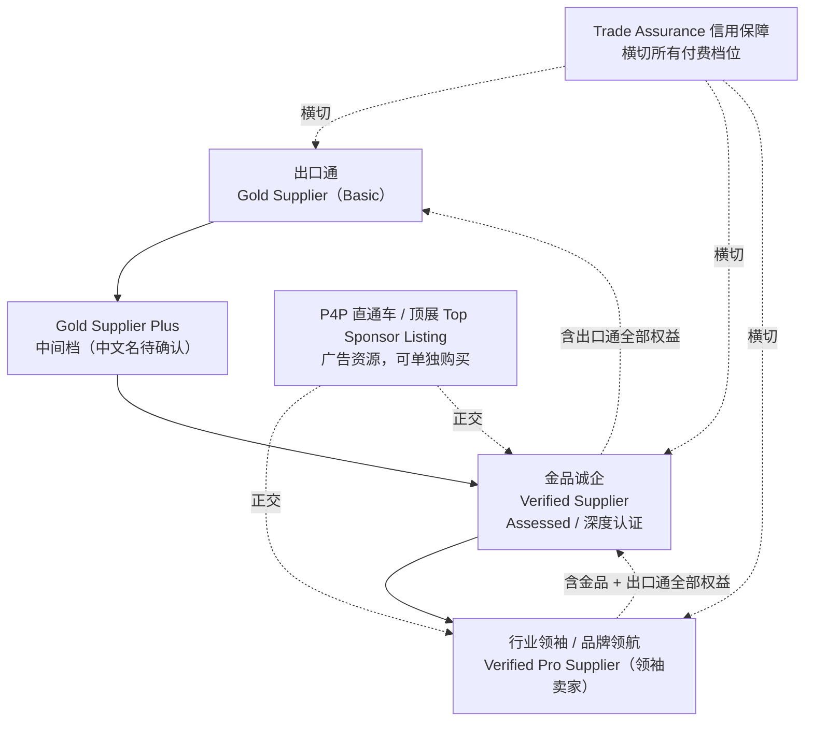
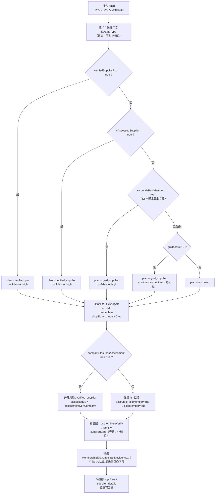

<p align="right"><a href="./README.md">← 文档索引</a></p>

# ali-client 会员体系与识别规则
| 项 | 内容 |
| --- | --- |
| 项目 | ali-client（阿里国际站 alibaba.com 本机只读客户端） |
| 文档 | 05-会员体系与识别规则.md |
| 版本 / 日期 | v1.0 / 2026-11-15 |
| 状态 | 设计稿（基于两轮实测，待评审） |
| 上游口径 | [02 接口草案](./02-接口草案.md) §3.2/§3.3/§2.10；[00 需求访谈记录](./00-需求访谈记录.md)；素材底稿 [membership-plans.md](../exploration/2026-11-15/membership-plans.md)（20 个来源链接） |
| 实测报告 | [REPORT.md](../exploration/2026-11-15/REPORT.md) §7、§11.5、§11.6；证据 `exploration/2026-11-15/artifacts/` |

> **口径声明**：本文是 [02 §3.2/§3.3](./02-接口草案.md) 的专题展开说明。**判定规则本身以 02 §3.3 为准**；本文负责解释「为什么」、给出证据字段与误判边界。若本文与 02 出现表述差异，以 02 为准并提 issue 修订本文。
>
> 标注约定：✅实测（有本地证据/线上页面）｜📐设计（客户端实现约定）｜🧪待实测（证据不足）｜⚠️风险（误判/不稳定）。置信度沿用底稿：**高 / 中 / 低 / 待实测**。

---

## 1. 目的与范围
### 1.1 本文解决什么
1. 把 alibaba.com 的「会员档位 / 认证验真 / 交易保障 / 广告」四个正交层拆开，避免把广告或标签误判成会员。
2. 给出**中文名 ↔ 英文站 UI ↔ 上游字段/筛选参数**的稳定映射，供 `memberships.catalog` 与 Agent 提示词使用。
3. 给出**列表级（search card）→ 详情级（render.htm）→ 输出证据**的识别规则、优先级与置信度。
4. 把 `Supplier Index = SOPI = shopSign.supplierStars（0–5）` 与 `reviewScore`/`reviewCount`/store rating 严格分开。
5. 列出误判边界与待实测清单，让实现做到「文案/图标怎么变都不判断崩」。

### 1.2 非目标（v1 不做）
- 不做买家侧评价体系（reviews）的完整封装，只区分「星级 vs 评分」。
- 不做卖家后台/会员合同/有效期真伪核验（上游不提供公开接口）。
- 不核实年费数字（官方不公开报价，本文只给第三方量级并标注置信度）；不做「升级建议/商家画像」等下游 CRM 逻辑。

### 1.3 术语（先对齐词义）
| 术语 | 本文定义 | 易混淆点 |
| --- | --- | --- |
| **会员档位（plan）** | 商家按年购买的店铺级别：出口通 → 金品诚企 → 行业领袖 | 枚举只输出 `verified_pro / verified_supplier / gold_supplier / unknown` |
| **认证（certification）** | ISO / BSCI / CE / SGS 等公司或产品认证 | 认证 ≠ 档位；多数含在金品内，也可单独展示 |
| **验真 / 验厂（verification / assessment）** | 平台或第三方对身份/工厂的核验：基础验真、实地验厂（onsite）、第三方评估（assessed） | `onsite=true` ≠ 金品（出口通样本也有）；`assessed` 才是金品主信号 |
| **交易保障（Trade Assurance）** | 订单/支付保障，卖家按单收费 | `ta=y` 是筛选，不是会员档位 |
| **广告（P4P / 顶展）** | 付费曝光：直通车（按点击）、Top Sponsor Listing（固定首位） | 广告卡可属任意档位；先标 `isAd` 再判档 |
| **Supplier Index / SOPI** | 平台综合绩效分层，**0–5 星**，详情字段 `shopSign.supplierStars` | ≠ `reviewScore`（store rating，4.6/5）、≠ `reviewCount` |
| **供应商身份类型** | Custom Manufacturer / Manufacturer / Trading Company / Factory 等 `companyBusinessType` / `identityKey` | 身份 ≠ 档位，可与任意档位组合 |

---

## 2. 四层模型总览
### 2.1 四层表（✅/中高置信度）
| 层 | 是什么 | 包含哪些 | 是否付费档位 | 判定入口 |
| --- | --- | --- | --- | --- |
| **A. 会员档位** | 每年购买的店铺级别 | 出口通（Gold Supplier Basic）、Gold Supplier Plus（中间档）、金品诚企（Verified Supplier）、行业领袖（Verified Pro / 领袖卖家） | 是 | `isAssessedSupplier` / `verifiedSupplierPro` / `goldYears`（list）；`companyHasPassAssessment` / `accountIsPaidMember`（detail） |
| **B. 认证 / 验真** | 对身份、工厂、产品能力的核验 | 第三方实地评估（Assessed / 深度认证）、Verified Supplier 徽章、Verified Custom Manufacturer（身份认证）、ISO/BSCI/CE 等 | 多数含在档位内；认证本身不是档位 | `assessmentCertCompany`、`companyAuthTag`/`productAuthTag`、`identityKey`、`authCards` |
| **C. 交易保障** | 订单/支付保障 | Trade Assurance（信用保障） | 否；卖家按订单 3% 服务费（官方口径，见来源⑧） | 筛选 `ta=y`；详情 `baoAccountAmount` / `hasTAOrderYear` |
| **D. 广告 / 流量** | 付费曝光 | P4P / 外贸直通车、顶展 / Top Sponsor Listing、问鼎/品牌直达 | 否；可单独买，高层级套餐可含额度 | list `newAd` / `adInfo` / `tpText` / `isTopRank`；`isP4P` |

> 一句话：**A 是「你是谁」，B 是「谁替你证明了什么」，C 是「订单出问题怎么办」，D 是「你额外买了多少曝光」。**

### 2.2 包含关系（mermaid）


- ✅ 已确认：金品包含出口通；行业领袖包含金品；Verified Pro 是**身份标**而非单独售卖的套餐（来源⑯：2023 年 3 月推出，须行业领袖/品牌领航 + 新店招）。
- ⚠️ 图是**会员权益包含关系**，不是页面 DOM 嵌套；广告位与会员徽章在页面并列渲染。🧪 Gold Supplier Plus 的公开中文名/售卖区域/字段区分待实测（见 §12 P0）。

---

## 3. 中文名 ↔ 英文站 UI ↔ 平台字段/筛选参数
### 3.1 总映射表（文本会变，字段/参数不会变）
| 中文名（卖家侧/常见叫法） | 英文站 UI / 常见英文 | 平台字段 / 筛选参数 | 性质 | 置信度 |
| --- | --- | --- | --- | --- |
| **出口通** | **Gold Supplier**；定价页写作 **Gold Supplier Basic** | 无显式档位字段；`goldYears > 0`（list）表示 Gold Supplier 年限 | 基础付费会员 | 高 |
| （中间档） | **Gold Supplier Plus** | 未发现字段 | 会员档位（官方定价页有名称） | 中 / 待实测 |
| **金品诚企**（金品） | **Verified Supplier**；中文 UI 可能显示「Verified 供应商」 | list `isAssessedSupplier === true`；筛选 `assessmentCompany=true` | 高级付费会员 | 高 |
| **深度认证 / 评估供应商** | **Assessed Supplier**；公司页文案 “assessed / verified on-site” | `isAssessedSupplier`、`assessmentCompany`、`companyHasPassAssessment`、`assessmentCertCompany` | 金品的第三方评估层（旧称/别名），不是独立档位 | 中高 |
| **领袖卖家 / 行业领袖** | **Verified Pro**、**Verified Pro Supplier**；中文 UI「Verified PRO 供应商」 | list `verifiedSupplierPro === true`；筛选 `verifiedPro=1` | 顶层会员 / 定向邀约 + 身份标 | 中高 |
| **认证制造商 / 定制制造商** | **Verified Custom Manufacturer**；商品页 “Verified as Custom Manufacturer” | detail `companyCard.authCards.value.identityInfo.identityName = "Custom Manufacturer"`、`identityKey = "strengthFactory"`；`companyIdentityInfo` | 供应商身份/能力类型 | 中高 |
| **信用保障** | **Trade Assurance (TA)** | 筛选 `ta=y`；详情 `baoAccountAmount` / `baoAccountCreditLevel` / `hasTAOrderYear` | 交易保障 | 高 |
| **外贸直通车** | **P4P / Keyword Advertising** | list `traceCommonArgs.isP4P`（本样本顶展卡为 false） | 点击付费广告 | 高 |
| **顶级展位 / 顶展** | **Top Sponsor Listing**（也见 “Top Sponsored listing”） | list `adInfo`、`tpText`、`isTopRank`、`campaignType=56`、`qtag=76`；详情 `productIsExhibition` | 固定首位广告 | 高 |
| **问鼎 / 品牌直达** | Top brand / Brand direct | 本地样本未出现 | 品牌广告 | 中 |
| 公司认证 / 产品认证 | ISO、BSCI、IATF 16949、CE、ROHS… | 筛选 `companyAuthTag` / `productAuthTag` | 认证（非档位） | 高 |
| 能力标签 | Full customization / Finished product inspection… | 筛选 `tagKvPairIntFilter`；list `tag` | 产能/服务能力（非档位） | 高 |
| 供应商身份 | Manufacturer / Trading Company / Custom Manufacturer | `companyBusinessType.value`、`companyIdentityInfo`、`identityKey=strengthFactory` | 经营主体类型（非档位） | 高 |
| 详情专属会员/认证字段 | —（详情弹卡） | `accountIsPaidMember`、`companyHasPassAssessment/Onsite/BaseVerify/AV`、`assessmentCertCompany`、`authCards` | 复核/补证 | 高 |

### 3.2 逐字段说明（list 级 vs detail 级）
**列表级（`window._PAGE_DATA_.offerResultData.offerList[]`，✅实测 21 卡）**

| 字段 | 示例 | 语义 | 可判档？ |
| --- | --- | --- | --- |
| `verifiedSupplierPro` | `true`/`false` | Verified Pro 身份标 | ✅ true → `verified_pro`；false 只是弱否定 |
| `isAssessedSupplier` | `true`/`false` | 是否通过第三方评估（金品） | ✅ true → `verified_supplier` |
| `goldYears` | `"6 yrs"` / `"6 年"` | Gold Supplier 年限（上平台时间） | ⚠️ 仅弱证据（>0 → 至少出口通） |
| `reviewScore` | `"4.6"` | 店铺评分均值（0–5） | ❌ |
| `reviewCount` | `10` | 评价条数 | ❌ |
| `transactions` | `"US $60,000+"` | 近 6 个月线上交易额文案 | ❌ |
| `memberTag` | `"8000002221692,…"` | 内部标签 ID 串，无公开字典 | ❌ |
| `type` | `"freeBlock"` | 卡位模板类型（广告卡也是它） | ❌ |
| `iconList` | 图片 URL 数组 | 徽章图标（会随活动变） | ❌（仅可作交叉校验） |
| `tag` | `["Full customization",…]` | 产能/服务标签 | ❌ |
| `newAd` / `adInfo` | `true` / 对象 | 广告位 | 正交，先标 `isAd` |

**详情级（`POST …/alisite/render.htm`，`componentKeys=shopSign,companyCard,companyOverview`，✅实测）**

| 字段 | 示例（Kangyuan） | 语义 | 可判档？ |
| --- | --- | --- | --- |
| `shopSign.companyHasPassAssessment` | `true` | 第三方评估通过（金品主信号） | ✅ → `verified_supplier` |
| `shopSign.accountIsPaidMember` | `true` | 付费会员（≥出口通） | ✅ → 至少 `gold_supplier` |
| `companyCard.isGold` | `true`（Kangyuan）/ `false`（joyfiller） | Gold Supplier 标记 | ⚠️ 不能作主判据（见 §9） |
| `shopSign.companyHasPassOnsite` | `true` | 实地验厂通过（金品附加层） | ❌ 不等于金品 |
| `shopSign.companyHasPassBaseVerify` / `companyHasPassAV` | `false` / `false` | 基础验真 / AV 认证（含义待确认） | ❌ 档位无关 |
| `shopSign.assessmentCertCompany` | `{name:"sgs", title:"SGS Group"}` | 第三方评估机构 | 证据 → `assessedBy` |
| `shopSign.supplierStars` | `2` | **Supplier Index 星级（0–5）** | 不是档位（见 §6） |
| `shopSign.companyJoinYears` | `"6"` | 入驻年限（≈ `goldYears`） | ❌ 年限≠档位 |
| `companyCard.authCards` / `globalData.leaderSupplier` | 对象 / `false` | 悬浮卡展示字段 / 领袖供应商标记 | 展示依据；leaderSupplier 仅作 Pro 交叉校验 |
| `companyOverview.companyIdentityInfo` | 对象 | 企业类型认证（Custom Manufacturer 等） | 身份，不是档位 |

> 只读代码里应把上表做成**白名单常量表**，避免未来把某个「看起来像档位」的新字段擅自加入判定。

### 3.3 术语冲突（做客户端必须知道的坑）
1. **卖家侧口径**：`Verified Supplier` = 金品诚企套餐，核心交付物是 SGS/TÜV 等第三方**实地验厂**（来源②③④）。
2. **买家帮助页旧口径**：`Verified Supplier` 被描述为「基础法律注册核验」，`Assessed Supplier` 才是第三方实地检查——与卖家侧冲突（来源⑩）。**以字段为准，文案只做展示。**
3. **商品页展示变体**：同一供应商可能同时出现 “Verified as Custom Manufacturer”“Evaluated as top-rated supplier”“Recognized as Verified Pro Supplier” 三个徽章，分属身份/评估/身份标三个维度（来源⑫）。
4. **中文 UI 混用**：`snData` 写「金品诚企 / 领袖卖家」，截图显示「Verified 供应商 / Verified PRO 供应商」。✅ 因此**不能按文案匹配，必须按布尔字段/查询参数匹配**。

---

## 4. 权益差异（定性）
### 4.1 年费量级（⚠️ 官方不公开报价）
> 官方定价页（来源①）只写 “pricing and benefits vary by region，以本地客户经理报价为准”，**不公开具体数字**。下表是第三方公开资料的量级，用于「档位分层」的直觉校准，**不是报价**。Gold Supplier Plus 为官方定价页列出的中间档，中文名/区域售卖待实测。

| 档位 | 年费量级（人民币） | 来源 / 置信度 | 说明 |
| --- | ---: | --- | --- |
| 出口通 / Gold Supplier Basic | **约 3.58 万/年** | 第三方 2025 报道（来源⑭，中） | 基础入驻；不含第三方深度验厂 |
| 金品诚企 / Verified Supplier | **约 8–9 万/年** | 第三方 2024 报 8 万、2025 报 9 万（来源⑭⑮，中） | 含第三方实地评估、Verified 徽章 |
| 行业领袖 / Verified Pro | **约 50 万/年，定向邀约** | 第三方 2024 报道（来源⑭，中低） | 不自助购买；面向行业头部/品牌企业 |

> ⚠️ 客户端**不落库、不展示**年费数字，最多在 `memberships.catalog` 里放一句 “pricing not publicly listed” 提示。

### 4.2 权益对比（定性，✅ 官方定价页 + 第三方交叉）
| 权益项 | 出口通（Gold Supplier Basic） | 金品诚企（Verified Supplier） | 行业领袖（Verified Pro / 领袖卖家） |
| --- | --- | --- | --- |
| 定位 | 入门付费会员 | 高级会员，强调第三方验真/品牌 | 顶层会员，行业头部/品牌型，定向邀约 |
| 店铺装修 | 基础旺铺 | Verified 迷你站、验厂视频、360/VR 工厂展示 | 金品全部 + 品牌视觉/品牌保护/行业解决方案 |
| 发布/类目/橱窗 | 发布不限；类目 3 个；橱窗 20（2026 页） | 不限/不限；橱窗 60（2026 页；旧资料 8 组） | 60+ / 24 组（旧资料，按合同） |
| RFQ / 子账号 | 20 条/月；5 个 | 60 条/月；10 个 | 更高/按合同；20 个（旧资料） |
| 认证与验厂 | 营业执照/基础验真 | 第三方实地验厂 + 评估报告 + 验厂视频 + 360/VR | 金品全部 + 更高等级认证/品牌保护 |
| 专属徽章/筛选 | Gold Supplier | Verified Supplier 徽章 + 专属筛选 + 专属展馆 | Verified Pro 徽章 + 首页/搜索/详情全链路展示 |
| 星级直达 | 无 | 4 星直达（符合条件可 5 星） | 4/5 星机会 + 合同期内星级保护 |
| 数据参谋 / AI | 普通版；Message Copilot 300 条/月、图片 20/视频 5/数据 5 credits | 专业版/不限量（2026 页 AI 均 Unlimited） | 金品全部 + OKKI CRM Pro AI |
| 广告 | 可单独买 P4P/顶展 | 可单独买；部分套餐含额度 | 含顶级展位/品牌直达等（按合同） |
| 信用保障 | 可申请（需付费 Gold Supplier + 验真） | 可申请；首次基础授信约 4,000–6,000 美金 | 金品全部，额度/服务按合同 |

> 数字差异说明：2026 官方定价页与 2024 中文资料在「橱窗数量/子账号」上不一致，属**年份/地区/套餐版本**差异；报告保留区间，客户端不硬编码这些数字（来源①②⑮）。

### 4.3 认证 vs 广告（正交，别混进档位）
- **认证/验真**（B 层）回答「平台或第三方替你证明了什么」：金品的 `Assessed`、SGS/TÜV 报告、ISO/BSCI/CE 等。**认证不是档位**，也不能单独推出档位。
- **广告**（D 层）回答「你额外买了多少曝光」：P4P 按点击、顶展固定首位（「一个关键词只售一名」）。**广告不是档位**，但广告卡也带某档位身份。
- 客户端输出必须把 `isAd/adType/tradeAssurance/certifications` 放在 `membership` 之外的正交字段（见 §10），不得塞进 `plan` 枚举。


## 5. 供应商身份类型
「身份类型」来自企业类型认证（`companyIdentityInfo`）与 `companyBusinessType`，是**能力/经营主体标签**，与会员档位正交组合。

| UI/字段名 | 中文 | 上游字段（✅实测） | 说明 |
| --- | --- | --- | --- |
| **Verified Custom Manufacturer** | 认证制造商（定制制造商） | 商品页徽章 “Verified as Custom Manufacturer”；金品悬浮卡 `identityInfo.identityName="Custom Manufacturer"`；`identityKey="strengthFactory"`；`identityDescMdsKey="Ma-cardManagement.Custommanufacturer"` | Verified Supplier 三种服务类型之一（Custom Manufacturer / Multispecialty / Brand Holder，来源⑪）；**不是档位**，可与金品/Pro 并存 |
| **Custom Manufacturer** | 定制制造商 / 实力工厂 | `companyCard.authCards.value.identityInfo`；`companyOverview.companyIdentityInfo.value` | 企业类型认证结果 = Manufacturer or Combined；有定制产线/设计能力描述 |
| **Manufacturer / Trading Company** | 制造商（工厂）/ 贸易公司 | `companyBusinessType.value`（如 `"Manufacturer, Trading Company"`，`authenticated:true`） | 搜索 `tab=supplier`「Manufacturers」入口即此类；⚠️ 公司名含 Trading ≠ 贸易公司，也**不能**据此判档（反例：金品 Wirsing 公司名含 Trading） |
| **Factory** | 工厂（认证工厂目录） | `/factory/index.html` → `modelId=10300`：`factoryProvince`、`factorySizeText`、`assessedSupplier`、`goldSupplierYears` 等 | 独立入口的「认证工厂」目录；仅省、总量上限 ≈500、无城市 |

**组合关系示例**（✅实测 Kangyuan）：`accountIsPaidMember=true` + `companyHasPassAssessment=true` + `identityKey=strengthFactory` → 「金品诚企 + Custom Manufacturer」，即「认证制造商」是**金品身份之上的身份标签**，不是额外会员。


## 6. Supplier Index（SOPI）详解
### 6.1 定义与算法（官方 SOPI 说明，来源⑦，置信度中高）
- **Supplier Index = Supplier Online Performance Index（SOPI，供应商在线绩效指数）**，平台对供应商经营表现的综合分层，**0–5 共 6 级，5 最高**。
- 前身是 **Transaction Level（交易等级）**；四维：**Presentation Quality（信息展示）、Product Popularity（产品热度）、Transaction Volume（交易额）、Service Quality（服务质量）**；**取四项最低分**（木桶）；0 级灰色钻石、其余橙色钻石；每月更新。
- 公司页 tooltip 原文（✅实测，`kangyuanxiangsu.en.alibaba.com/company_profile.html` 的 `RatingStarTip`）：
  > “Supplier Online Performance Index (Supplier Index) is classified into 6 levels (0-5, with 5 being the highest level). Click the「View more」button to review the formula of the Supplier Index.”
- 后续平台把 SOPI 与「商家星等级 / Star Rating」融合（📐推断，公开资料名称混用）：0–5 星、每月 5 日更新、四能力项，影响搜索排序与活动权益。**名称混用不影响客户端：统一以详情字段 `supplierStars` 为准。**

### 6.2 数据来源（✅实测）
| 项 | 内容 |
| --- | --- |
| 详情字段 | `shopSign.supplierStars`（int，Kangyuan=2） |
| 上限 | `shopSign.maxStar.value`（=5） |
| 展示 | 公司页/详情弹卡的心形或星形图标；图标只是渲染，**底层 0–5** |
| 列表级 | ❌ 搜索卡 `offerList[]` **没有** Supplier Index 字段（只有 `reviewScore`/`reviewCount`），必须详情回填 |
| 服务端字段名 | 搜索 JSON 无 `supplierIndex/sopiLevel`；公司页 SSR 有 `RatingStarTip` 文案但无数值，数值由异步接口/组件返回（🧪 精确 XHR 端点待实测） |

### 6.3 与「评分/评价数」的区分表（最容易混的一组）
| 指标 | 含义 | 取值/示例 | 数据来源 | 展示 | 客户端字段 |
| --- | --- | --- | --- | --- | --- |
| **Supplier Index（SOPI）** | 平台综合绩效等级 | 0–5 星（Kangyuan=2） | 平台按四维计算 | “Supplier Index ♥♥” | `supplierIndex.stars` ← `shopSign.supplierStars` |
| **reviewScore** | 买家对店铺的评分均值 | `"4.6"`（满分 5，可为 `"0.0"`） | 买家 reviews | “4.6/5 (10 评价)” | `rating.score` |
| **reviewCount** | 评价条数 | `10` | 买家 reviews | 括号内数字 | `rating.count` |
| **Store rating** | 详情悬浮卡里的店铺评分 | 4.6/5 | `authCards…basicCapacity.storeScore` | 悬浮卡 | `performance.storeRating` |
| **reviews.starLevel** | 评价星级显示（取整） | `5` | `supplierPerformance.reviews.starLevel` | 评价模块 | 不输出（内部展示） |
| **supplierRating** | 含义未确认（Kangyuan=6） | 6 | `companyCard.supplierRating` | 未直接展示 | 🧪 暂只放 `raw` |

> 关键：`reviewScore = 0.0` 不代表星等级低（可能只是没有评价）；`reviewScore = 5.0/1 条` 也不代表星等级高。两者**不可互相替代**，更不能用 `Math.round(reviewScore)` 冒充星级。

### 6.4 截图对照（♥♥ = 2）
| 证据 | 路径 | 说明 |
| --- | --- | --- |
| 用户详情弹卡截图 | （用户提供，未入库） | 「Supplier Index ♥♥」→ 对应 `supplierStars=2`（REPORT §4.4 对照表） |
| 字段证据 | `artifacts/render_components.json`、`artifacts/anon/anon_detail_components_full.json` | 登录/匿名均返回 `shopSign.supplierStars=2`、`maxStar.value=5` |
| 公司页截图 | `artifacts/kangyuan_profile.png` | 中文公司页可见 **4.6 / 10 评价 / 6 年 / SGS 验证**——注意 4.6 是店铺评分，**不是**♥♥ |
| 登录/匿名搜索对照 | `artifacts/search_hebei_en_logged.page_data.json`、`artifacts/anon/anon_search_hebei_p1.page_data.json` | 两处搜索卡均无星等级字段 → 必须详情回填 |

### 6.5 客户端处理（📐）
1. 详情返回 `supplierStars` → 输出 `supplierIndex{stars,maxStars:5,label:"Supplier Index",source:"shopSign.supplierStars"}`。
2. 缺失/null → 输出 `stars:null`，UI 显示 “—”，**禁止回退到 `reviewScore`**。
3. 列表未 enrich → `supplierIndex:null`（02 §3.1 允许），UI 不显示星级；`supplierRating` 不并入星级，放 `raw`（02 §2.8）。


## 7. 识别规则
### 7.1 列表级判定（优先级从高到低，伪代码与 02 §3.3 一致）
```text
输入：一张 offerList 卡片 card；输出：plan / confidence / evidence
# 0) 广告正交标记（先标广告，不参与档位判断）
isAd    = card.adInfo != null or card.newAd == true
adType  = "top_sponsor" if card.adInfo?.creativeInfo?.tpText == "Top sponsor listing"
                          or card.traceCommonArgs?.isTopRank == "true"
          else "p4p" if card.traceCommonArgs?.isP4P == "true"
          else "unknown_ad" if isAd else null
# 1) 档位判定（短路，先高后低）
if card.verifiedSupplierPro === true:          # Verified Pro / 行业领袖
    plan = "verified_pro";       confidence = high   # 语义：含金品
elif card.isAssessedSupplier === true:         # 金品诚企 / Verified Supplier
    plan = "verified_supplier";  confidence = high
elif card.accountIsPaidMember === true:        # 付费会员（≥出口通）★见注
    plan = "gold_supplier";      confidence = high
elif parseYears(card.goldYears) > 0:           # 弱证据：至少出口通
    plan = "gold_supplier";      confidence = medium
else:
    plan = "unknown";            confidence = none
```

> ★ 注：✅ 实测搜索卡字段集（REPORT §3.3）**不含 `accountIsPaidMember`**，该行只在「同一判定函数被详情/工厂目录复用」或未来上游补字段时命中；纯 list 判定实践中会落到 `goldYears` 弱证据分支。这与 02 §3.3 的写法和顺序一致。

**交叉校验（只调置信度，不覆盖 plan）**：

```text
if plan == "verified_supplier" and iconList 为空: confidence 降为 medium（模板/字段缺失）
if plan == "verified_supplier" and iconList/tag/(staff|area) 均非空: confidence 保持 high
if plan == "gold_supplier": 仅提示「isAssessedSupplier=false + memberTag 为空」不代表不是出口通
```

### 7.2 详情级复核（覆盖/升级列表结论）
```text
输入：render.htm 的 shopSign + companyCard + companyOverview
输出：对 list.plan 的升级/补证 + 新的 evidence.source="detail"

# 1) 金品复核（覆盖 list 的 gold/unknown）
if shopSign.companyHasPassAssessment === true:
    plan = max(plan, "verified_supplier"); verifiedSupplier = true
    assessedBy = shopSign.assessmentCertCompany.title   # "SGS Group" / "TÜV…"
# 2) 付费会员（出口通主判据）
if shopSign.accountIsPaidMember === true:
    paidMember = true
    if plan 仍为 unknown: plan = "gold_supplier"
# 3) 实地验厂（金品附加层，不等于金品；不改变 plan）
if shopSign.companyHasPassOnsite === true: onsiteAssessment = true
# 4) 基础验真 / AV（证据，不改变 plan）
baseVerify = shopSign.companyHasPassBaseVerify
av         = shopSign.companyHasPassAV        # 含义待实测
# 5) Supplier Index（不是档位）
supplierIndex.stars = shopSign.supplierStars  # 0–5
# 6) Verified Pro 只能来自 list
#    详情没有 verifiedSupplierPro；list.plan=="verified_pro" 时保留，不降级
```

> 覆盖关系：**detail 只能「升级或补证」，不能把 `verifiedSupplierPro=true` 判出的 `verified_pro` 降级**（详情无 Pro 字段，false 也不构成否定）。冲突处理：list=pro 而 detail `companyHasPassAssessment=false` → 保留 pro，`warnings` 记「detail assessed=false，可能评估过期/模板差异」，并降低 detail 证据置信度。

### 7.3 置信度约定
| 结论 | 依据 | 置信度 | 说明 |
| --- | --- | --- | --- |
| `verified_pro` | list `verifiedSupplierPro=true` | high | 实测 3/3 同时 assessed；详情无反向证据 |
| `verified_supplier` | list `isAssessedSupplier=true` 或 detail `companyHasPassAssessment=true` | high | 两个独立来源可互相印证 |
| `gold_supplier` | detail `accountIsPaidMember=true`（且 assessed=false）／仅 list `goldYears>0` | high / medium | 第二轮实测修正后的主判据；仅年限是弱证据 |
| `unknown` | 无任何付费/评估信号 | none | **不要默认出口通** |
| 否定结论 | `isAssessedSupplier=false` / `verifiedSupplierPro=false` | ⚠️ 不输出「不是」 | 只能说「未观察到」；原因见 §9 |

### 7.4 证据字段表（输出 → 上游来源）
| 输出证据 | list 来源 | detail 来源 | 判定作用 |
| --- | --- | --- | --- |
| `isAssessedSupplier` | ✅ `offerList[].isAssessedSupplier` | — | 金品主信号 |
| `verifiedSupplierPro` | ✅ `offerList[].verifiedSupplierPro` | ❌ 无 | Pro 唯一来源 |
| `goldYearsText` / `goldYears` | ✅ `offerList[].goldYears` | ✅ `shopSign.companyJoinYears` | 弱证据/年限展示 |
| `accountIsPaidMember` | ❌ 无 | ✅ `shopSign.accountIsPaidMember` | 出口通主信号 |
| `companyHasPassAssessment` / `companyHasPassOnsite` | — | ✅ `shopSign` | 金品复核 / 实地验厂（附加层） |
| `companyHasPassBaseVerify` / `companyHasPassAV` | — | ✅ `shopSign` | 基础验真 / AV（🧪 待实测） |
| `assessmentCertCompany` | — | ✅ `shopSign` | `assessedBy`（SGS/TÜV…） |
| `isGold` | — | ✅ `companyCard`/`globalData` | ❌ 不作判据，仅存 raw |
| `identityKey/identityName` | — | ✅ `authCards.identityInfo` / `companyIdentityInfo` | 身份类型（正交） |
| `supplierStars` | ❌ 无 | ✅ `shopSign.supplierStars` | Supplier Index（非档位） |

### 7.5 判定示例（Kangyuan，✅实测）
```json
{
  "plan": "verified_supplier", "label": "Verified Supplier", "rank": 2,
  "verifiedSupplier": true, "verifiedPro": false, "paidMember": true,
  "goldSupplier": true, "onsiteAssessment": true, "baseVerify": false,
  "assessedBy": "SGS Group", "goldYears": 6,
  "evidence": { "source": "detail", "isAssessedSupplier": true, "verifiedSupplierPro": false,
                "companyHasPassAssessment": true, "companyHasPassOnsite": true,
                "accountIsPaidMember": true, "isGold": true },
  "supplierIndex": { "stars": 2, "maxStars": 5 }
}
```


## 8. 实测样本验证（三组）
> 证据：`artifacts/anon/anon_pro_and_membership_samples.json`、`artifacts/render_components.json`、`artifacts/search.page_data.json`、`artifacts/search_hebei_en_logged.page_data.json`、REPORT §11.5。

### 8.1 样本表
| 样本 | 子域 | goldYears / joinYears | stars | accountIsPaidMember | isGold | assessed / companyHasPassAssessment | onsite | baseVerify | 判定 plan |
| --- | --- | --- | ---: | --- | --- | --- | --- | --- | --- |
| Hengshui Kangyuan（金品） | kangyuanxiangsu | 6 / 6 | **2** | true | **true** | **true / true**（SGS） | true | false | `verified_supplier` |
| Hebei Joinwin（出口通） | joyfiller | 6 / 6 | **2** | true | **false** | **false / false** | **true** | false | `gold_supplier` |
| Hebei Jianduo（出口通） | jianduomesh | 12 / 12 | **1** | true | **false** | **false / false** | **true** | false | `gold_supplier` |
| Hebei Huatong Cable | huatongcables | 12 / — | — | — | — | true / true | — | — | `verified_pro`（list `verifiedSupplierPro=true`） |
| Hebei Haiao Wire Mesh | — | 14 / — | — | — | — | true / true | — | — | `verified_pro` |
| Hebei Shengxin Metal | — | 18 / — | — | — | — | true / true | — | — | `verified_pro` |

### 8.2 结论（第二轮实测修正）
1. ✅ **Verified Pro 3/3 同时 `isAssessedSupplier=true`**，验证「Pro 含金品」；Pro 只能从 list 字段判定。
2. ✅ **`isGold` 不能当出口通判据**：joyfiller / jianduomesh 是付费出口通，但 `isGold=false`。
3. ✅ **`companyHasPassOnsite=true` ≠ 金品**：两家非 assessed 出口通样本 onsite 均为 true；出口通主判据 = `accountIsPaidMember=true` 且 `companyHasPassAssessment=false`。
5. ✅ **年限/星级都无关档位**：12 年、18 年也可能不是 Pro；6 年两家一个金品一个出口通；金品样本星级可低至 2。
6. ✅ 广告卡（Kangyuan 在搜索页是 Top Sponsor Listing）**不影响**其金品判定——先标广告再判档。

### 8.3 反例补充（防规则写反）
| 反例 | 数据 | 说明 |
| --- | --- | --- |
| 18 年 ≠ 金品/Pro | `Hebei Shengtian Pipe-Fitting`：`goldYears="18 yrs"`、assessed=false、pro=false | 年限不代表档位 |
| 1 年也可以是金品 | `Hebei Guanshun Wire Mesh`、`Hebei Wirsing Trading`：`goldYears="1 yr"`、assessed=true | 年限短不代表低档 |
| 评分 5.0 ≠ 金品 | `Hebei Longshi Auto Parts`：reviewScore=5.0、reviewCount=1、assessed=false | 评分不能判档 |
| 评分 0.0 也可能是金品 | `Hebei Guanshun`：reviewScore=0.0、reviewCount=0、assessed=true | 无评价≠差 |
| 广告卡 2 个图标 ≠ Pro | Kangyuan 广告卡 `iconList` 长度 2，但 `verifiedSupplierPro=false` | 图标数量不能判 Pro |
| 公司名含 Trading 也可以是金品 | `Hebei Wirsing Import And Export Trading Co., Ltd.` assessed=true | 名称/type 不能判档 |


## 9. 误判与边界清单
| # | 误判做法 | 为什么不能 | 反例 / 正确做法 |
| --- | --- | --- | --- |
| 1 | 用 `isGold` 判出口通 | 详情里非 assessed 的付费商家 `isGold=false`（语义可能仅指旧 Gold 标） | joyfiller / jianduomesh；出口通用 `accountIsPaidMember=true && assessed=false` |
| 2 | 用 `companyHasPassOnsite=true` 判金品 | onsite 是「实地验厂服务」，出口通也可购买/通过 | 两家出口通样本 onsite=true、assessed=false |
| 3 | 用 `goldYears >= 5` 判 Verified Pro | 5 年只是 `verifiedPro` hover 的营销文案；Pro 需行业领袖/品牌领航身份 + 新店招 | Shengtian 18 年仍非 Pro；只看 `verifiedSupplierPro` |
| 4 | 用 `memberTag` 判档 | 17/21 卡有值，评估/非评估都有；1 张金品卡为空；无公开字典 | 仅作内部标签保留，不参与判定 |
| 5 | 用 `type` 判商家类型/档位 | 本样本 21/21 全为 `freeBlock`（含广告卡），是卡位模板类型 | 商家类型看 `companyBusinessType` / `identityKey` |
| 6 | 用 `iconList.length >= 2` 判 Pro | 广告卡会多图标；URL/数量随活动变 | Kangyuan 广告卡 2 图标但非 Pro |
| 7 | 用 `reviewScore`/`reviewCount`/`transactions` 判档 | 买家评分/交易额与会员档位无关；0.0 可能只是无评价 | Longshi 5.0 非金品；Guanshun 0.0 是金品 |
| 8 | 把 `reviewScore` 当 Supplier Index | 一个是买家评分，一个是平台四维绩效（木桶） | 只认 `shopSign.supplierStars`（0–5） |
| 10 | 把广告 / Trade Assurance 当档位 | 广告与会员正交；TA 是交易保障（`ta=y` 筛选），都不是会员 | 先 `isAd`/`adType` 再判档；TA 放 `trust.tradeAssurance` |
| 12 | 按中文/英文文案匹配 | `snData` 文案与截图 UI 本地化不一致 | 只按布尔字段/查询参数匹配 |
| 13 | 以 `isAssessedSupplier=false` / `verifiedSupplierPro=false` 断言「不是」 | 评估可能过期/字段缺失/模板差异；Pro 标需「新店招」才显示，未升级会漏标 | 输出 unknown + warning；必要时用 `globalData.leaderSupplier` 交叉校验 |

> ⚠️ 总原则：**正信号可判档，负信号只降置信度、不下否定结论。** 所有否定都写进 `warnings`，不写进 `plan`。


## 10. 输出 schema 建议
> 完整 TypeScript 定义见 [02 接口草案 §3.2 `Membership`](./02-接口草案.md)；本节只列字段职责，避免两处漂移。

| 字段 | 类型 | 来源 | 说明 |
| --- | --- | --- | --- |
| `plan` | `"verified_pro" \| "verified_supplier" \| "gold_supplier" \| "unknown"` | 规则 | 唯一档位枚举（不得混入 ad/TA/认证） |
| `label` | string | 映射 | `Verified Pro Supplier` / `Verified Supplier` / `Gold Supplier` / `Unknown` |
| `rank` | `3 \| 2 \| 1 \| 0` | 映射 | 便于排序/提示词使用 |
| `verifiedSupplier` | boolean | assessed / passAssessment | 是否金品 |
| `verifiedPro` | boolean | list `verifiedSupplierPro` | 是否 Pro |
| `paidMember` | boolean \| null | detail `accountIsPaidMember` | 付费会员（出口通及以上） |
| `goldSupplier` | boolean \| null | detail `isGold` | 仅存证据，**不作判据** |
| `onsiteAssessment` / `baseVerify` | boolean \| null | detail `companyHasPassOnsite` / `companyHasPassBaseVerify` | 实地验厂（附加层）/ 基础验真 |
| `assessedBy` | string \| null | detail `assessmentCertCompany.title` | SGS Group / TÜV… |
| `goldYears` | number \| null | list `goldYears` / detail `companyJoinYears` | 年限（展示用） |
| `evidence.source` / `evidence.*` | `"list" \| "detail"` / 原始布尔文案 | 规则 / 上游 | 本结论主要证据来源 + 逐字段回溯（见 §7.4） |

配套 `memberships.catalog`（02 §2.10）应返回：`plans[]`（4 枚举 + rank）、`rules[]`（判定优先级 + confidence）、`supplierIndex{field:"shopSign.supplierStars",range:[0,5]}`、`storeRating{field:"companyCard.supplierRatingReviews.averageStar"}`、`cautions[]`（memberTag/type/iconList 不能判档；广告/TA 不是会员）。**规则只存这一处（single source of truth）**，CLI/REST/MCP 的说明文案都从 catalog 取。


## 11. 识别流程（list → detail 复核 → 输出证据）


**执行时机（📐）**：列表搜索默认只判 list 级（快）；`locationMode=strict` 的详情回填顺带复核；`suppliers.detail` 一定走 detail 复核。两种入口共用同一判定函数与缓存（02 §4）。


## 12. 待实测清单
| 优先级 | 待测项 | 具体字段/接口 | 验证方法 | 影响 |
| --- | --- | --- | --- | --- |
| P0 | **Gold Supplier Basic vs Plus 区分** | 搜索/详情是否有 `memberLevel`/`planType`/`memberTag` 位 | 找已知 Basic/Plus 账号对比全部字段 | 决定能否细分出口通子档；否则统一 `gold_supplier` |
| P0 | **`supplierRating` 含义** | `companyCard.supplierRating`（Kangyuan=6） | 多档位样本对比，查页面/前端 JS 引用 | 决定是否输出（当前只放 raw） |
| P0 | **Verified Pro 授予规则与漏标率** | `verifiedSupplierPro`、`globalData.leaderSupplier`、公司页店招版本 | 找未升级店招的行业领袖账号验证 false negative | 决定是否需要人工/后台校验 |
| P0 | **评估（assessed）有效期/过期展示** | `companyHasPassAssessment`、公司页 `verifiedBadgeUrl`/`verifyTitle` | 找过期/刚续费账号观察字段与徽章 | 避免把过期误判成非金品 |
| P0 | **`isGold` 精确语义** | `companyCard.isGold`、`globalData.isGold` | 多类目/多档位大样本相关性分析 | 决定证据里是否保留、是否可用于交叉校验 |
| P1 | `memberTag` 字典 | 数字 ID 串 | 收集多档位样本 + 找 JS 映射 | 可能解锁更细标签（当前禁用） |
| P1 | TA 单卡字段 | 搜索卡是否有 `hasTradeAssurance` 类字段 | 抓 `ta=y` 与非 TA 结果对比 | 目前只能靠查询参数，不能逐卡判断 |
| P1 | `iconList` 徽章字典 | URL/alt | 建 URL→名称映射 | 可作金品兜底校验（当前禁用） |
| P1 | `authCards` 悬浮卡全字段 | `authGroupInfoList[].authInfoList[]` | 与用户截图逐项对照（REPORT §4.4 已对 15 项） | 决定详情还能展示哪些指标 |
| P1 | 认证/能力标签有效期 | `companyAbilityTags`、`companyAuthTag` | 多时间点对比 | 证书过期是否从列表消失 |
| P2 | 区域套餐差异 + 「Assessed vs Verified」术语定稿 | Gold Supplier Plus / 区域定价；买家帮助页 vs 卖家页 | 对比 CN/US/EU/SEA 定价页与官方中英文页面 | 国际化展示、对外文案一致性 |


## 13. 来源与置信度
### 13.1 官方 / 平台自有（优先，13 条）
| # | 来源 | 用途 | 置信度 |
| --- | --- | --- | --- |
| ① | [Tiered Membership Plans for Business Growth](https://seller.alibaba.com/pricing?tracelog=angle) | 三档套餐与权益表；官方不公开具体报价 | 高 |
| ② | [Make Trust Happen — Verified Supplier](https://seller.alibaba.com/verified_supplier) | Verified Supplier 定义、Gold Supplier 对比、4/5 星直达 | 高 |
| ③ | [金品诚企服务](https://fuwu.alibaba.com/jpcq/home.htm) | 第三方验厂、报告、视频、橱窗、TA 额度 | 高 |
| ④ | [Alibaba.com 再升级金品诚企认证](https://www.alibabanews.com/alibabacom%E5%86%8D%E5%8D%87%E7%B4%9A%E9%87%91%E5%93%81%E8%AA%A0%E4%BC%81%E8%AE%A4%E8%AF%81/) | 「Verified Supplier = 金品诚企」官方新闻 | 高 |
| ⑤ | [阿里巴巴国际站金品诚企怎么认证](https://supplier.alibaba.com/trade/domestic/PX002DN8C.htm) | 金品 = 深度认证服务 | 高 |
| ⑥ | [出口通和金品诚企有什么区别](https://supplier.alibaba.com/trade/domestic/PX002DPRY.htm) | 出口通基础 / 金品含验厂、橱窗、RFQ、数据管家 | 高 |
| ⑦ | [Supplier Online Performance Index](https://activity.alibaba.com/helpcenter/SOPI.html) | SOPI 0–5、四维度、取最低分、每月更新 | 高 |
| ⑧ | [What is Trade Assurance](https://activity.alibaba.com/ggs/tradeassurance.html) | 付费 Gold Supplier + 验真；买家免费；卖家 3% | 高（页面较旧，费率以上游最新为准） |
| ⑨ | [什么是顶级展位](https://activity.alibaba.com/ad_digital_marketing/8a779a3d.html) | 顶展：首位/皇冠/一关键词一名 | 高 |
| ⑩ | [Supplier Verification](https://www.alibaba.com/featured/supplier-verification.html) | 买家侧 Verified/Gold/Assessed 说明（术语有冲突） | 中（口径冲突，仅作参考） |
| ⑪ | [The Ultimate Guide to Alibaba Verified Suppliers](https://reads.alibaba.com/ultimate-guide-alibaba-verified-suppliers/) | Verified Supplier 三种服务类型 | 中高 |
| ⑫ | [商品页徽章示例](https://www.alibaba.com/product-detail/China-manufacturer-ABS-3-star-ping_1600456086677.html) | Verified as Custom Manufacturer / top-rated / Verified Pro 三徽章 | 中高 |
| ⑬ | [公开公司页](https://kangyuanxiangsu.en.alibaba.com/company_profile.html) | Supplier Index tooltip、Verified Supplier alt、Custom Manufacturer 身份 | 高（✅实测抓取） |

### 13.2 第三方 / 行业（交叉验证，不作为唯一依据，7 条）
| # | 来源 | 用途 | 置信度 |
| --- | --- | --- | --- |
| ⑭ | [2025 年三档费用与定位](https://reportify.cn/news/1158048082148069376) | 3.58 万 / 9 万 / 最高层 | 中（非官方报价） |
| ⑮ | [2024 年权益对比表](https://www.sohu.com/a/781009578_121192132) | 橱窗、子账号、数据参谋、星级直达 | 中 |
| ⑯ | [Verified Pro 身份标规则](https://www.yuque.com/chaike/yingxiao/ouapmu7xpe7ql2fp) | 2023 年 3 月推出；行业领袖/品牌领航；新店招 | 中 |
| ⑰ | [SOPI/Star Rating 四维与每月更新](https://www.techtongbo.com/post/how-valuable-is-alibaba-s-merchant-star-rating-for-global-buyers) | 星等级四能力项、每月 5 日更新 | 中 |
| ⑱ | [Alibaba Orange Heart 旧交易等级](https://www.junglescout.com/blog/what-is-alibaba/) | 旧 Transaction Level / Orange Heart 显示 | 低（历史口径） |
| ⑲ | [顶级展位中文说明](https://global.lianlianpay.com/article/MTE0MzMwLDQ1NQ.html) | 顶展中文解释 | 中 |
| ⑳ | [Apify 抓取器字段（SOPI 1–5、review_score 分离）](https://apify.com/devcake/alibaba-supplier-scraper/output-schema) | 第三方 schema 印证「星级与评分分离」 | 中 |

### 13.3 实测证据（本地，优先于公开资料）
| 证据 | 路径 | 结论 |
| --- | --- | --- |
| 登录态/匿名搜索页 | `artifacts/search_hebei_en_logged.page_data.json`、`artifacts/anon/anon_search_hebei_p1.page_data.json` | 21 卡（20+1 广告）、8 assessed、0 pro、1 广告；匿名与登录字段集一致 |
| 详情组件 | `artifacts/render_components.json`、`artifacts/anon/anon_detail_components_full.json` | Kangyuan：6 年 / stars 2 / assessed / onsite / SGS / identityKey |
| 会员样本 | `artifacts/anon/anon_pro_and_membership_samples.json` | Pro 3 家 + 出口通 2 家（isGold=false、onsite=true） |
| 截图 | `artifacts/kangyuan_profile.png`、`artifacts/search_hebei_en_logged.png`、`artifacts/search.png` | 页面展示口径（4.6 评分、Verified 徽章、筛选文案） |
| 调研底稿 | `exploration/2026-11-15/membership-plans.md` | 20 个来源链接与完整论证 |

### 13.4 四类信息与置信度约定
- **官方**（§2/§3/§4/§6.1，来源①–⑬）：高；官方文案冲突时以字段为准。
- **第三方**（§4.1/§6.1/§2.2，来源⑭–⑳）：中/低，标注「非官方报价」「行业资料」。
- **实测**（§3.2/§7/§8/§9，artifacts + REPORT §11.5）：高（可复现）。
- **推断/设计**（§7 置信度/§10 字段/§12 待测）：标 📐/🧪，不得当结论引用。


## 14. 自检清单（与 02 §3.3 一致性）
- [x] `plan` 枚举只有 `verified_pro / verified_supplier / gold_supplier / unknown`；list 优先级：`verifiedSupplierPro` → `isAssessedSupplier` → `accountIsPaidMember` → `goldYears`（medium）→ `unknown`。
- [x] detail：`companyHasPassAssessment → verified_supplier`；`accountIsPaidMember → paidMember`；`onsite ≠ 金品`；`assessmentCertCompany → assessedBy`；Pro 只来自 list。
- [x] `Supplier Index = shopSign.supplierStars（0–5）`，≠ `reviewScore`、≠ `reviewCount`。
- [x] 广告 / Trade Assurance / 认证 / 身份类型均放在 `membership` 之外的正交字段；20 个来源链接全部保留（§13.1 + §13.2）。
- [x] 实测样本（Kangyuan / joyfiller / jianduomesh / Pro 3 家）与 REPORT §11.5 一致。


*文档版本 v1.0（2026-11-15）。规则变更时：先改 [02 §3.3](./02-接口草案.md)，再同步本文 §7/§10，并在 §8 追加新样本。*
