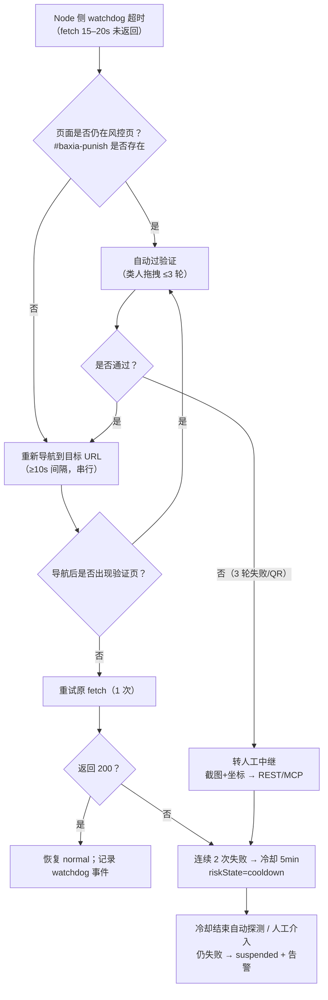
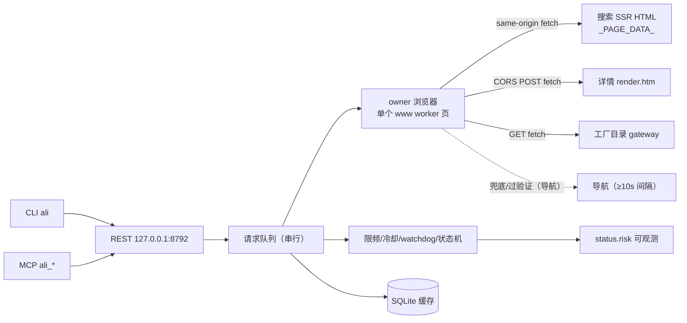
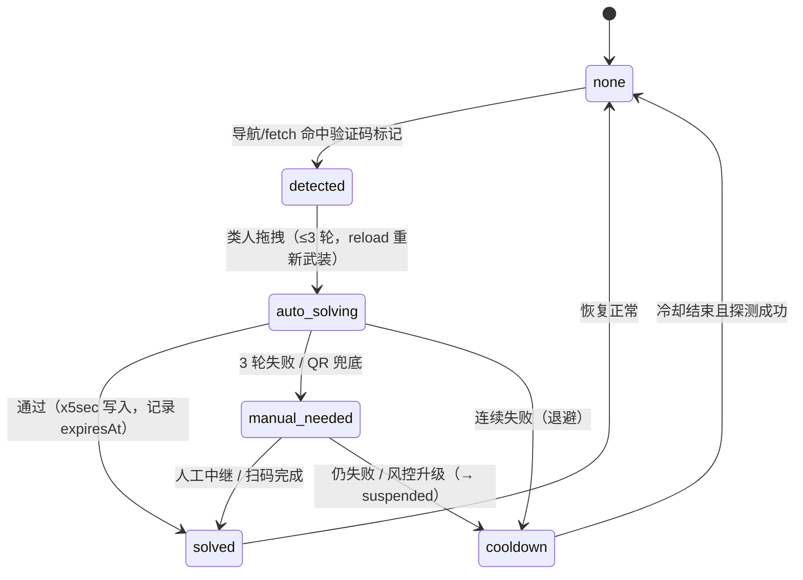

<p align="right"><a href="./README.md">← 文档索引</a></p>

# ali-client 风控与人机验证
| 项 | 内容 |
| --- | --- |
| 项目 | ali-client（阿里国际站 alibaba.com 本机只读客户端） |
| 文档 | 06-风控与人机验证.md |
| 版本 / 日期 / 状态 | v1.0 / 2026-11-15 / 已实现（`src/session/manager.ts`，v0.1.0） |
| 上游口径 | [02 接口草案](./02-接口草案.md) §2.2/§2.4/§5；[00 需求访谈记录](./00-需求访谈记录.md) |
| 实测依据 | [REPORT.md](../exploration/2026-11-15/REPORT.md) §8/§11.2/§11.4；`exploration/2026-11-15/artifacts/`；采集策略 anonymous-first + fetch-first + 单 worker 页 |

> **口径声明**：本文所有「触发次数 / 时间窗 / x5sec 时效 / 重试轮数 / watchdog」数字必须与 REPORT §11.4 及 02 §5 一致；若上游策略变化，先改 02，再回填本文并追加证据。
>
> 标注约定：✅实测（有日志/截图/JSONL 证据）｜📐设计（客户端实现约定）｜🧪待实测｜⚠️风险。
>
> **合规底线（先读）**：本项目只做**低频、只读**的公开页面查询；滑块验证只求「像正常用户一样通过」，**不破解、不绕过、不伪造设备**；风控升级即暂停并转人工，不与被保护系统对抗。

---

## 1. 目的与范围
### 1.1 本文解决什么
1. 解释 alibaba.com 上游风控的构成（NC 滑块、`x5sec`、cookie 链、设备指纹、频率、IP），以及为什么 **fetch-first 能显著降低暴露面**。
2. 给出滑块页面的**稳定 DOM 锚点与坐标体系**，支撑自动过验证与人工/远程中继。
3. 给出**触发矩阵**（导航 vs fetch）、过验证策略（类人拖拽 + reload 重试）、x5sec 生命周期与主动刷新策略。
4. 定义异常态（fetch 挂起、AbortSignal 无效、重启无效）的**恢复决策树**与 watchdog 设计。
5. 定义客户端治理（单 worker 页、限频、冷却、连续失败暂停、日志脱敏、`status.risk`）、**人工中继协议**、合规边界、演练/测试计划与证据索引。

### 1.2 非目标
- ❌ 不做验证码识别/破解（不训练模型、不接打码平台、不逆向 NC JS）。
- ❌ 不做多账号/代理池/IP 轮换、不伪造设备指纹、不批量注册。
- ❌ 不做「绕过风控继续高频抓取」——风控升级时默认**停止**而不是对抗。
- ❌ 不封装写操作（询盘/聊天/收藏/下单）。

### 1.3 设计原则（📐）
| # | 原则 | 说明 |
| --- | --- | --- |
| P1 | **anonymous-first** | 匿名即可拿到 v1 全部字段（REPORT §11.1），登录只影响买家侧功能 |
| P2 | **fetch-first** | worker 页内 fetch 搜索/详情/工厂目录；导航仅用于兜底与过验证 ✅ |
| P3 | **单 worker 页 + 低频可审计** | owner 浏览器只保留 1 个 www 页承载全部 fetch；所有请求有间隔/预算/冷却，`status` 可观测 |
| P4 | **人机核验只做「通过」** | 自动拖拽模拟正常用户；失败转人工/二维码；绝不尝试绕过 |
| P5 | **风控升级即暂停** | 连续失败/异常态 → 冷却/暂停 + 告警，不重试轰炸 |
| P6 | **证据留存、日志脱敏** | 保留判定证据；不落 cookie/token/账号密码 |

---

## 2. 上游风控要素总览
### 2.1 要素表（✅实测 + 📐推断）
| 要素 | 表现 | 观测/证据 | 客户端应对 |
| --- | --- | --- | --- |
| **NC 滑块验证** | 导航后被重定向到 `CAPTCHA Verification` 页（`#baxia-punish`），拖动 `#nc_1_n1z` 手柄 | ✅ 截图 `artifacts/cn_prov.png`、`kangyuan_en.png`；HTML 快照 `cn_prov.html` | 自动类人拖拽（§5）；失败转人工（§9） |
| **`x5sec` cookie** | 过验证后写入 `x5sec`（domain `.alibaba.com`），有效期 ≈30min；失效后导航可能再次弹验证 | ✅ `artifacts/anon/anon-captcha-events.jsonl` 的 cookies 快照 | 记录 `expiresAt`；剩余 <3min 且需导航时主动刷新（§6） |
| **cookie 链 + 会话级登录态** | `xman_f`/`xman_us_f`（长期）、`xman_t`/`cookie2`（会话，关进程即掉登录）、`isg`/`tfstk`/`_m_h5_tk*`/`sc_g_cfg_f` | ✅ events cookies 快照；REPORT §8（掉登录复现 2 次） | 只读不删、不清理 profile、不导出；owner 进程常驻 |
| **设备指纹 / 浏览器环境** | `~/cloak-env`（cloakbrowser 0.6.5 + Chromium 146）同一 profile 的 cookie/设备绑定；单纯重启浏览器不能解除风控 | ✅ REPORT §11.4（`anon_fetch_after_restart.json`） | 保持同一 profile 稳定运行；不频繁换 UA/视口/时区 |
| **频率 / 行为** | 页面导航约 8–9 次/30s 触发 1 次；fetch 150+ 次未触发 | ✅ §4 矩阵；REPORT §11.4 | 导航稀疏化 + 全部采集走 fetch |
| **IP / 网络/文案** | 住宅 IP 稳定、代理/VPN 易触发 deny；页面含 `captcha-h5-tips`/`wait-h5-tips`/`deny-h5-tips`/`Captcha Intercept` 等 i18n | 📐 推断 + ✅ `cn_prov.html` i18n | 不配代理池；用 DOM/文案识别风控态，不依赖单一语言 |
| **风控错误码** | 子域滑块出现 `Oops... something's wrong. Please refresh and try again. (error:EzFB9f / WbwAdf)` | ✅ `artifacts/kangyuan_en.png`、`kangyuan_en2.png` | 视为「风控升级」信号：reload 重试 1 次→仍失败转人工/暂停 |

### 2.2 客户端视角的风险链路（📐）
```text
CLI / REST / MCP
      ↓ 只调本机服务
owner 浏览器（单实例、headful、独立 profile）
      └─ 1 个 www worker 页
            ├─ fetch 搜索 URL（same-origin）───┐
            ├─ fetch 详情 render.htm（跨子域）──┤→ 上游风控面（导航才显著触发）
            └─ 兜底导航（过验证/恢复）─────────┘
      ↓
Node 侧：限频 / 冷却 / watchdog / 状态机 / 脱敏日志 / SQLite 缓存
```

> 关键结论：**风控主要盯「页面导航 + 浏览器环境」**；把采集从导航改成 worker 页内 fetch 后，暴露面从「每次请求」降到「兜底导航」。

---

## 3. 滑块页面结构（✅实测）
### 3.1 页面标识
| 项 | 值 | 来源 |
| --- | --- | --- |
| `<title>` | `CAPTCHA Verification` | `artifacts/cn_prov.html`、`kangyuan_en.html` |
| 根容器 | `<div id="baxia-punish" class="baxia-punish captcha pc">`；tracker `TraceSdk({pid:'punish-page'})` 新版处置模板 | 同上（全页唯一） |
| 页面结构 | `#J_Header`（logo）+ `.wrapper/.content-inside/.bannar` + 提示文案 + 滑块 + QR + footer | 同上 |
| 无搜索数据 | 页面不含 `window._PAGE_DATA_`，不含供应商列表 | 同上 |

### 3.2 DOM 锚点与尺寸
| 锚点 | 选择器 | 结构/尺寸（实测） | 用途 |
| --- | --- | --- | --- |
| 验证容器 | `#baxia-punish` | 全页 | 判断「处于风控页」 |
| 滑块容器 | `#nc_1_nocaptcha` → `#nc_1_wrapper` | `.nc-container #nc_1_wrapper{width:300px;height:34px}` | 轨道定位 |
| 轨道 | `#nc_1_n1t`（`.nc_scale`） | 300×34；父容器坐标实测 `tx=809.94, ty=702.94, tw=300, th=34`（viewport 1920×1080） | 计算拖动距离 |
| 背景条 | `#nc_1__bg`（`.nc_bg`） | 初始 `width:21px` | 进度视觉 |
| 手柄 | `#nc_1_n1z`（`span.nc_iconfont.btn_slide`，`aria-label="滑块"`，`role="button"`，`tabindex=0`） | **42×34**；实测中心 `hx=832.94, hy=719.94, hw=42` | 按下/拖动起点 |
| 文案/加载/失败态 | `#nc_1__scale_text`、`#captcha-loading`、`#nc_1_refresh1`（`.errloading`） | 文案 “Please slide to verify”；SVG spinner；“Oops... something's wrong…(error:…)”；`icon_warn` | 滑块就绪/加载/风控升级识别 |
| 提示文案 | `.warnning-text[data-bx-i18n="captcha-h5-tips"]` | “Please drag the slider to verify / Verify to ensure normal access” | 页面态识别（i18n 多语言） |
| QR 兜底 | 页面底部二维码（`img.alicdn.com` 600×600）+ `Feedback >` 链接；失败后出现（REPORT §8） | 截图 `cn_prov.png`/`kangyuan_en.png` 均可见 QR 区 | 人工用阿里 App 扫码 |
| 页脚 | `© 1999-2026 Alibaba.com. All rights reserved.` | 版本年份可作环境判断参考 | 辅助识别 |

### 3.3 实测截图与 HTML 证据路径
| 状态 | 截图 | HTML/JSON 证据 | 说明 |
| --- | --- | --- | --- |
| 正常待拖动 + QR 兜底 | `artifacts/cn_prov.png`（1920×1080） | `artifacts/cn_prov.html` | 首次触发验证页；无错误行 |
| 拖拽失败（error:EzFB9f / WbwAdf） | `artifacts/kangyuan_en.png`、`kangyuan_en2.png` | `artifacts/kangyuan_en.html`、`kangyuan_en2.html` | 子域滑块失败态/另一错误码；红字提示 refresh |
| 触发验证页（另一实例） | `artifacts/loc_cn.png` | `artifacts/loc_cn.html` | 验证页复现，DOM 一致 |
| 验证后页面 | `artifacts/anon/anon_nav_fallback.png` | `artifacts/anon/anon_nav_fallback.page_data.json` | 兜底导航→过验证→页面恢复可解析 |

> ⚠️ 截图是**证据**不是模板：上游可能改版；客户端识别必须同时命中「`#baxia-punish` + `#nc_1_n1z`」才判定为滑块页，允许 fallback 到 `.nc_wrapper` / 文本匹配。

---

## 4. 实测触发矩阵（导航 vs fetch）
### 4.1 矩阵（✅实测，证据在 `artifacts/`）
| # | 实验 | 请求类型 | 次数/时间窗 | 结果 | 证据 |
| --- | --- | --- | --- | --- | --- |
| 1 | 登录态 headful 页面导航 + 自动过验证 | 页面导航 | 3 次过验证尝试（www 1 成功；公司子域 2 次失败） | ✅ 触发（导航即可能触发；headful 也会） | REPORT §8；`artifacts/daemon.log`（14:00–14:16） |
| 2 | 匿名连续快速导航 | 页面导航 | 8 次（实测约 5–6s 间隔；REPORT 口径约 8–9 次/30s） | ✅ **第 8 次触发**（captcha event #2） | `artifacts/anon/anon_nav_stress_*.html`；`anon-captcha-events.jsonl` |
| 3 | 匿名慢速导航 | 页面导航 | 4 次（约 18s 间隔；REPORT：9–11s 间隔 4 次不触发） | ❌ 未触发 | `artifacts/daemon.log`（14:33–14:34）；REPORT §11.4 |
| 4 | 连续导航（带 x5sec） | 页面导航 | 8 次（约 5s 间隔） | ✅ 第 1 次即触发；过验证后 8 次未再触发 | `artifacts/anon/anon_nav_stress2_*.html`；captcha event #3 |
| 5 | 搜索 fetch（worker 页内 same-origin） | fetch | 9 次 / 31s | ❌ 未触发 | `artifacts/anon/anon_burst_matrix.json` |
| 6 | 详情 CORS fetch（30 家批量） | fetch | 30 次 / 41s（间隔 0.55–1s） | ❌ 未触发（30/30 成功） | `artifacts/anon/anon_detail_batch30.json` |
| 7 | 混合 burst（搜索+详情） | fetch | 9 搜索 + 10 详情 / 31s | ❌ 未触发 | `artifacts/anon/anon_burst_matrix.json` |
| 8 | 累计 fetch（两轮合计） | fetch | **150+ 次** | ❌ 未触发 | REPORT §0.8/§11.2 |

### 4.2 结论
1. ✅ **唯一稳定触发源是页面级导航**；fetch（搜索/详情/工厂目录）在 150+ 次、30/41s 批量下均未触发。
2. ✅ **频率相关**：连续快速导航约 8–9 次触发 1 次；慢速（≥9–14s）明显更稳。
3. ✅ **headful 也会触发**（第一轮登录态实验），只是降低概率；过验证后 `x5sec` 提供 ≈30min 窗口，窗口内导航不再弹（矩阵 #4 后半段）。
4. ⚠️ **子域与主域风险等级不同**：匿名首次导航公司子域页面即触发 1 次（captcha event #1）；公司子域拖拽 2 次失败并报 `EzFB9f/WbwAdf`（REPORT §8）→ 详情必须走 fetch，**尽量不导航到子域**。📐 由此确定 **fetch-first**；导航只用于「兜底/恢复/过验证」，间隔 ≥10s、单实例串行。

### 4.3 对实现的约束
- 搜索/详情/工厂目录一律 worker 页 `fetch()`（CORS 已验证 30/30）；**不做页面导航式采集**。
- 导航只出现在：① 恢复挂起 fetch；② 人工/自动过验证；③ 登录（可选）。全部串行、≥10s 间隔。
- `status.upstream.lastPageNavAt` 暴露最近导航时间，便于审计「是否把导航用在刀刃上」。

---

## 5. 过验证策略（类人拖拽）
### 5.1 自动拖拽算法（✅实测参数，脚本 `exploration/2026-11-15/scripts/daemon.mjs`）
| 步骤 | 动作 | 实测参数 |
| --- | --- | --- |
| 1 | 读取几何 | `#nc_1_n1z` 中心为起点；`#nc_1_wrapper` 轨道；终点 = 轨道右端 − 手柄半宽 + 3px（不超出右边界 4px） |
| 2–3 | hover 靠近 + 对准按下 | 起点左 4px/下 1px 移入（`steps:6`，停顿 300–500ms）→ 移到起点（`steps:3`，停顿 200–350ms）→ `mouse.down()` 后停顿 380–580ms |
| 4 | 小位移「脱离」 | 先右移 4px、下 1px（`steps:2`），停顿 150ms |
| 5 | 缓动拖动 | **54–62 步**（首轮版本固定 58 步）；前 35% 缓加速、后 65% 指数减速；每步间隔 13–33ms；X/Y 随机抖动 ±1.6/±1.7px |
| 6 | 到位回拉 | 移到终点（`steps:5`），停顿 280–400ms；再回拉 1.5px（`steps:2`），停顿 160ms |
| 7 | 释放与判定 | `mouse.up()`；等待 2.6s；检查 `#baxia-punish`/`#nc_1_n1z` 是否消失 |
| 时长 | 单轮 | **约 1.5–2.5s 拖拽 + 等待 ≈ 5–8s/轮**（02 §2.4：单轮 5–8s） |

### 5.2 reload 重试策略（✅实测）
```text
单次触发最多 3 轮：
  轮 1：类人拖拽 → 等待 2.6s → 检测
    成功 → 结束（记录 attempts=1）
    失败 → page.reload({waitUntil:"domcontentloaded", timeout:60s}) → 等待 ≈3.5s（重新武装滑块）
  轮 2：再拖拽 → 检测
  轮 3：再 reload → 再拖拽 → 检测
  3 轮仍失败 → 返回 CAPTCHA_REQUIRED（附最新截图），转人工/远程中继
```

- ✅ **实测 3 次触发：最终 3/3 成功，首次成功率 2/3**；失败的一次经 `reload()` 后 attempt2 成功（与 [03 部署与使用](./03-部署与使用.md) 同口径）。
- ✅ `reload()` 是有效的「重新武装」手段（本机验证有效），**不是**刷新频率对抗。
- ⚠️ 子域失败 2 次（`error:EzFB9f/WbwAdf`）说明存在「拖对了也被拒」的风控升级态：此时 reload 1 次仍失败 → 转人工/暂停，不硬刚。失败原因归类：轨迹/环境被识别、x5sec 失效、子域风控升级、QR 要求、网络异常。

### 5.3 成功判定
| 信号 | 判定 |
| --- | --- |
| `#baxia-punish` / `#nc_1_n1z` 从 DOM 消失；`ctx.cookies()` 出现 `x5sec` 且 expires 距今 >5min | 成功（主判据，02 §17） |
| 页面 title/URL 回到原目标页（如 `trade/search`） | 成功 |
| `wait-h5-tips`/deny 文案或 `error:EzFB9f/WbwAdf` | 失败/风控升级 → 按 §5.2 重试；仍失败转人工/暂停 |

### 5.4 伪代码（📐 设计说明，非实现代码）
```text
async function passCaptcha(page):
  for round in 1..3:
    if not isCaptcha(page): return OK(attempts=round-1)
    drag = await humanLikeDrag(page)      # §5.1 七步
    await sleep(2600)
    if not isCaptcha(page): return OK(attempts=round)
    await page.reload(); await sleep(3500) # 重新武装
  return CAPTCHA_REQUIRED(screenshot=await screenshot(page))
```

---

## 6. x5sec 生命周期与主动刷新
### 6.1 是什么
- 过滑块后上游写入 `x5sec` cookie（`domain=.alibaba.com`，非 session），有效期内被视为「已验证客户端」、导航不再弹滑块。✅ 实测有效期 **≈29.8 分钟**（3 次事件一致），工程口径 **≈30 分钟**。

### 6.2 实测换算（`artifacts/anon/anon-captcha-events.jsonl`）
| 事件 | 过验证时间（UTC） | `x5sec.expires`（UTC） | 有效期 |
| --- | --- | --- | --- |
| captcha event #2（nav_stress_8） | 2026-11-15T14:37:11.899Z | 2026-11-15T15:07:01.585Z | **29.83 min**（23:07:01 CST 失效） |
| captcha event #3（nav_stress2_1） | 2026-11-15T14:40:47.272Z | 2026-11-15T15:10:37.010Z | 29.83 min |
| captcha event #4（nav_fallback） | 2026-11-15T14:54:32.998Z | 2026-11-15T15:24:18.839Z | 29.76 min |

> 与 REPORT §11.4「solve 14:37:11Z → expire 23:07 CST」完全一致 ✅。

### 6.3 `status` 暴露（02 §2.2）
```json
"risk": { "x5secExpiresAt": "2026-11-15T23:07:01+08:00", "riskState": "normal", "cooldownUntil": null },
"upstream": { "lastPageNavAt": "2026-11-15T22:30:00+08:00", "requestsLast10Min": 7,
              "captcha": { "required": false, "lastSolvedAt": "2026-11-15T22:37:11+08:00" } },
"worker": { "ready": true, "fetchHealthy": true, "lastFetchHungAt": null }
```

### 6.4 主动刷新策略（📐）
| 场景 | 动作 |
| --- | --- |
| `x5secExpiresAt` 剩余 **>3min** | 正常 fetch；无需刷新 |
| 剩余 **<3min** 且**即将需要导航**（恢复/登录/人工兜底） | 可主动刷新一次（导航到目标页→必要时过验证），避免中途失效 |
| 仅 fetch / 剩余 <3min 且无导航需求 | **不主动刷新**（fetch 不依赖 x5sec 到分钟级）；仅记录，下次导航时自然处理 |

### 6.5 不要主动删 `x5sec`（✅ 反证）
- 人为删除 `x5sec` 后，同一 worker 页连续 fetch **挂起不返回**（单次/连续均复现；`AbortSignal` 也无效）——见 §7 与 `artifacts/anon/anon_fetch_captcha_single.json`。
- 结论：**`x5sec` 是上游信任链的一部分，删除它等于把自己打回风控态**；客户端不得主动清理 cookie、不得「换新 profile 试试」。

---

## 7. 异常态与恢复（fetch 挂起）
### 7.1 现象（✅实测）
| 现象 | 实测细节 |
| --- | --- |
| fetch 挂起不返回 | 删除 `x5sec` 后，worker 页内 fetch 搜索 URL **永不 resolve**；Node 侧 16s race 超时才捕获 |
| `AbortSignal` 无效 | 页面内 `fetch(..., {signal})` 的 abort 不能中断挂起（页面网络层被接管） |
| 页面本身仍可用 | title/URL 正常，页面 JS 可执行；只是 XHR/fetch 不返回 |
| 连续 fetch 均挂 | 连续 2 次 fetch 都 `raceTimeout` |
| 重启无效 / 风控绑 cookie/设备 | 同一 profile 重启后 fetch 仍挂起（`anon_fetch_after_restart.json`）；风控态绑 cookie/设备指纹，重启不等于解除 |

### 7.2 恢复实验表（✅实测）
| 动作 | 结果 | 证据 |
| --- | --- | --- |
| 删除 `x5sec` 后单次/连续 2 次 fetch | ❌ 挂起（16s race 超时；AbortSignal 无效） | `anon_fetch_captcha_single.json`、`anon_fetch_captcha_recover.json` |
| 仅导航普通页面后 fetch | ❌ 仍挂起 | `anon_fetch_after_nav.json` |
| 重启同一 profile 浏览器 | ❌ 仍挂起 | `anon_fetch_after_restart.json` |
| **导航到目标搜索页 → 过验证（attempt1 成功）→ 重试 fetch** | ✅ **恢复 200 / ≈1s** | `anon-captcha-events.jsonl` event #4（14:54:32Z）→ `anon_nav_fallback.*`；REPORT §11.4 |

### 7.3 恢复决策树（mermaid）


### 7.4 watchdog 设计（📐）
- **必须在 Node 侧**做 `Promise.race([fetchPromise, timeout(15–20s)])`（页面内 Promise 挂死时页面计时器也不可靠）。
- 超时后：记录 `worker.lastFetchHungAt`/`hungCount24h` → 进入恢复流程（§7.3）→ 成功后重试被中断的请求 1 次。
- 另有**浏览器级** watchdog：`evaluate(1+1)` race 5s 失败 → 先 reload worker 页；仍无响应 → 重启 context（anonymous 安全；logged_in 需重登 + 告警）（02 §17）。
- 超时**不能**直接杀掉 owner 进程；只标记风险态并串行恢复。
- 恢复成功后继续队列；若队列积压过大，返回部分结果 + `meta.warnings`，避免无人值守时长时间挂死。

### 7.5 风控绑定与环境
- 风控态绑定 **cookie + 设备指纹**：同 profile 单纯重启无效；换 profile/换 UA 属于「换设备」，会带来新的风控评估，**不鼓励**。
- 正确处理：保持 profile 稳定 + 通过验证 + 等冷却；必要时人工介入。
- ⚠️ 不要把「删 profile 重来」写进运维脚本；这会丢掉 `x5sec` 与登录态，放大风控。

---

## 8. 客户端治理设计（📐）
### 8.1 单 worker 页架构


### 8.2 限频与并发（与 02 §5 一致）
| 项 | 默认 | 说明 |
| --- | --- | --- |
| 页面导航（仅恢复/兜底/过验证） | 单实例串行，相邻 **≥10s** | 导航是唯一稳定触发源（实测 8–9 次/30s 触发） |
| 搜索 fetch | 串行，间隔 **0.8–1.2s**（+抖动） | 实测 9 次/31s 无滑块 |
| 详情 fetch（render.htm） | 并发 **2**，单条间隔 **0.6–1s** | 实测 30/41s 全成功、无滑块 |
| fetch watchdog | **15–20s**（Node `Promise.race`） | 风控态 fetch 可能永不返回 |
| 单查询页数 / enrich | 默认 **5** 页（硬上限 20）/ enrich ≤**60** 家 | 以「返回 0 条」终止；`totalCount` 不可靠；超出 `maxEnrich` 返回 warnings |
| 滑块重试 | 单次触发 ≤**3 轮**，轮间 reload + 3.5s | 实测 3/3 最终成功 |
| 冷却/退避 | 单次失败 5s 后重试；**连续 2 次失败 → 冷却 5min** | `status.risk.cooldownUntil` |
| x5sec | ≈**30min** | `status.risk.x5secExpiresAt` |
| 全局预算 | 10 分钟 ≤**120** 次 fetch（可配） | 超限 `RATE_LIMITED` |

### 8.3 冷却、暂停与告警（📐）
| 触发条件 | 行为 |
| --- | --- |
| 单次滑块失败 / 连续 2 次失败或 watchdog 连续超时 | 单次失败 5s 后重试（≤3 轮）；连续 2 次 → `riskState=cooldown`，冷却 5min（02 §5；02 §17 设计为 60s→5min→15min 退避），只读缓存；上游错误码 `RISK_COOLDOWN`/`RATE_LIMITED`，挂起超时 `UPSTREAM_TIMEOUT` |
| 冷却结束仍失败 / 出现 deny 页或反复 `EzFB9f/WbwAdf` | `riskState=suspended`，暂停上游请求，日志告警，等待人工 |
| 人工/远程中继完成 | 恢复 `normal`，记录 `lastSolvedAt` |
| 全局预算超限 | `RATE_LIMITED`，延迟到窗口外 |

### 8.4 日志脱敏（⚠️ 必须）
| 数据 | 处理 |
| --- | --- |
| cookie（`x5sec`/`xman_*`/`cookie2`/`isg`/`tfstk` 等） | **禁止打印值**；最多打印「存在/过期时间」 |
| 登录账号/密码/短信码；Bearer token | 凭证永不落日志；登录由人工在浏览器完成；token 打码（仅末 4 位或哈希前缀） |
| 请求头 `cookie` / `user-agent` / 设备标识 | 不落日志；调试需开启显式开关且仅本机 |
| 截图 | 只落 `~/.ali-client/run/`（本机目录），不写入 SQLite，不外传；含页面像素时按需清理 |
| 供应商数据 | 结构化字段入库（公开数据），不存 HTML/cookie/图片二进制 |

### 8.5 `status.risk` / `status.upstream` 字段表（02 §2.2 对齐）
| 字段 | 类型 | 含义 |
| --- | --- | --- |
| `risk.x5secExpiresAt` | ISO8601 \| null | x5sec 过期时间（过验证后写入） |
| `risk.riskState` / `risk.cooldownUntil` | enum / ISO8601 \| null | 风控对外状态投影 / 冷却结束时间 |
| `upstream.captcha.required` / `lastSolvedAt` | boolean / ISO8601 \| null | 当前是否处于验证页 / 最近一次过验证时间 |
| `worker.fetchHealthy` / `worker.lastFetchHungAt` | boolean / ISO8601 \| null | fetch 健康标记 / 最近一次挂起发现时间（📐建议加 `hungCount24h`） |
| `upstream.lastPageNavAt` / `requestsLast10Min` | ISO8601 / number | 导航审计与预算观测 |

> `riskState` 枚举（`normal/captcha_pending/solving/cooldown/suspended`）是 06 的**对外投影**；02 §17 内部状态为 `none/detected/auto_solving/solved/manual_needed/cooldown`，映射见 §8.6；`suspended` 为 06 扩展（cooldown 后仍失败/deny 页/需人工接入）。

### 8.6 风控状态机（📐）


---

## 9. 人工中继协议（📐，与 02 §2.4 一致）
### 9.1 何时转人工
1. 自动拖拽 3 轮仍失败（`CAPTCHA_REQUIRED`）。
2. 页面出现 QR 兜底/扫码提示（`type:"qr"`）。
3. 子域风控升级（`error:EzFB9f/WbwAdf`）且 reload 1 次仍失败。
4. `riskState=suspended` / deny 页 / 反复冷却。

### 9.2 截图与坐标（REST `GET /v1/verification`）
```json
{
  "required": true,
  "type": "slider",                      // slider | qr | unknown
  "pageUrl": "https://www.alibaba.com/trade/search?...",
  "screenshotPath": "~/.ali-client/run/captcha-20261115-223711.png",
  "track":  { "x": 510, "y": 703, "width": 300, "height": 34, "viewport": "1920x1080" },
  "handle": { "x": 522, "y": 720, "width": 42, "height": 34 },
  "autoSolveSupported": true
}
```

- 截图路径固定在 `~/.ali-client/run/captcha-<yyyyMMdd-HHmmss>.png`（本机文件，`screenshotPath` 返回绝对路径）。
- `track`/`handle` 为**视口坐标**（viewport 1920×1080），远程 Agent 只传坐标，不接触 cookie。

### 9.3 REST / MCP / CLI 中继
| 形态 | 接口 | 入参/说明 |
| --- | --- | --- |
| REST | `GET /v1/verification` | 当前滑块信息 + 截图 + 轨道/手柄坐标 |
| REST | `POST /v1/verification/solve` | `{"mode":"auto"}` 或 `{"mode":"drag","from":[x,y],"to":[x,y],"durationMs":800}`；返回 `{solved,attempts,elapsedMs}` |
| MCP | `ali_verification_get` / `ali_verification_solve` | 无参查看 / `{mode:"auto"\|"drag", from?, to?, durationMs?}` |
| CLI | `ali verify` / `ali verify solve [--from x,y --to x,y]` | 人读输出；`--format json` 输出 envelope |

> 远程中继安全：REST 仅绑定 loopback + Bearer（02 §7）；中继只传**坐标与时长**，不传截图外的敏感数据；截图回传需人工确认。

### 9.4 远程 Agent 使用流程
1. Agent 调 `ali_verification_get` → 拿到 `type/screenshotPath/track/handle/viewport`。
2. Agent 将截图与坐标交给人工/视觉模型判断拖动目标（或直接 `mode:"auto"`）。
3. `ali_verification_solve{mode:"drag", from:[...], to:[...], durationMs}`；失败返回 `CAPTCHA_REQUIRED` + 新截图。
4. 成功 → 继续原请求（客户端自动重试被中断的 fetch，见 §7.4）；多次失败/QR → 人工在本机浏览器扫码（阿里 App）后调 `ali_verification_solve{mode:"auto"}` 确认状态，或等待 `riskState` 回 `normal`。

### 9.5 二维码扫码兜底
- 验证页底部常驻 QR（`artifacts/cn_prov.png` 可见）；`type:"qr"` 时客户端**不自动**处理。
- 人工用阿里 App 扫码 → 客户端轮询 `/v1/verification` → `required:false` 后恢复队列；二维码内容/链接**不落日志、不外传**。

---

## 10. 合规与账号安全
| # | 事项 | 约定 |
| --- | --- | --- |
| 1 | **只读** | 只抓公开搜索/详情/工厂目录；不询盘、不聊天、不收藏、不发商品、不写后台 |
| 2 | **低频** | 按 02 §5 限频；单查询页数 ≤5（硬上限 20）、enrich ≤60；不做全站爬取 |
| 3 | **不破解验证码；「通过」≠「绕过」** | 只模拟正常用户通过滑块；不做图像识别/逆向/打码平台；不篡改签名、不删除/伪造风控 cookie、不注入伪造 `x5sec` |
| 5 | **风控升级即暂停** | deny 页/反复错误码/连续失败 → `suspended` + 告警，等人工，不重试轰炸 |
| 6 | **账号保护 + 不伪造环境** | 使用本人账号（可选）；不共享 cookie/凭证、不多地同时登录、不导出 profile；不轮换 UA/代理池/设备指纹 |
| 8 | **数据合规** | 只存公开结构化字段；不落 HTML/cookie/图片；按需清理截图与日志；遵守平台服务条款与当地法律 |
| 9 | **可停止** | 提供 `ali-client` 停止/暂停开关（systemd stop / `riskState=suspended`），异常时可一键停采 |
| 10 | **免责声明** | 本项目与阿里巴巴官方无关；风险与后果由使用者承担（README 同口径） |

> ⚠️ 任何「提高成功率」的手段都必须在「正常用户行为」范围内：低频率、单账号、过验证；超出即违规。

---

## 11. 演练与测试计划
### 11.1 安全触发（怎么练而不惹事）
| 项 | 约定 |
| --- | --- |
| 环境 | 用**独立匿名 profile**（如 `~/.ali-client/profile-test`）或测试机，不动生产 profile |
| 时间窗 | 选低峰时段；单次演练 ≤5 分钟 |
| 配额 | 单次演练导航 ≤10 次、fetch ≤30 次；触发 1 次验证即止 |
| 目标页 | 用低价值搜索页（如 `keywords=hebei&page=1`），不刷深页 |
| 结束后 | 清理测试 profile；恢复生产 profile；记录演练日志（脱敏） |

### 11.2 离线单测（不启浏览器）
- **验证页识别**：用真实 HTML fixture（`artifacts/cn_prov.html`、`loc_cn.html`、`kangyuan_en.html`、`kangyuan_en2.html`）断言 `#baxia-punish`、`#nc_1_n1z`、`#nc_1_wrapper`、失败态 `errloading`、QR 存在。
- **坐标解析**：fixture 或 mock 的 `getBoundingClientRect` → 校验 `track/handle` 尺寸（300×34 / 42×34）与终点计算。
- **状态机**：normal→captcha_pending→solving→cooldown→suspended 转换单测。
- **watchdog**：mock fetch 永不 resolve → 15–20s 超时触发恢复；mock 恢复 → 请求重试 1 次。
- **限频**：虚拟时钟断言间隔/预算/冷却。
- **日志脱敏**：注入含 token/cookie 的日志行 → 断言输出已打码。

### 11.3 live smoke 清单（真机冒烟）
| # | 步骤 | 期望 |
| --- | --- | --- |
| 1 | 启动 owner（headful、匿名 profile）→ `GET /v1/status` | `browser.running=true`、`riskState=normal` |
| 2–3 | worker 页 fetch 搜索 URL；连续 9 次（0.8–1.2s 间隔） | 200 + `_PAGE_DATA_` 可解析；全部 200，`captcha.required=false` |
| 4 | 30 家详情 CORS fetch（并发 2） | 30/30 成功，无滑块 |
| 5 | 训练触发：快速导航 8 次 | 出现验证页；`GET /v1/verification` 返回截图+坐标 |
| 6 | `POST /v1/verification/solve{"mode":"auto"}` | `solved=true`；`x5secExpiresAt` ≈30min 后 |
| 7 | 过验证后 fetch | 恢复 200；`riskState=normal` |
| 8 | 人为删 `x5sec` → fetch | watchdog 15–20s 超时；导航→过验证→重试 fetch 恢复 |
| 9–10 | 同 profile 重启浏览器 → fetch；连续 2 次失败 | 重启**不**恢复（确认结论）；`cooldownUntil` 生效，错误码语义正确 |

### 11.4 失败演练（断 x5sec 实验，✅可复现）
1. 在测试 profile 过验证拿到 `x5sec`。
2. 用 CDP 删除 `x5sec` → 观察 fetch 挂起（预期 `raceTimeout`）。
3. 导航到目标搜索页 → 若出现验证页则自动/人工过验证（attempt1 预期成功）。
4. 重试 fetch → 预期 200/≈1s 恢复（REPORT §11.4）；恢复后清理测试状态并记录事件（`lastHungAt`/`hungCount24h`）。

### 11.5 证据留存
- 事件日志 JSONL：`{ts, kind:"captcha", name, url, solved, attempts:[{n,solved,detail,kind}], cookies:{仅名称+expires}}`（对齐 `anon-captcha-events.jsonl`）。
- 截图仅本机 `~/.ali-client/run/`（保留最近 N 张、定期清理）；演练记录（日期/环境/触发次数/成功率/x5sec 时效/watchdog 次数）脱敏后入 docs 或 exploration。

---

## 12. 证据索引（`artifacts/` 与结论对应）
| 文件 | 结论 |
| --- | --- |
| `anon/anon-captcha-events.jsonl` | 4 次滑块事件（3 次治理统计 + 1 次断 x5sec 恢复实验）；attempts、x5sec expires≈29.8min |
| `anon/anon_nav_stress_1..8.*`、`anon_nav_stress2_1..8.*` | 8 次连续导航第 8 次触发（event #2）；另 8 次第 1 次触发、过验证后不再触发 |
| `anon/anon_nav_fallback.png/.html/.page_data.json` | 兜底导航→过验证→页面恢复可解析（captcha event #4） |
| `anon/anon_burst_matrix.json` | 9 搜索 fetch + 10 详情 fetch / 31s，无滑块 |
| `anon/anon_detail_batch30.json` | 30 家详情 CORS 30/30 成功、41s、无滑块 |
| `anon/anon_filters_boundary.json`、`anon_boundary_keyword.json`、`anon_cn_browse_keyword_variants.json` | 过滤参数生效；分页/深页边界；无关键词 country=CN；中文关键词 |
| `anon/anon_fetch_captcha_single.json`、`anon_fetch_captcha_recover.json` | 删 x5sec 后单次/连续 2 次 fetch 挂起（raceTimeout，AbortSignal 无效） |
| `anon/anon_fetch_after_nav.json`、`anon_fetch_after_restart.json` | 仅导航/重启同 profile 后仍挂起（风控绑 cookie/设备） |
| `anon/anon_detail_components_full.json`、`anon_component_enum.json`、`anon_cors_test.json` | 详情组件键与匿名完整字段；跨子域 render.htm CORS 允许、same-origin 搜索 200 |
| `anon/anon_search_hebei_p1.page_data.json`、`anon_home*.png/.html` | 匿名搜索页/首页证据 |
| `anon/anon-daemon.log` | 匿名 daemon 时间线（loop/触发/过验证） |
| `artifacts/cn_prov.png`、`loc_cn.png`、`kangyuan_en.png`、`kangyuan_en2.png` | 验证页截图（正常/失败 error:EzFB9f/WbwAdf、QR 兜底） |
| `artifacts/cn_prov.html`、`loc_cn.html`、`kangyuan_en*.html` | 验证页 DOM 快照（`#baxia-punish`/`#nc_1_*`/文案/i18n/尺寸 CSS） |
| `artifacts/daemon.log` | 第一轮登录态实验：solveSlider 时间线与几何（`tx=809.94,tw=300,th=34,hx=832.94,hw=42`） |
| `exploration/2026-11-15/scripts/daemon.mjs` | 类人拖拽算法实现参数（54–62 步、缓动、抖动、reload 重试） |
| `artifacts/anon/anon_pro_and_membership_samples.json` | 会员判定修正（会员文档 §8） |


## 13. 风险与开放问题
| # | 风险/问题 | 影响 | 应对 |
| --- | --- | --- | --- |
| R1 | 自动拖拽被上游识别（轨迹/环境特征） | 通过率下降、风控升级 | 保持参数随机化（步数/抖动/停顿）；失败即转人工；不追求 100% |
| R2 | 二维码兜底不可自动化 | 无人值守时可能卡住 | 客户端 `type:"qr"` 明确转人工/远程中继；不伪造扫码 |
| R3 | 上游策略变更 + 设备指纹/环境绑定 | 识别/恢复失效；换环境触发更强风控 | DOM 锚点多路 fallback；单 profile 稳定运行；禁止 UA/代理轮换；定期演练复测 |
| R5 | fetch 挂起导致服务假死 | 请求堆积/超时 | Node watchdog 15–20s + 串行恢复 + 队列上限 |
| R6 | 远程中继暴露面 + 合规边界 | 本机接口被滥用；账号/法律风险 | loopback + Bearer；中继只传坐标、截图不外传；低频只读、风控升级即暂停、一键停采 |
| R8 | 长时运行内存/页面漂移（worker 页跑一天） | fetch 偶发失败 | 按 02 §16.4 每 200 次 fetch 或每 6h 软重建 worker 页（导航刷新，≥10s）；记录 hungCount |
| R9 | 登录态会话级失效（可选登录时） | 买家功能不可用 | anonymous-first 不影响 v1；掉线自动降级 `mode:"anonymous"` + warning |
| R10 | 上游 `totalCount` 波动被误用 | 分页/统计失真 | 以「返回 0 条」终止；`pages` 默认 5；文档明确不依赖 totalCount |

**开放问题（🧪 待实测/待评审）**

1. 公司子域 `EzFB9f/WbwAdf` 的触发阈值（导航次数？子域访问频率？）与恢复策略是否只有人工。
2. `x5sec` 在**纯 fetch** 场景下的实际必要性（本实验只在删除后复现挂起；正常 fetch 是否完全不依赖它需再测）。
3. QR 扫码中继能否做成「远程截图→人工扫码→回传完成」的标准流程（v1.1 预留）。
4. 第 4 次 captcha event（14:54:32Z）属于恢复实验，是否应计入治理成功率统计（当前不计入，3/3 口径）。
5. 上游是否对 `fetch` 的 `Sec-Fetch-*`/referer 有额外校验（当前 same-origin 与跨子域 POST 均正常）；worker 页每日软重建是否触发额外风控（待观察）。


## 14. 自检清单（与 REPORT §11 / 02 §5 一致）
- [x] 触发源：仅页面导航；约 8–9 次/30s；fetch 150+ 次未触发；`x5sec` ≈30min（实测 29.76–29.83min），`status.risk.x5secExpiresAt` 暴露、不主动删。
- [x] 自动拖拽：缓动+抖动+回拉；失败 reload 重试 ≤3 轮；最终 3/3、首次 2/3；单轮 5–8s。
- [x] 异常态：fetch 挂起、AbortSignal 无效、watchdog 15–20s、导航→过验证→重试恢复、同 profile 重启无效。
- [x] 治理：单 worker 页、fetch-first、限频/冷却/连续失败暂停/日志脱敏/`status.risk`。
- [x] 人工中继：截图路径 + track/handle 坐标 + REST/MCP/CLI 三通道 + QR 兜底。
- [x] 合规：只读、低频、不破解、验证码只做「通过」不做「绕过」、风控升级即暂停；截图/DOM 证据路径全部来自 `artifacts/`，无编造。


*文档版本 v1.0（2026-11-15）。上游策略变更时：先复跑 §11.3 smoke 清单与 §11.4 失败演练，再更新本文数字与证据索引。*
